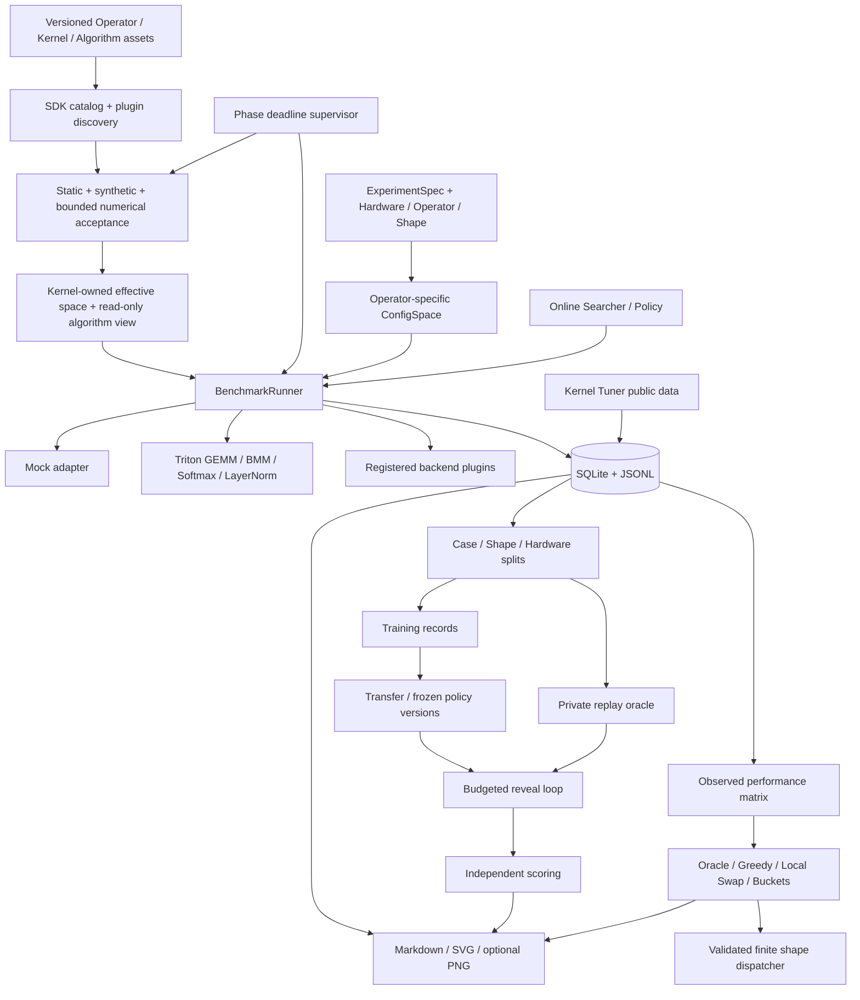

# Architecture

平台面向长期研究：算法、测量后端、数据、评分和部署分派分别有明确边界。核心模块只使用 Python 标准库；GPU 与绘图依赖按需导入。

## Core modules

| Module | Responsibility |
| --- | --- |
| `models.py` | Versioned records, stable identities, explicit units and provenance |
| `assets.py`, `catalog.py`, `sdk.py` | Independent versioned asset declarations, content identities, discovery and public contributor API |
| `asset_space.py`, `acceptance.py` | Effective spaces, immutable algorithm views and executable protocol acceptance |
| `kernel_runtime.py`, `operator_library.py`, `claims.py` | Shared operator services, full-flow execution and scoped correctness evidence |
| `asset_experiments.py`, `asset_context.py` | Strict v2 asset-selection experiments and resolved execution cases |
| `asset_validation.py`, `asset_search.py`, `asset_runner.py` | Bounded acceptance, guarded search, supervised deadlines and archives |
| `scaffolding.py` | Working SDK-only Kernel/algorithm templates and their experiment configuration |
| `builtin_assets/`, `quantization.py` | Auto-discovered quantized, attention and MoE semantics, bit packing and real implementations |
| `proposal_suite.py` | Dynamic operator matrix, small/production specifications and strict suite archives |
| `hardware.py` | Sourced H200 SXM / H800 SXM / RTX 4090 / RTX 5060 Ti 16GB profiles |
| `gpu_validation.py` | Physical smoke aggregation with device/runtime/source identity and shape coverage |
| `operators.py`, `space.py` | Per-operator schemas, domains, legality and baseline registry |
| `experiments.py` | Portable JSON experiment specifications |
| `backends/` | Mock + lazy real GPU adapters; external factory registration |
| `runner.py` | Preparation, JIT, correctness, warmup, sampling, cache and failure journal |
| `storage.py` | Normalized dimension tables, journal, deduplication and JSONL exchange |
| `search/`, `tuning.py` | Six algorithms, shared suggestion contract and live measurement loop |
| `datasets.py`, `replay.py` | Grouped splits, private source table, reveal-only histories and independent scores |
| `policies/` | Reusable functions/algorithms, legality fallback, version snapshots and evaluation logs |
| `l3/` | Observed matrix, selection objectives, solvers and deployment dispatcher |
| `analysis/` | Source-separated analyses, insufficient-data markers and figure generation |
| `adapters/` | External data import with unknown correctness preserved |
| `cli.py` | End-to-end integration and explicit budget scopes |

## Identities and caching

Hardware, operator, shape and config IDs are hashes of canonical JSON. A measurement has a full-content ID for exact deduplication and a cache key for compatible resume. Cache keys include hardware/operator/shape/config, seed, experiment ID, protocol, configuration domains, environment versions, source hash, repetitions, warmup and provenance. Before cache lookup, legality is checked again so that newly tightened constraints cannot reuse an old successful outcome.

SQLite stores normalized specification tables plus foreign keys and the complete versioned record payload for audit/export. Independent repetitions remain separate records; importing the same record twice adds nothing. Repeated measurements are not deduplicated by latency, and no minimum-latency cherry-picking is used to select a replay record.

Batch insertion and JSONL import are transactional. JSONL reads/exports stream records; exports replace a completed temporary file atomically. CLI analysis commands open existing journals read-only and fail on missing paths. Large domains are represented once in the experiment specification; measurement protocols retain a compact space fingerprint. Candidate indexing and seeded sampling do not materialize the Cartesian product, and large-space algorithms use bounded pools with explicit approximation flags.

## Research isolation

Case identity is `(hardware, operator, shape)`. Every configuration belonging to a case stays in one split. Holdouts can instead group all matching shapes or all matching hardware. Transfer fitting accepts only explicitly labelled training records and rejects target overlap. Policies receive hardware, operator, shape, legal domains and already revealed observations. Replay owns a private source table; per-step regret and oracle values are computed after search completes and never enter history.

This protects the API contract against accidental data leakage. Ordinary Python strategy code runs in-process and is trusted; output validation is not an operating-system security boundary. The framework does not claim to sandbox malicious code that reads arbitrary files.

L3 consumes observed matrices as an offline optimization task. This transductive L3 use is separate from fitting global L2 policies; viewing an L3/report artifact is not a permitted test-driven policy tuning step.

## Extending the lab

The preferred contributor path is now the independently registered asset SDK and v2 `check`/`run` workflow. An operator supplies inputs, references, tolerances and validation cases; a Kernel supplies implementation and its parameter capability space; an algorithm supplies a factory and capability declaration. `ExecutionPlan` unifies complete-call correctness and timing. Asset catalogs accept files/modules/entry points without modifying a core asset list. See [EXTENDING.md](docs/EXTENDING.md).

New kernel implementations implement `KernelAdapter`, register a factory with `register_adapter`, and provide their own `ConfigSpace` and constraints. Preparation, compilation, correctness and measurement are separate callbacks. TileLang can therefore be connected without requiring it for CPU execution; a concrete TileLang backend is not included in v0.1.

`ktlab --plugin MODULE_OR_PATH ...` explicitly loads a trusted extension, optionally invoking its `register_plugin()` hook. A checked-in runnable example demonstrates factory customization. See [PLUGINS.md](docs/PLUGINS.md).

Generated policies export `create_policy(space, seed)` in a trusted Python module, then use `load_policy` and the independent evaluator. There is no fixed LLM SDK or paid API dependency. See [SEARCH_POLICY.md](docs/SEARCH_POLICY.md) for executable examples and [INTERFACES.md](docs/INTERFACES.md) for model contracts.
