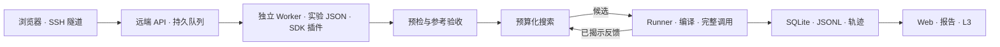
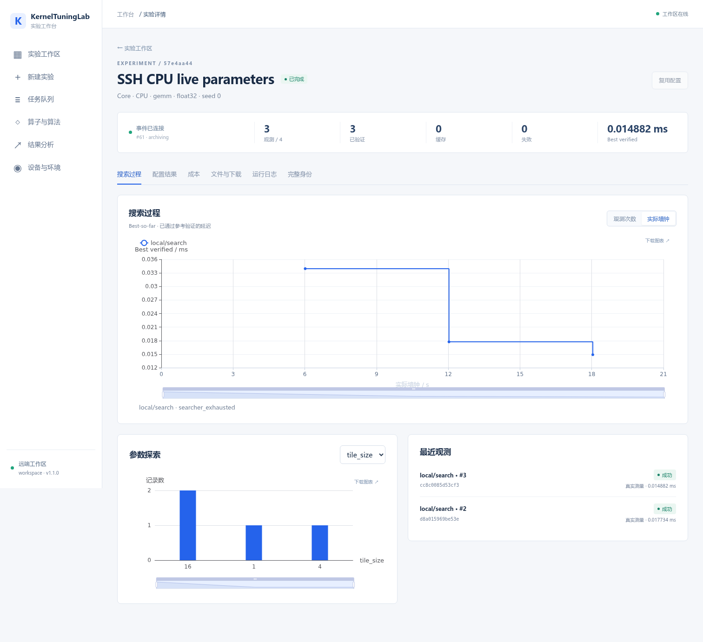

# KernelTuningLab

[](https://github.com/MingASA/KernelTuningLab/actions/workflows/cpu.yml)
[](pyproject.toml)
[](LICENSE)

面向真实硬件的算子配置寻优平台。用 **CLI / SDK、实验 JSON 和统一 Runner** 连接生产算子、搜索算法、AI 决策与可恢复的测量记录。

稳定使用入口为 **main · Web v2 / 1.1.0**，交付记录见 [PR #3](https://github.com/MingASA/KernelTuningLab/pull/3) 与 [STATUS](docs/STATUS.md)。历史 **v1.0.1** 标签与开发分支保留；研究与复现固定源码 commit。

## 主要功能

- **统一实验**：多个算子、实现、Shape、dtype、seed 和预算；静态检查、参考验证、完整调用计时与失败记录。
- **真实配置空间**：条件参数、离散模板、原生默认与显式配置；大空间按需访问，完整集合与采样前缀分开。
- **成熟搜索器**：Random、Grid、启发式及原生 SMAC RF、Kernel Tuner DE；预算、失败反馈、缓存和恢复共用接口。
- **三种 AI 路线**：已有模型预测、模型逐步决策、生成并审查 SDK Searcher；API 与本地模型是独立部署方式。
- **L3 与分析**：有限配置集合、Shape 分派、K–Loss、成本、覆盖和部署身份。
- **远端实验工作台**：浏览器上传项目、预检预算、提交与恢复实验，实时查看曲线、配置和成本，选择性下载结果；独立串行 Worker 复用原 Runner。
- **迁移与恢复**：私有环境 bootstrap、CPU 安全 doctor、SHA 校验和归档恢复。

## 系统结构



默认工作流：平台与完整数据放在 GPU 服务器，本机浏览器通过 SSH 隧道创建、监控和分析实验；仅在明确下载时传输产物。CLI / SDK 可以独立运行。SSH 负责连接与端口转发，Git / Bundle 固定源码，rsync / scp 用于选择性归档。E 盘是离线资产库。

## Quickstart：远端 Web 工作台

在服务器获取稳定 main：

```bash
git clone --branch main https://github.com/MingASA/KernelTuningLab.git
cd KernelTuningLab
python3 -m venv "$HOME/.venvs/ktlab-web"
"$HOME/.venvs/ktlab-web/bin/python" -m pip install '.[web]'
"$HOME/.venvs/ktlab-web/bin/ktlab" serve --workspace "$HOME/ktlab-workbench"
```

首次在服务器终端启动时设置工作区密码，之后重启与恢复沿用该密码。本机建立 SSH 隧道，再打开 `http://127.0.0.1:8765`，输入密码登录：

```bash
ssh -N -o ExitOnForwardFailure=yes -L 127.0.0.1:8765:127.0.0.1:8765 ktl-gpu
```

点击 **新建实验 → CPU 模板 → 预检并继续 → 提交实验**。生产 GPU 环境在服务器 `server.json` 中登记各自解释器、组件与准入锁。服务不需要现场安装 Node；前端资源随 wheel 发布。[完整工作台流程](docs/WEB.md) · [环境与部署](docs/DEPLOYMENT.md)。



## Quickstart：CPU 五分钟上手

CPU 核心包没有第三方运行依赖，不需要 Torch、Triton 或 GPU。

```bash
git clone https://github.com/MingASA/KernelTuningLab.git
cd KernelTuningLab
python3 scripts/bootstrap.py --profile core --env .venv
source .venv/activate-ktlab.sh
ktlab doctor
ktlab run --spec examples/quickstart/cpu.json --output artifacts/first-run
ktlab web --root artifacts/first-run
```

浏览器打开 `http://127.0.0.1:8765`。示例对一个小型 CPU GEMM 使用 Random / Grid，每方法最多两次揭示；输出应为 `status: passed`。缓存可能使真实执行数少于观测数。

相同命令和输出目录可恢复实验；新实验使用新目录。完整流程见 [Quickstart](docs/QUICKSTART.md)。Windows GPU 使用 WSL2；Windows 原生 CPU 环境的程序位于 `.venv\Scripts\`。

## 生产算子与硬件支持

以下是固定 profile 的定向实机覆盖，新增配置仍由 Runner 验算。

| 生产算子 | 已验证路径 | 主要边界 |
|---|---|---|
| GemLite A16 W4/W2 | 4090 FP16/BF16，GEMM / Split-K、默认与显式 | uniform group-scale；Split-K 元数据尾部已修复；GEMV/RevSplit-K 未实机验收 |
| FLUTE W3 High | H800 FP16/BF16；4090 部分模板及 FP16 默认 | P32 packing；独立 FP32 归约 profile；逐模板共享内存检查；原 Mixed 有精度限制 |
| FlexAttention | H800 Torch2.6 TRITON forward，dense/causal，FP16/BF16 | 与 Torch2.14、FLASH、backward 等路径分开 |
| SGLang paged decode | H800 原生/显式、等长/不等长分页，FP16/BF16 | 关闭 PDL 的兼容路径，保留 Split-KV 与 merge |
| vLLM MoE 0.8.5 | H800 完整两次 GEMM、SiLU、对齐和归约，FP16/BF16 | 官方固定组件 + Torch2.6/CUDA12/ABI0；与0.30分开 |

5060 Ti 已验证核心 GPU Runner 与研究算子栈。不同后端可以使用独立环境；一个环境的支持不能推到全部生产路径。

[最终支持说明](docs/PRODUCTION_STABILITY.md)列出静态合法、编译成功、数值通过及未验证范围。一次实际工程修复将完整3200点 MoE CPU 构建从47.926秒降至0.501秒，集合一致；这是特定任务的数据，见[原始记录](examples/production_stability/CPU_PROFILE.json)。

## 自定义搜索算法与 AI 接入

```bash
ktlab scaffold algorithm --output my_search
ktlab run --spec my_search/experiment.json --output artifacts/my-search
```

生成的 `assets.py` 实现公开 SDK 的 `suggest`。模型可以返回配置、partial、region 或空间查询；生成程序经过审查、开发和冻结后进入测试。平台不代训练路线A，也不将协议 fixture 当作模型效果。

- [SDK 与插件](docs/EXTENDING.md)
- [SMAC / KT 与生产配置空间](docs/SPACE_PRODUCTION.md)
- [AI 接口与资源协议](docs/PRODUCTION_SUITE.md)
- [团队使用指南](docs/TEAM_GUIDE.md)

## 结果、Web 与数据恢复

```bash
ktlab web --root artifacts/first-run --root artifacts/another-run
ktlab report --database artifacts/first-run/measurements.sqlite --output artifacts/report
ktlab l3 --database artifacts/first-run/measurements.sqlite --output artifacts/l3
ktlab export --database artifacts/first-run/measurements.sqlite --output records.jsonl
```

`ktlab web` 保留只读兼容；`ktlab serve` 提供上传、持久队列、实时 SSE、配置分析和选择性导出。两者读取相同原生实验格式，测量库仍由 Runner 管理。见 [Web 使用说明](docs/WEB.md)。

从私有归档库按源机器和目录前缀恢复：

```bash
ktlab archive verify --vault "$KTL_VAULT"
ktlab archive restore --vault "$KTL_VAULT" --source H800 \
  --prefix "$EXPERIMENT_PREFIX" --output restored-data
```

私有原始数据、机器信息和模型权重不随 GitHub 发布。部署层、ABI、可信来源与恢复验收见[部署与恢复](docs/DEPLOYMENT.md)。

## 文档导航

| 想做什么 | 文档 |
|---|---|
| 从安装到第一个实验 | [Quickstart](docs/QUICKSTART.md) · [个人练习](docs/PERSONAL_HANDOFF.md) |
| 新服务器、环境选择与 E 盘恢复 | [部署与恢复](docs/DEPLOYMENT.md) |
| 团队学习与工作流 | [团队指南](docs/TEAM_GUIDE.md) |
| 创建、监控、筛选和下载实验 | [Web 工作台](docs/WEB.md) |
| 开发 Kernel / Searcher 插件 | [SDK 扩展](docs/EXTENDING.md) · [接口](docs/INTERFACES.md) |
| 正确性、计时与证据 | [验证](docs/VALIDATION.md) · [协议](docs/PROTOCOL.md) |
| 有限配置集合和分派 | [L3](docs/L3.md) |
| 当前能力与限制 | [STATUS](docs/STATUS.md) · [生产支持](docs/PRODUCTION_STABILITY.md) |
| 历史研究 | [阶段一](docs/RESEARCH_PHASE1.md) · [阶段二](docs/RESEARCH_PHASE2.md) · [跨 GPU](docs/CROSS_GPU_PHASE1.md) |

## 许可证

原始平台代码采用 [Apache-2.0](LICENSE)。第三方源码保留各自许可证与版权，见 [NOTICE](NOTICE)。
