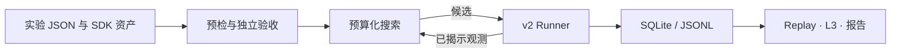

# KernelTuningLab

面向真实硬件的算子配置寻优研究平台。研究者提交 **SDK 插件和实验 JSON**，用一条命令运行多个算子/实现、Shape、dtype、seed 和预算，比较搜索算法并生成报告。

- **L2**：有限观测预算下的配置搜索、历史迁移和离线 Replay。
- **L3**：有限配置集合选择与分派；配置数、编译特化数和二进制体积分别记录。
- **AI 接口**：配置预测、下一步建议和只读历史；当前没有AI已优于专家库的声明。

## 五分钟 CPU 上手

Python ≥3.10，核心包无第三方运行依赖；CPU路径不需要Torch/Triton。

```bash
git clone --branch research/5060ti-readiness https://github.com/MingASA/KernelTuningLab.git
cd KernelTuningLab
git checkout --detach 35ac36ed66becf19271c9ed3e97950fb67a03d87
python3 -m venv .venv
.venv/bin/python -m pip install -e '.[dev]'
.venv/bin/ktlab research --spec examples/research/cpu.json --output artifacts/first-study
```

打开 `artifacts/first-study/report.md` 查看搜索曲线、已验证性能、成本、失败和覆盖。相同命令恢复；`--write-only` 预览预算，`--report-only` 重建报告，`--quiet` 关闭stderr进度。若Python缺少ensurepip，可使用已有uv：`uv venv --python 3.12 --seed .venv`。

完整安装、wheel、GPU最小实验、恢复与数据导出见 **[QUICKSTART.md](docs/QUICKSTART.md)**。

当前 `main` 尚未包含这套验证交付；上述命令固定到已验证源码。开发请另建分支。跨硬件 Anchor 使用独立冻结的实验 commit，见[跨 GPU 研究报告](docs/CROSS_GPU_PHASE1.md)，不能以浮动 main 代替。

## 添加实现或算法

```bash
.venv/bin/ktlab scaffold kernel --runtime python --output my_kernel
.venv/bin/ktlab check --spec my_kernel/experiment.json --output artifacts/check
.venv/bin/ktlab run --spec my_kernel/experiment.json --output artifacts/run
.venv/bin/ktlab scaffold algorithm --output my_algorithm
```

修改生成的 `assets.py`，无需修改核心注册表。文件、模块和安装包entry points均可发现资产。多步骤Kernel用 `ExecutionPlan` 表达初始化与有序步骤，正确性和完整调用计时共用同一流程。见 **[CONTRIBUTING.md](docs/CONTRIBUTING.md)**、[EXTENDING.md](docs/EXTENDING.md)。



版本化资产、合法性、输入完整性、实际计时输出检查、进程期限、兼容缓存和恢复共用现有Runner/存储。[ARCHITECTURE.md](ARCHITECTURE.md)说明详细设计。

## 当前证据与边界

| 能力 | 证据 |
|---|---|
| CPU-only安装、测试、SDK、搜索与SVG报告 | 已在独立无Torch/Triton环境执行，源码和wheel均验证 |
| RTX 5060 Ti 16GB / WSL2 | 原四类十阶段严格gate、新八类有限验证；[GPU报告](docs/5060TI_RESULTS.md) |
| T1 GEMM / L2 / L3 | C64的10 Shape×64配置×3输入seed真实矩阵；[第一阶段研究](docs/RESEARCH_PHASE1.md) |
| 扩展tile、Shape-generic、交付审计 | [第二阶段研究与验收](docs/RESEARCH_PHASE2.md)逐项标注通过、部分通过、未执行与限制 |
| H20/H200/H800/4090 | [可复用迁移检查单](docs/GPU_MIGRATION.md)，本轮未在这些GPU执行 |
| Mock / Replay | Mock是合成性能；Replay揭示已有标签，均不产生新GPU测量 |

已接入GEMM、BMM、Softmax、LayerNorm、W4/W3/W2反量化与量化GEMM、连续Attention、MoE Grouped GEMM。[算子文档](docs/PROPOSAL_OPERATORS.md)给出语义边界；canonical bitstream、连续Attention、局部MoE不代表GPTQ/AWQ、paged KV或完整生产推理。

GPU环境需独立安装兼容Torch/Triton；CPU安装成功不表示CUDA可用。5060Ti固定栈与最小实测命令见[Quickstart](docs/QUICKSTART.md)。其他GPU须重新probe、编译和数值验收。

## 研究与维护入口

| 需要做什么 | 入口 |
|---|---|
| 搜索插件与多case一站式比较 | [RESEARCH_WORKFLOW.md](docs/RESEARCH_WORKFLOW.md) |
| 预算、正确性、计时、划分和结果解释 | [RESEARCH_PROTOCOL.md](docs/RESEARCH_PROTOCOL.md) → [PROTOCOL.md](docs/PROTOCOL.md) |
| 环境、编译、数值、缓存与恢复排错 | [TROUBLESHOOTING.md](docs/TROUBLESHOOTING.md) |
| 历史示例、Mock Demo、规模与公共数据 | [examples](examples/README.md)、[PUBLIC_DATA.md](docs/PUBLIC_DATA.md) |
| 支持状态和源码接口 | [STATUS.md](docs/STATUS.md)、[INTERFACES.md](docs/INTERFACES.md) |

大型SQLite/JSONL、日志、编译产物放在 `artifacts/`，单独归档校验；Git中的精简矩阵和图表不替代原始证据。立项书历史图表缺少原始表，未作为新实测数据导入。
