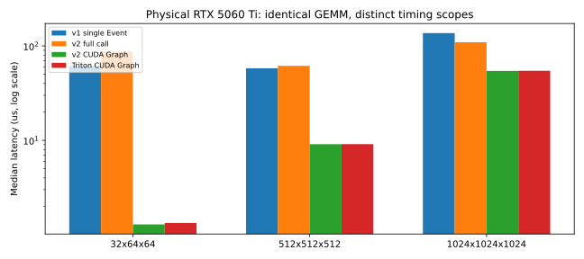
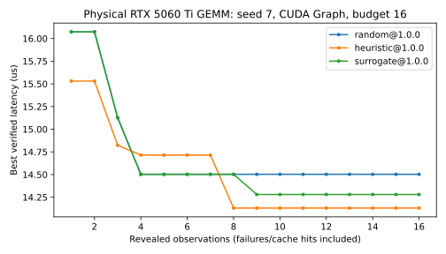
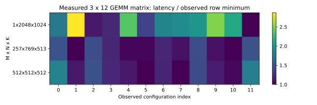

# RTX 5060 Ti 实机验证与研究平台校验

实验日期：2026-10-25 UTC。开发分支：`gpu/5060ti-validation`；起始提交：`12cca3a724caa19427a29a0eabecf75b65740700`。没有合并或修改 `main`。

这里的 GPU 结论来自物理 **NVIDIA GeForce RTX 5060 Ti 16GB / sm_120**，不使用 Mock、CPU 或历史 PPT 图表代替 GPU 证据。所有“通过”均限于归档中实际列出的配置、Shape、dtype、输入 seed 和计时模式；没有宣称整个开放配置空间通过。

## 环境与复现

| 项目 | 实测 |
| --- | --- |
| GPU | 36 SM；17,074,421,760 bytes 可见容量；32 MiB L2 |
| 单 block opt-in shared memory | 101,376 bytes；每 SM 65,536 个 32-bit registers |
| WSL | Linux 6.6.87.2-microsoft-standard-WSL2；4 个可用逻辑 CPU |
| 主机内存 | 约 7.8 GiB RAM，4 GiB swap；cgroup quota 文件未暴露，CPU affinity 为 4 |
| Python | 项目环境 3.12.13；无 GPU 依赖的独立回归环境 3.10.12 |
| Torch / Triton | 2.13.0+cu132 / 3.7.1 |
| CUDA | Torch runtime 13.2；已有系统 nvcc 13.2；驱动查询为 616.92 |
| 驱动工具 | nvidia-smi CLI 615.71.08；其 KMD 显示 616.92 |
| 实际 Triton assembler | sm120 路径选择 ptxas-blackwell 13.1.80；没有编译器路径/架构/选项覆盖 |

先只读探测了现有开发环境，选择与本机已能识别 sm_120 的 vLLM 环境相同的 Torch/Triton 版本，在项目内**重新安装**，没有复制旧 venv，也没有修改 xLLM/vLLM、Windows 驱动、WSL 全局驱动或系统 CUDA。Torch 编译架构清单实际包含 `sm_120`。

系统 `python3 -m venv .venv` 首次因缺少 ensurepip 失败，使用已有 uv 创建独立环境，避免安装系统包。可复现命令：

```bash
uv venv --python 3.12 --seed .venv
.venv/bin/python -m pip install -r docs/data/5060ti-requirements.txt \
  --extra-index-url https://download.pytorch.org/whl/cu132
.venv/bin/python -m pip install -e .
.venv/bin/python -m pip check
.venv/bin/python -m pytest -q
.venv/bin/python -m kernel_tuning_lab probe --gpu --hardware 5060ti16g
KT_PYTHON_BIN=.venv/bin/python bash scripts/run_gpu_smoke.sh \
  5060ti16g artifacts/5060ti/baseline/core
```

完整依赖固定在 [5060ti-requirements.txt](data/5060ti-requirements.txt)。本地 `artifacts/5060ti/baseline/environment/` 保留 CPU 安装日志、无 Torch 的首次 probe、GPU 安装日志、pip freeze/check、系统资源、驱动、nvcc、实际 GPU probe 和起始提交。公开摘要不包含本机绝对路径、登录信息或令牌。

## 已复现的问题与修复

| 问题与证据 | 根因与处理 | 回归证据 |
| --- | --- | --- |
| 同一小 GEMM，单次 Event 约 50–60 µs，Graph 约 1.3 µs | WSL 主机提交空隙进入单次 Event 区间。保留原 v1 Event 和 v2 synchronized full flow，新增显式 `timing_mode="cuda_graph"`，完整捕获 initialize 与有序 GPU steps | `1938394`；GPU 覆盖普通 GEMM、量化 Split-K、persistent MoE reset 和实际计时后输出核对 |
| L3 接受混合 Event/full-flow、不同环境与正确性协议 | 原 `PerformanceMatrix.from_records` 只检查 hardware/operator/provenance。现在拒绝不兼容测量上下文，仅允许 Shape 对应的配置域不同 | `2c64db0`；首次 5 条失败回归日志和修复后测试均保留 |
| 小 M 的量化 GEMM 拒绝 GROUP_M=8 | tile 映射已经钳制最后一个分组大小，原约束与 resolver 不必要地删掉合法候选 | `2d6b70e`；W4/W3/W2 × FP16/BF16 六次直接 GPU 数值复现；融合与 pipeline 的正常路径回归 |
| 首次完整套件两条资源编译失败 | 融合路径估计漏掉流水化 int32 packed/zero 缓冲，W3 还有第二个 packed word。W3 案例实际需 221,184 bytes，W4 案例需 149,504 bytes，均超过本卡 101,376 bytes | `c43373e`；16 组 stage/group-size 资源探测各在 FP16/BF16 复现；原配置现在为明确 `invalid_config`，相邻 stage=1 配置正常数值通过 |
| 三条“无 CUDA”测试在 GPU 机器上实际调用了 CUDA | 测试隐式依赖开发机缺设备。现在在相应测试中显式设置 `CUDA_VISIBLE_DEVICES=""`，GPU 回归单独 opt-in | 不关闭平台验证；完整 CPU-only 环境与物理 GPU 回归分别执行 |

首次失败完整保存在 `artifacts/5060ti/full-proposal/`，没有覆盖或删除。两条失败的 compile 时间为 1169.08 / 553.52 ms，墙钟为 1.181 / 0.565 s，均消耗验收尝试预算，未以零成本丢弃。修复后的完整套件使用 `full-proposal-repaired/`。资源约束按物理容量判断，没有全局删除 Hopper 候选；CPU 回归明确检查上述 221,184-byte 配置在 H200 规格下仍被保留。资源估计由当前编译器实测校准，实际 compiled resource 检查继续保留；Hopper 编译布局仍须在目标设备复验。

两个重点平台改进是**显式区分的 Graph 计时及误差对照**、**阻止 L3 混合不兼容测量协议**。分组和资源约束属于实机发现的 P0 修复，没有增加新的数据库或另一套执行框架。

## 测量、预算与追溯审查

| 路径 | 统计范围 | 不在延迟样本内、但计入实际调优墙钟的工作 |
| --- | --- | --- |
| v1 `cuda_events_hot_single_kernel` | Event 前后的一次热态 launch；可能包含主机提交空隙 | 输入/参考、JIT、正确性、warmup |
| v2 `cuda_synchronized_full_flow_perf_counter` | 调用前同步，计时 initialize → 所有 steps → 完成同步；含主机步骤和提交 | 输入/参考、build、one-time setup、workspace allocation、输出 poison/input integrity |
| v2 `cuda_graph_events_full_flow_amortized` | Event 围绕批量 graph replay，除以完整调用数；包含捕获的 GPU initialize/steps | 上述工作，以及 capture、side-stream lazy warmup、一次未计时 graph replay |

Graph 模式显式不重复执行 Python/host callbacks，只适用于稳定缓冲和可捕获流程；它不是端到端部署延迟。每次 replay 前在计时外 poison 输出，内部调用复用缓冲；初始重复调用与最后一次实际计时输出、输入完整性依然核对。捕获失败保留为编译失败，不静默回退。默认仍为 full flow。

量化 pipeline 的 dequantize → GEMM → Split-K reduction 均在完整流程内。MoE 的 counter reset → tile map → GEMM → 可选 reduction 同样计时；没有只计 GEMM 而隐藏必要预处理。one-time setup、工作区和 Graph capture 成本保存在执行元数据/compile 与总墙钟中。

v1 的预算限制新 admission，包含失败，缓存不增加物理尝试；因此旧 v1 不能直接用相同数字做等信息量算法比较。v2 限制已揭示候选观测，失败和缓存命中都消耗观测预算，单列新测量和 cache hits；验收预算、研究预算、Kernel 数和 Shape 数分开记录。硬时间限制由 v2 父进程监督。

同一 v2 实验内不同算法共享测量缓存是等观测预算下合理的复用：算法看不到未提议配置的结果。它会令后运行算法受益于已测结果及 Triton JIT cache，因此不能把 trial wall time 直接解释为独立冷启动调优速度。缓存绑定实际探测的硬件属性、实现/参考源码内容、正确性协议、Torch/Triton/CUDA/driver、输入 seed 和实验身份。频率、温度、桌面活动、同型号不同板卡差异没有被固定；跨机器应保留独立实验目录与重复试验。

SQLite/JSONL 保留完整 record，包括 raw samples、scope、正确性、失败和来源；L3 的实测记录另外进行了导出、导入、再导出，按完整 record ID 检验语义未丢失。不同源码/计时/软件上下文不能直接组成同一个性能矩阵。

## TMA 与架构能力边界

MoE 强制 `USE_TMA=True`，在 `M=19,N=32,K=128,Groups=4` 上验证了 grouped/persistent × Split-K 1/2，验收输入 seed 为 17、0、104729、130363，研究 seed 为 7。BF16 扩展也实际通过 TMA 配置。`tma-probe/ptx/` 归档了四份 `.target sm_120a` 产物，包含真实 `cp.async.bulk.tensor.2d/3d` 指令。

本实现使用普通 descriptor loads，没有把 `sm_120 >= sm_90` 当作 WGMMA、TCGen05 或所有 Hopper 专属机制的通行证，也没有因“消费级”标签错误关闭已验证的 TMA。具体 API/步长限制参见 [Triton descriptor 文档](https://triton-lang.org/main/python-api/generated/triton.language.make_tensor_descriptor.html)；各指令的目标限制见 [NVIDIA PTX ISA](https://docs.nvidia.com/cuda/parallel-thread-execution/)。TMA store/scatter、cluster、warp specialization 不在本轮支持声明内。

## 严格 GPU gate 与新增算子覆盖

原四类十组 dtype 的严格 smoke **10/10 通过，80/80 成功**：GEMM/BMM 各 FP16、BF16；Softmax/LayerNorm 各 FP16、BF16、FP32。每组两个 Shape、8 次新测量。没有关闭 require-all-success，也没有改动原数值容差。

| 阶段 | 任务 | 研究观测 / 新测量 / 缓存 | 另计验收 | 状态 |
| --- | ---: | --- | ---: | --- |
| 逐类 FP16 pilot | 8 | 36 / 36 / 0 | 70 | 通过 |
| BF16 扩展 | 8 | 72 / 72 / 0 | 70 | passed |
| Attention/MoE 语义变体 | 22 | 216 / 216 / 0 | 176 | passed |
| 首次默认完整套件 | 16 | 480 / 424 / 56 | 126 | failed |
| 修复后默认完整套件 | 16 | 576 / 520 / 56 | 140 | passed |

新增八类的下表为各阶段累计、按完整 record ID 去重后的实际记录；不同源码版本与计时口径仍分别保留，不能把累计数量解释为同一个性能矩阵。配置数是配置键值的去重数量，包含诊断拒绝及历史失败；完整 Shape/config/seed 对在对应 JSONL 中。

| 算子 | FP16：记录 / Shape / 配置 | BF16：记录 / Shape / 配置 | 最终默认套件 |
| --- | --- | --- | --- |
| dequantize_w4 | 57 / 3 / 8 | 60 / 3 / 8 | FP16/BF16 通过 |
| dequantize_w3 | 57 / 3 / 8 | 60 / 3 / 8 | FP16/BF16 通过 |
| dequantize_w2 | 57 / 3 / 8 | 60 / 3 / 8 | FP16/BF16 通过 |
| w4a16_gemm | 162 / 5 / 92 | 85 / 3 / 71 | FP16/BF16 通过 |
| w3a16_gemm | 134 / 3 / 83 | 85 / 3 / 68 | FP16/BF16 通过 |
| w2a16_gemm | 132 / 3 / 82 | 138 / 3 / 85 | FP16/BF16 通过 |
| attention | 312 / 9 / 63 | 270 / 6 / 59 | FP16/BF16 通过 |
| moe_grouped_gemm | 227 / 8 / 76 | 134 / 5 / 48 | FP16/BF16 通过 |

独立反量化的有限配置域 4 个 BLOCK_SIZE × 2 个 warp 值已被累计覆盖，但不意味着每个配置与每个 Shape/seed 的组合都被穷举。量化融合与 pipeline、Attention 的 384 候选、MoE 的百万级声明空间都只做了有限采样。实际覆盖包括 K=35/65 的量化跨 word/尾组、退化尾块、GQA/MQA、长短 SeqQ/SeqKV、bottom-right/top-left 因果与全遮罩行、特殊 scale、空/倾斜专家、Split-K、persistent、TMA，以及多步骤计时。

完整套件使用默认 `--scale smoke`、random+grid、每 trial 4 个观测；它不是 production scale，也不是遍历所有 Kernel 变体。首次两项验收失败导致对应研究路径未执行完，均保留其 partial 覆盖；修复后在新目录重新执行了全部 16 项。

最终 journal 合计 **2,470 条唯一记录：2,464 条 GPU 数值验证成功、2 条首次资源编译失败、4 条修复后明确非法配置诊断**。非法配置未启动 GPU kernel。直接编译资源探测、独立 Event/Graph 控制数据另外归档，未伪装成平台性能矩阵记录。

## 同实现计时对照

固定 FP16、seed=7、tile 32×64×32、4 warps、2 stages，v1/v2 调用同一个 `gemm_kernel`，逐元素确认输入相同。每种 Shape 测 5 轮，每轮 50 个平台样本；独立 Event、Triton Graph 和 Torch mm 均另测。下表 Graph 为每次 replay 1024 个完整调用。所有数值单位为 µs。

| M×N×K | v1 单次 Event | 独立单次 Event | v2 full flow | v2 Graph | Triton Graph | Torch mm Graph |
| --- | ---: | ---: | ---: | ---: | ---: | ---: |
| 32×64×64 | 61.280 | 98.160 | 86.801 | 1.285 | 1.333 | 1.297 |
| 512×512×512 | 57.952 | 49.536 | 61.601 | 9.109 | 9.117 | 10.387 |
| 1024×1024×1024 | 136.816 | 94.960 | 109.352 | 54.341 | 54.544 | 52.916 |



512 与 1024 的 v2 Graph 和独立 Triton Graph 中位数相差约 0.08% / 0.37%；v2 Graph 的五轮中位数 CV 约 0.02% / 0.03%。小 Shape 的 v2 Graph CV 约 1.43%，独立 Triton Graph CV 约 10.84%，其约 0.047 µs 的差别不足以支持精细排名。单次 Event/full flow 的轮间 CV 可达约 20–53%，因此不能把这些单次数据解释为微秒 kernel 的纯设备成本。

128-call 试验的小 GEMM 约 1.497 µs，而 1024-call 约 1.285 µs，说明较小批次仍有 Event/replay 边界误差。研究实验统一采用 512-call、31 样本、10 warmup；与 1024-call 对照分开保存，不能直接混成 L3。Graph 是热缓冲口径，主机全调用和冷数据延迟仍需独立测量。

Torch 基线使用同一 FP16 输入、预分配输出和相同数学 matmul 语义，实际结果对 FP32-reference-cast 核对通过。这里只展示可比的绝对时间，不将计时口径变化报告为 kernel 加速，也不声称相对专家库的普遍加速。原始各轮数据、P10/P50/P90、温度/频率/负载快照在 timing-control 系列目录。

## 有限代表性性能实验

全部为 FP16、seed=7、Graph 512-call、31 样本，正确性和最终计时输出均通过。最大的单个输入权重为 64 MiB；参考的 FP32 转换及输出加起来仍远低于 16GB。量化/MoE 的最大平台 workspace 实测为 **8,404,992 bytes**，低于显式 256 MiB 预算。prepare/reference、workspace、capture 与检查均计入实际调优成本，没有把主机内存预算当作显存预算。

| 场景 | Shape / 语义 | 已测集合最佳中位数 µs |
| --- | --- | ---: |
| GEMM 低 M，权重超过 L2 | 1×8192×4096；64 MiB B | 159.278 |
| GEMM 计算型 | 1024×2048×2048 | 212.513 |
| W4 fused / pipeline | M=1,N=2048,K=2048 | 16.817 / 25.340 |
| W4 fused / pipeline | M=128,N=1024,K=2048 | 29.809 / 28.661 |
| Attention causal prefill | B=1,H=4,KVH=2,D=64；S=128 / 1024 | 2.531 / 27.529 |
| Attention noncausal prefill | 同上，S=128 / 1024 | 2.702 / 34.810 |
| Attention decode | Q=1,KV=4096；causal / noncausal | 49.318 / 49.034 |
| MoE balanced / skewed | M=128,N=256,K=256,G=4 | 4.830 / 4.833 |
| MoE balanced / skewed | M=256,N=512,K=512,G=8 | 8.575 / 8.525 |

一个受控 GEMM 对照只改变 BLOCK_M：在 1024×2048×2048、BLOCK_N=64、BLOCK_K=64、4 warps、2 stages 下，BM=16 为 **332.43 µs**，BM=64 为 **212.51 µs**，延迟降低约 **36.1%**。其 P10–P90 分别为 332.25–334.41 与 212.15–214.02 µs，差异明显超过样本波动。更大 M tile 将 CTA 数从 2048 降到 512，增加同一 B tile 对多行 A 的复用；这是与实现结构一致的原因推断，尚无 Nsight counter 证明。低 M 的同类 tile 差异仅约 2%，与计算型行为不同。

W4 小 M 的融合路径避免完整权重物化；大 M 的多步骤路径能复用物化权重，实测略胜融合，但这里只比较这两个规范格式实现及相同有限配置集合。它们均包含 Split-K reduction，pipeline 还实际计入 dequantize。不能把它们当作 GPTQ/AWQ 生产布局对照。Attention 是连续 KV，MoE 已完成分组且不含路由/scatter；没有报告相对 paged attention 或完整 MoE 层的误导性加速比。

## 真实 L2：等观测预算、可追溯缓存

固定 GEMM M=512,N=1024,K=512、72 个合法候选，比较 Random、Heuristic、已有 distance-surrogate。seed=7 分别执行预算 4/8/16；seed=19/31 各执行预算 16，共 15 trials、180 个观测、124 次新研究测量、56 次缓存命中；另外 60 次验收。观测失败数为 0，推荐均来自独立数值通过的结果。

| seed；预算16 | Random µs（新/缓存） | Heuristic µs（新/缓存） | Surrogate µs（新/缓存） |
| --- | --- | --- | --- |
| 7 | 14.503（16/0） | 14.131（12/4） | 14.280（6/10） |
| 19 | 14.167（16/0） | 14.167（9/7） | 14.711（6/10） |
| 31 | 14.503（16/0） | 14.127（12/4） | 14.127（5/11） |



seed=7 的 Random/Heuristic 候选集合对称差为 24，Random/Surrogate 为 20，三种策略确实进入了不同候选。Surrogate 的随机冷启动可与 Random 重合，之后才依据已观测数据分化。单次 trial 的 best-so-far 单调不增；不同预算重新实测时有微小噪声，不能要求独立 run 的同一配置延迟完全相同。

三个 seed 的研究观测共覆盖 51/72 候选；已知最佳约 14.123 µs，**不是全空间全局最优**。这里只证明算法工作流和有限预算行为，不能根据三个 seed 宣称某算法具有统计优势。所有历史只包含已揭示记录，未把这个 pooled best 传入 searcher。

相同 spec 的数据库快照恢复后，48 个研究观测全部缓存命中、新研究测量为 0；三种策略的完整候选/record ID 序列与原运行一致。12 次新的验收单列。编译与失败的原始成本保留在记录中；缓存 trial 的墙钟不重复计入历史编译成本。

## 真实 L3：限定完整矩阵与配置预算

后续定义校正：本节历史 API 中的“变体”实际是配置字典，未统计 Shape constexpr 导致的物理编译特化或代码体积。K 属于 Config Budget；更大矩阵及实际编译身份统计见 [RESEARCH_PHASE1.md](RESEARCH_PHASE1.md)。下列原始实测数值不变。

使用同一 GEMM 实现、FP16、Graph 512-call、warmup=10、31 samples，采集 **3 Shape × 12 Config × 3 seed = 108 条研究测量**，另有 36 次验收。Shape 按 M 排序为 (1,2048,1024)、(257,769,513)、(512,512,512)，权重为 0.4/0.3/0.3。矩阵每格聚合 93 个原始 runtime samples 的中位数，去重 record IDs，覆盖率为 100%。

| K 上限 | exact oracle 加权 µs / 相对已观测参考损失 | greedy 损失 | local swap 损失 |
| --- | --- | --- | --- |
| 1 | 9.180 / 8.785% | 8.785% | 8.785% |
| 2 | 8.531 / 1.098% | 1.440% | 1.098% |
| 4 | 8.439 / 0.000% | 0.000% | 0.000% |



K=4 时只需 3 个配置便达到此表的逐 Shape 参考，符合“至多 K”。dispatcher 在真实硬件/operator/config space 下完成有限 Shape 分派和合法性检查。SQLite → JSONL → SQLite → JSONL 的完整 record ID 集合一致。

此 exact 只针对声明的 12 个候选，不是平台全部 GEMM 空间的全局最优，也不是对新 Shape 的泛化能力。缺失格子在平台中保持 None，不能分派到无成功观测的配置；其他 Shape 拒绝。不同 measurement scope、批次、软件/源码或正确性协议会被矩阵构建器拒绝；没有用稀疏观测填充预测值。

## 复现入口与数据版本

```bash
# 完整默认矩阵；首次失败另存，修复后使用独立目录
.venv/bin/ktlab proposal-suite --runtime cuda --hardware 5060ti16g \
  --output artifacts/5060ti/full-proposal-repaired
# 语义变体：验收预算与研究预算分别保存
.venv/bin/ktlab proposal-suite --runtime cuda --hardware 5060ti16g \
  --operators attention moe_grouped_gemm --variants --max-evaluations 2 \
  --algorithms random --output artifacts/5060ti/variants
.venv/bin/python scripts/check_gpu_timing.py --graph-batch-size 1024 \
  --output artifacts/5060ti/timing-control-graph-1024
.venv/bin/python scripts/run_5060ti_research.py l2 --output artifacts/5060ti/l2
.venv/bin/python scripts/run_5060ti_research.py l3 --output artifacts/5060ti/l3
.venv/bin/python scripts/run_5060ti_research.py representative --output artifacts/5060ti/representative
KT_RUN_GPU_TESTS=1 .venv/bin/python -m pytest -q tests/test_cuda_graph_runtime.py
.venv/bin/python scripts/summarize_5060ti.py
```

主目录 `artifacts/5060ti/` 下每项保留 spec、assets.lock、验收记录、完整 SQLite/JSONL、trials 和日志；全套数据另存为本地 `artifacts/5060ti-evidence-20261025.tar.gz`，相邻 `.sha256` 文件校验完整性，排除可重建的 CPU-only venv。原始数据**不会因 git commit 自动入库**。Git 内保存本报告、SVG、依赖锁及 [机器可读摘要](data/5060ti-summary.json)。归档内含源码补丁和目录级 SHA-256 inventory，便于从起始提交重建。

| 数据 | 对应库源码提交 |
| --- | --- |
| 原四类严格 smoke | `12cca3a` |
| 首次独立计时 / 最早 dequant pilot | `2c64db0` |
| 其余 pilot、BF16 扩展、强制 TMA、128-call 对照 | `1938394` |
| 参数语义变体 | `2d6b70e` |
| 首次完整失败套件及资源诊断 | `f33174f` |
| 修复后完整套件、资源拒绝回归 | `c43373e` |
| 1024-call 对照、L2/L3、代表性与缓存恢复 | `8f95b84`，库源码与 `c43373e` 相同 |
| 较大 GEMM generator 与 L3 exchange 工具 | `c324dc1`，GPU 库源码未变 |

少数 pilot 在提交前以相同工作树源码执行，以上提交按相关文件内容对应；每条记录的源码指纹是最终审计依据，已校验 runtime hash 有对应提交。`experiment-ledger.json` 给出目录映射，spec 自带 seed/dtype/Shape/config domain/预算/计时模式。环境快照固定依赖，不复制个人开发环境。

最终 CPU-only 回归 **305 passed, 9 skipped**；9 项为显式 opt-in GPU 测试。物理 GPU 回归 **9 passed**。原 CPU 基线 288 passed，新增测试覆盖 Graph 口径、缓存身份、混合协议拒绝、合法分组和量化资源约束；没有无依据放宽容差。

## 尚未验证与下一阶段 GPU 清单

| 设备 | 必须执行的核查 |
| --- | --- |
| H20 | 先实际 probe；当前没有 H20 专用命名 profile，v2 可不指定 hardware 并保存实际属性；补核实 profile 后再用严格核心脚本。检查带宽型 GEMM/量化 decode、TMA 和本地资源模型是否仍适用 |
| H200 | 原四类十阶段 gate；本轮资源失败配置的相同参数应重新编译核对，不能直接接受 sm120 估计；TMA/grouped/persistent/Split-K；大 M/N/K、较长 Attention 和更大 workspace |
| H800 | 同上，并与 H200 保持软件、dtype、语义、计时 scope、批次及 seed 一致；检查 WGMMA lowering 与共享内存资源 |
| RTX 4090 | 严格 gate、八类与 Graph；确认普通指针 MoE 路径，TMA 不应因数值比较架构版本而误开放；独立检测 Ada 编译资源和低 M 行为 |

各卡先小规模逐类验收，再扩大 production Shapes；同一块 GPU 不并发性能任务。跨硬件性能矩阵分开，迁移训练先按 case/Shape/GPU 划分 train/validation/test，再冻结策略评分。对 Hopper 的 TensorDescriptor 或 WGMMA 性能，5060 Ti 结果不能替代实机证据。

**已被真实 GPU 验证：** 原四类严格 smoke、八类新增算子的 FP16/BF16 默认与有限语义采样、融合/多步骤/Split-K/persistent/TMA load、显式 Graph 计时、真实 L2、有限完整 L3、缓存和数据往返。

**仅有限采样：** 所有大配置域、Graph 的算子/精度组合、代表性 Shape 与三个搜索 seed；本轮未运行整个 production suite、16K 大上下文矩阵或百万候选。

**本卡不支持的已确认配置：** 超过 101,376-byte block shared memory 的上述配置，已在启动前拒绝；这不是把整个算子或所有 TMA 都标为不支持。WGMMA/TCGen05 等架构专属机制没有本轮支持声明。

**尚待 Hopper 实机：** 其专属 lowering、资源布局、TMA 性能与生产规模、多 GPU/隔离时钟环境。生产 GPTQ/AWQ、paged KV、完整 MoE 路由和专家实现对照也未执行，不存在相应加速结论。

## 后续 L2/L3/AI 研究最应优先解决的三个问题

1. **统一性能问题的测量定义与噪声控制。** 单次 Event 与 Graph 对小 kernel 相差约 40 倍量级，主机口径轮间 CV 可超过 50%；先固定 scope、批次、缓存状态、独立重复和物理设备身份，再研究百分之几的算法收益。
2. **用实测 compiler resources 校准配置合法性与真实调优成本。** 已发现合法 GROUP_M 被误杀、融合 int32 staging 被漏算，两条首轮资源失败消耗了真实预算。下一步应建立分硬件/软件版本的资源先验与失败诊断，不能把编译失败成本当成零，也不能用过强约束缩掉真正有效候选。
3. **为跨硬件策略与有限变体选择获取可比较、覆盖明确的数据。** 本轮 L2 只覆盖 51/72 候选、三个 seed，L3 只完整覆盖 3×12 的限制空间。优先研究稀疏矩阵主动补测、预算分配与训练隔离，再让 AI 积累跨 GPU 的配置知识；不要把这些小样本当成已证明的泛化优势。

