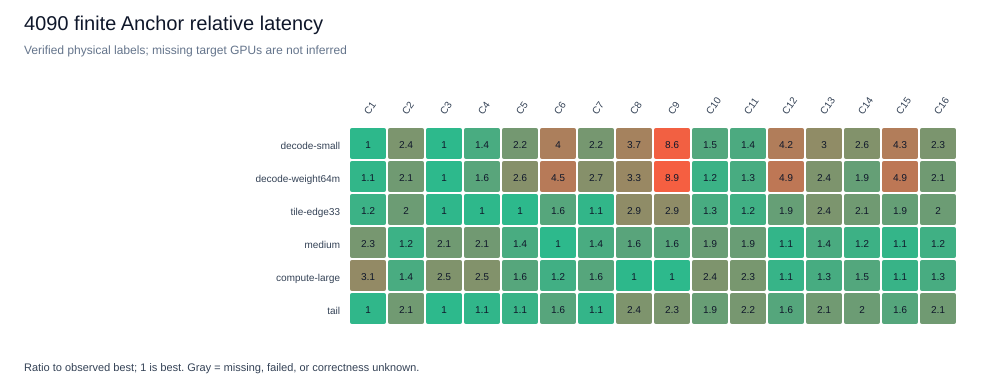
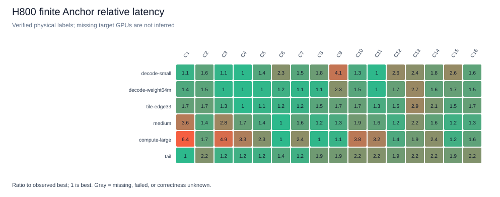
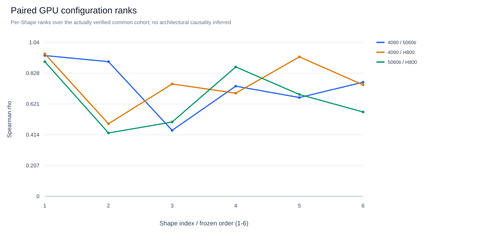
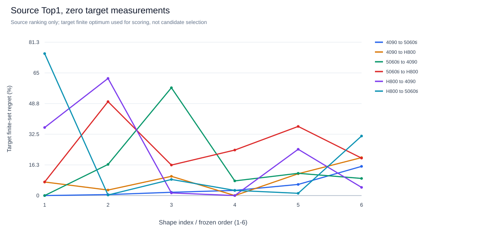
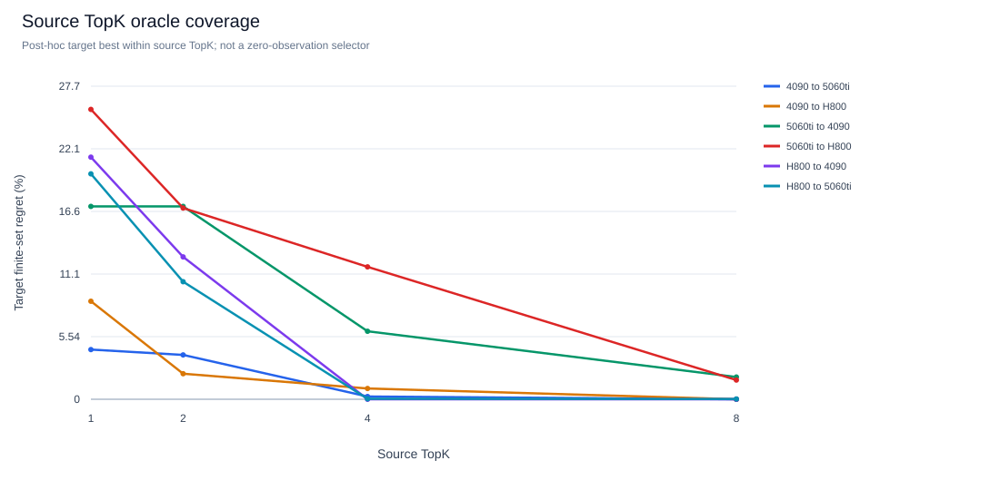
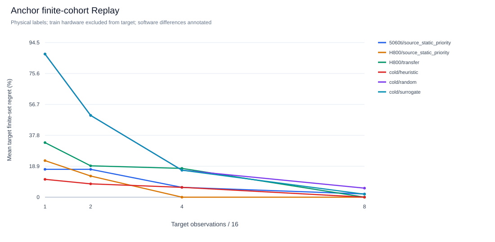
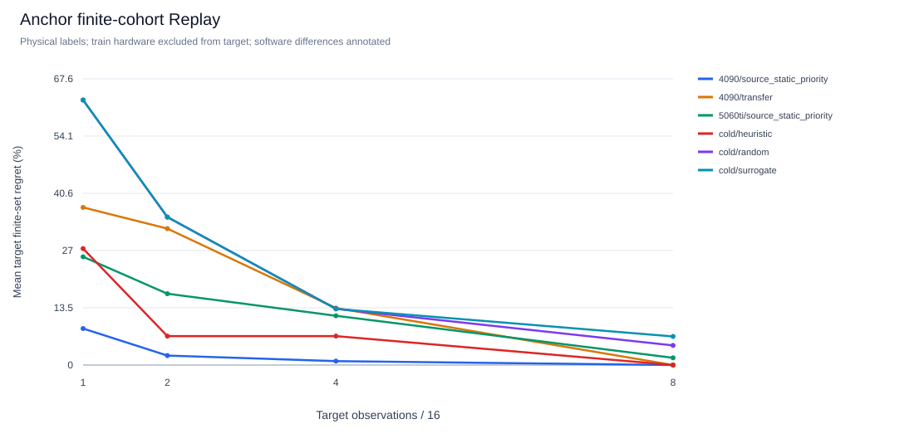

# 第一轮真实跨GPU配置迁移研究

**已取得三张卡各192/192条正确性通过的Anchor观测**：RTX5060 Ti、RTX4090、H800，共576条，6 Shape × 16配置 × 2输入run。三卡共同候选为全部16点；没有预测填表或将缓存命中算新测量。两台远端另完成18条在线搜索轨迹：72次观测=54次新测量+18次缓存观测，独立验收另计。

主要发现：相同源码的配置排名有相关性，源卡Top1仍会明显失配。5060 Ti逐Shape的Top1迁到4090/H800，平均损失为17.05%/25.63%。少量目标反馈有价值，但源历史先验和现有Transfer都不保证优于Heuristic。所有“最好”仅指本次有限16候选；本轮没有证明1%穷举成本或AI优势。

[机器可读汇总](data/crossgpu-anchor-summary.json)包含环境、成本、质量、覆盖、迁移、Replay与在线结果；[5060 Ti](data/crossgpu-anchor-5060ti-matrix.json)、[4090](data/crossgpu-anchor-4090-matrix.json)、[H800](data/crossgpu-anchor-H800-matrix.json)为可由现有L3接口读取的精简矩阵。原始samples、完整SQLite/JSONL、环境锁、日志和PTX/CUBIN另行私有归档。

## 1. 固定版本与实际环境

| 对象 | 固定版本 |
|---|---|
| 本次GPU测量源码 | `6ecde2ed6c6778bec4c68be0c326a3320212f43c`，三机干净checkout |
| T1/参考/Runner/缓存 | 与readiness `35ac36ed66becf19271c9ed3e97950fb67a03d87`字节一致；[源码SHA锁](../examples/crossgpu_anchor/runtime-sources.json) |
| 分析代码 | `54465fb8d1ef2e10d32b95715659768dbff209f9` |
| 实际远端资源guard | `cbccd9d4ab9ce1567b0fd20bce2e7c8f306070fd`，SHA `87cdf18731d113d0ad3573d1a75df0bf99829f45ab16cb5fa6b56abd3f92e249` |
| 在线插件/规格 | `248ff04`，额外控制文件；核心仍6ec，不冒称6ec已含新插件 |
| 编译归档兼容修复 | `523486b`，仅CPU归档helper，不改变GPU实现 |
| 4090追加噪声诊断规格 | `d2e6d12`，在看到主矩阵噪声后冻结，明确属于探索性诊断 |
| cohort ID | `0bf1376584fecd9c4ea19b0ba5027209c7a905ec875790f6b4f4e9dc380a1f16` |
| 正式spec SHA256 | `39713e46e9af6513e6ed34f5cf1ab6c4d11a798cfdb43a0a99a0493b33ad28b2` |

| 实测项 | RTX5060 Ti | RTX4090 | H800 |
|---|---|---|---|
| 架构 / SM | sm120 / 36 | sm89 / 128 | sm90 / 132 |
| probe显存bytes | 17,074,421,760 | 23,785,373,696 | 84,942,979,072 |
| probe L2 | 32 MiB | 72 MiB | 50 MiB |
| Driver | 616.92 | 550.54.15 | 535.216.03 |
| Python | 3.12.13 | 3.11.11 | 3.11.11 |
| Torch / runtime | 2.13.0+cu132 / 13.2 | 2.6.0+cu124 / 12.4 | 2.6.0+cu124 / 12.4 |
| Triton | 3.7.1 | 3.2.0 | 3.2.0 |
| 执行环境 | WSL2独立venv | 私有离线运行时拷贝 | 新私有venv |

以上是实际probe和record，不以静态Profile代替。远端Torch返回shared-memory-per-block=0，报告保留未知，16个候选通过实际编译/正确性验收。完整依赖快照留在私有证据；[远端关键版本约束](data/crossgpu-cu124-constraints.txt)只锁研究相关组件，不包含镜像构建路径。

**可比性限制**：三卡源码、语义、布局、dtype、seed及计时协议相同；软件、驱动、OS不同。全部12个Shape/input-run的跨卡输入hash均不同，即使4090/H800同Torch版本也如此；生成器实际在CUDA上调用`randn`，相同seed不保证跨设备逐位相同。每卡都对其实际输入完成严格参考验证、完整hash检查及最终输出检查。这里是设备与软件栈配对的初步迁移证据，不能解释为纯架构因果实验。后续应另冻结跨设备一致的输入字节生成协议，不能回写本批数据或假装原输入一致。

## 2. 资源门禁、部署与最小验收

用户明确授权当前账户使用空闲单GPU，无额外固定配额。两台各仅用一张实际空卡，按UUID限制并核对Torch实际UUID；CUDA ordinal0不冒充宿主索引。每阶段连续空闲检查、启动前重查、运行中监测compute/graphics PID；未知PID拒绝，同一登录UID不代表自己。主Anchor分别有100/95次冲突检查，未发现外部进程。检查是采样，不是服务器资源预留或绝对排他锁。

未使用sudo、锁频、GPU reset、SSH信任绕过、全局驱动/环境变更或他人任务控制；没有连接H20。内部地址、账户、路径、UUID及进程信息只在私有记录。获准工作目录来自当前账户的隔离入口，没有遍历他人实验。

- GitHub不稳：两台均使用开发机生成的887,517-byte源码bundle，经SSH传输、SHA验证、准确checkout。bundle SHA `369febee3f97cc8152441e903eb7dc65585a196a22e59397683119544ea270a4`。
- 4090外网包下载不可达：在用户只读复用授权下，从既有官方PyTorch缓存镜像提取组件到自己的私有目录。自己的提取容器从未启动；没有进入他人容器、修改镜像/共享环境或绕过被拒绝的`/proc`访问。cp311运行时实际通过宿主CUDA验证，不混装cp312扩展。
- H800在新cp311私有venv安装准确cu124栈。第一次ENOSPC保留；仅将pip暂存迁到自己的大盘目录后恢复，不清理共享/tmp。旧2.5/cu121的成功/partial失败独立保留，不进入主矩阵。

| 两台分别执行 | 4090 | H800 | 原始证据相对目录 |
|---|---|---|---|
| CPU research示例、probe | passed | passed | `<GPU>/cpu-example`、私有ops日志 |
| 最小T1 FP16/BF16、规则/尾块 | passed | passed | `<GPU>/t1-smoke` |
| 原四类严格Smoke | 80/80 | 80/80 | `<GPU>/core-guard-v2/validation_summary.json` |
| Pilot | 24/24数值；首轮噪声未过，追加两轮后放行 | 24/24，质量通过 | `<GPU>/pilot*`及review |
| 正式Anchor | 192/192；48独立验收；0缓存 | 同左 | `<GPU>/anchor` |
| 在线复核 | 36观测=27新测+9缓存；36独立验收 | 同左 | `<GPU>/online` |

严格Smoke为GEMM/BMM/Softmax/LayerNorm的FP16/BF16，另Softmax/LayerNorm FP32，共十组合，各8配置。它使用v1热态Event协议，**不与v2 Anchor Graph延迟混排**。未执行新增八类完整proposal-suite、目标卡Shape-generic或MoE TMA验收，不能由T1通过推断它们通过。

## 3. 冻结设计、预算与质量

[冻结设计](../examples/crossgpu_anchor/frozen-design.json)、[正式规格](../examples/crossgpu_anchor/anchor.json)、[Pilot](../examples/crossgpu_anchor/pilot.json)。全部Shape对5060 Ti已有探索证据，不包装成该卡新盲测。候选与协议在获得目标卡性能前固定。

| 顺序 / M,N,K | 预先选择理由 |
|---|---|
| 1 / 1,2048,2048 | 单token、低M并行度，BM16与warp对照 |
| 2 / 4,8192,4096 | 64 MiB权重：高于5060 Ti/H800的L2、低于4090的L2 |
| 3 / 33,2048,2048 | BM32/64边界与尾块 |
| 4 / 512,1024,1024 | 中等M、tile及资源平衡 |
| 5 / 1024,2048,2048 | 较大计算量和调度 |
| 6 / 63,1031,1025 | 三轴尾块、不规则地址 |

16个点覆盖BM16/32/64/128、BN32/64/128、BK32/64、warps4/8、stage2/3及GROUP1/8控制。旧通用配置C2为BM32/BN128/BK32/w4/s3/G1；精确C1–C16顺序见冻结JSON。它们只是底层192点域的受控子集。独立验收可能另测域内配置，不混进16点主矩阵。

协议：FP16连续row-major A/B/C；input seed7/19改变输入及可复现的候选顺序；warmup10、31原始样本、Graph batch512；Event测完整有序GPU计划的摊销热态时间。输入准备、参考、JIT、allocation、setup/capture不在latency；全部GPU步骤在内。T1当前一步。严格验证、poison、输入hash及最终计时输出检查启用，trust_claims=false。每条record有15,872次计时调用，每卡正式共3,047,424次，不能只按192条低估工作量。

先Pilot再正式；单编译/测量worker、workspace限256 MiB，GPU阶段分别600/1200秒外层期限、失败/attempt保留。最大输入含64 MiB权重；正式源测量成本见后表，不重跑旧2304条矩阵。可用卡不是预留卡，每阶段重新准入。

| 两run中位数的sample SD/mean | 5060 Ti | 4090 | H800 |
|---|---:|---:|---:|
| 96 cell CV中位 | 0.0795% | 0.2426% | 0.1250% |
| P90 | 0.7817% | 1.1648% | 0.6078% |
| 最大 | 1.6811% | 6.3732% | 2.9928% |
| 超过5%的cell | 0 | 4 | 0 |

当前统一使用sample SD；早期单卡摘要使用population SD，原始数据未变。31个内部样本不是31次独立物理实验，10个算法RNG也不是10次物理重测。上述CV不是显著性检验。

4090首Pilot一cell CV6.51%，保留全部原记录。随后预先冻结两轮独立同协议Pilot（各24新测+24验收），最大CV0.649%/0.545%，均过原5%门槛，再开始正式矩阵。主矩阵仍有4处约6%波动；又冻结一次4cell×3seed=12观测诊断，不覆盖原矩阵、不用于主排名/Replay。三处追加CV≤0.684%，tail BM64/BN64/BK32仍5.50%；样本有约8–10%双水平变化。**不能通过挑稳定重复来消除原不确定性**；细小Top差不作显著性结论，噪声根因尚无计数器证据，不继续无界重试。

## 4. 真实延迟与配置变化

以下为每cell两run全部样本中位数，单位µs。C编号只在本冻结cohort内有意义。

| Shape顺序 | 5060 Ti最好 / µs | 4090最好 / µs | H800最好 / µs |
|---|---|---|---|
| 1 | C3 / 6.720 | C3 / 7.186 | C4 / 9.458 |
| 2 | C10 / 160.643 | C3 / 19.588 | C4 / 32.169 |
| 3 | C6 / 15.712 | C5 / 8.876 | C4 / 7.871 |
| 4 | C12 / 27.305 | C6 / 8.634 | C6 / 5.880 |
| 5 | C12 / 191.529 | C9 / 53.847 | C6 / 22.839 |
| 6 | C7 / 11.612 | C3 / 15.412 | C1 / 20.963 |




观察与假设分开：

- BM16/BN64/BK64的C3/C4只差warps8/4，低M源卡偏好不能直接视为目标卡偏好。更大计算Shape的最好配置也不同，不存在本次三卡共同逐Shape Top1。
- 64 MiB权重在三卡实测L2容量边界不同，4090热态延迟远低于5060 Ti。这与缓存复用假设一致；没有硬件计数器，不能声称已经分解出DRAM/L2/占用率贡献。
- H800并非每个Shape都最快；低M、尾块与大M呈不同排序。这里没有Torch/cuBLAS生产加速比或跨设备购买建议。

## 5. 零目标测量迁移

逐Shape源Top1只使用源标签；目标同候选集合的已测最好作regret分母。Spearman为6 Shape平均，Top4重叠为每Shape交集数量的平均占比。

| source → target | 平均rho | Top4重叠 | B0逐Shape Top1 平均 / 最大损失 |
|---|---:|---:|---:|
| 5060 Ti → 4090 | 0.745 | 62.5% | 17.05% / 57.17% |
| 5060 Ti → H800 | 0.659 | 66.7% | 25.63% / 49.80% |
| 4090 → 5060 Ti | 0.745 | 62.5% | 4.39% / 15.47% |
| 4090 → H800 | 0.764 | 79.2% | 8.67% / 20.12% |
| H800 → 5060 Ti | 0.659 | 66.7% | 19.93% / 75.26% |
| H800 → 4090 | 0.764 | 79.2% | 21.41% / 62.10% |

16点的Top5%/10%/20%向上取整为1/2/4，完整交集/Jaccard在汇总。Top1相同只有5060 Ti/4090与4090/H800各1/6 Shape；5060 Ti/H800为0/6。较高整体相关性不保证Top1可迁移：Shape2的5060 Ti/4090 rho0.906，Top1迁移仍损失16.51%。Shape3损失57.17%，说明tile边界是后续值得测试的迁移难点。




另一个B0基线为**源卡全Shape共用一配置**：按源卡等权平均归一化延迟选取，目标标签不参与选择。5060 Ti与4090都选C3，迁到H800平均/最大损失104.94%/385.61%；H800选C6，迁到4090为132.55%/353.34%。这是合成的等权Shape目标，不是线上流量，也不是L3加权期望延迟的同义目标。



TopK图使用目标标签从源TopK中取最好，只是**事后oracle覆盖**，不冒充B0预测器。将多个候选测完再选最好需要目标预算。

## 6. 小预算Replay与在线复核

离线运行8,160条轨迹、30,600次揭示；Random、Heuristic、Surrogate，以及源卡逐Shape静态优先序和指纹兼容时的Transfer。B=1/2/4/8，占16候选6.25%/12.5%/25%/50%；每组6 Shape×2物理input-run×10算法RNG。硬件留出派生fold保留原record ID和原split，搜索器只见已揭示history，oracle只用于评分，审计逐步重算best及成本。

| target / 方法 | B1平均regret | B4 | B8 |
|---|---:|---:|---:|
| 4090 / Random | 87.46% | 16.49% | 5.52% |
| 4090 / Heuristic | 10.90% | 6.01% | 0.00% |
| 4090 / Surrogate | 87.46% | 16.49% | 1.80% |
| 4090 / 5060 Ti静态源优先序 | 17.02% | 5.99% | 1.96% |
| 4090 / H800静态源优先序 | 22.34% | 0.00% | 0.00% |
| 4090 / H800 Transfer | 33.35% | 17.60% | 0.00% |
| H800 / Random | 62.61% | 13.27% | 4.63% |
| H800 / Heuristic | 27.51% | 6.84% | 0.00% |
| H800 / Surrogate | 62.61% | 13.27% | 6.75% |
| H800 / 5060 Ti静态源优先序 | 25.57% | 11.64% | 1.70% |
| H800 / 4090静态源优先序 | 8.62% | 0.92% | 0.00% |
| H800 / 4090 Transfer | 37.24% | 13.47% | 0.00% |




B8时4090的Random/Heuristic/Surrogate达到5%以内比例为66.7%/100%/83.3%，H800为76.7%/100%/59.2%。汇总保留P90、5%/10%成功率、条件达标观测数、预算内未达标数，以及固定Shape/input后的RNG波动；未达标轨迹是右删失，不能从条件均值推断无条件期望成本。所有轨迹失败/缺失为0，仅说明这16点通过。

现有Transfer会按Shape/SM相似度融合源卡多个Shape的归一化标签，在本小cohort低预算时可能弱于直接使用源卡同Shape优先序。Surrogate的前4次为随机初始化，B≤4与Random相同；H800 B8还可能更差，不能包装成学习方法已获胜。涉及5060 Ti的四个方向因完整资产指纹不兼容，原Transfer明确not_applicable；没有修改指纹绕过。文本/协议匹配的静态源优先序是单独声明的方法。

**真实在线复核**另在两卡各运行3 Shape（2/5/6）、seed7、3方法、B4，共18轨迹。它们不读取目标矩阵；源优先序只读按SHA固定的5060 Ti源矩阵。按所选配置在此前目标Anchor上的损失评分：

| target | Random平均损失 | Heuristic | 5060 Ti源优先序 |
|---|---:|---:|---:|
| 4090 | 12.70% | 0.00% | 9.60% |
| H800 | 16.01% | 1.34% | 14.08% |

这只是各方法每Shape一条实际轨迹，不是算法优劣显著性证明。当前在线实测延迟偶尔比旧Anchor最小值低；报告将其写成跨run点估计差，**不会记为负搜索regret或宣称超越oracle**。推荐必须是实际揭示且正确性通过的最好配置。

源历史并非免费：5060 Ti的192条源记录墙钟320.493秒，含验收/调度的job墙钟396.122秒，Pilot另131.915秒。在线每卡36观测中只有27次新物理测量，9次复用缓存；共享缓存用于观测公平性，不能证明独立冷启动调优更快。B8为50%，远非1%成本目标。

## 7. 真实成本与编译产物

| 正式192条主矩阵 | 5060 Ti | 4090 | H800 |
|---|---:|---:|---:|
| job墙钟秒 | 396.122 | 214.875 | 220.528 |
| 源测量墙钟秒 | 320.493 | 164.878 | 149.355 |
| compile阶段秒 | 6.735 | 25.985 | 32.284 |
| 其中build / capture秒 | 3.847 / 2.880 | 16.624 / 9.353 | 19.516 / 12.760 |
| 独立验收观测 | 48 | 48 | 48 |
| 新测 / 缓存 | 192 / 0 | 192 / 0 | 192 / 0 |

compile包含build/setup/Graph capture，子项不能再相加；latency不包含这些项。job墙钟还包括验收与调度，SSH及环境安装另计。缓存没有清空，不声称独立冷启动JIT成本。远端在线job墙钟64.226/77.143秒，新测源墙钟27.420/24.013秒，含验收但不含下载/部署。

每卡保存95个与原record SHA完全匹配的CUBIN，三卡共285个artifact引用，不能用配置数冒充物理代码体积：

| 设备 | CUBIN容器bytes | ELF .text bytes | 实际PTX目标/路径 |
|---|---:|---:|---|
| 5060 Ti | 3,158,792 | 565,248 | 独立Blackwell编译 |
| 4090 | 3,123,360 | 785,664 | sm_89，mma.sync |
| H800 | 2,891,328 | 700,416 | sm_90a，包含mma.sync与wgmma.mma_async |

T1源码相同也会由不同编译器/架构生成不同执行路径；H800实际出现WGMMA是编译证据，**不代表MoE TMA、所有Hopper功能或Shape-generic已验证**。这些bytes不是driver驻留/部署包体积，未新增物理变体预算求解声明。不跨卡复制编译缓存或二进制。

## 8. 故障、修复与恢复纪律

机器手册为[REMOTE_GPU_TROUBLESHOOTING.md](REMOTE_GPU_TROUBLESHOOTING.md)，恢复任务先读[AGENTS.md](../AGENTS.md)及对应私有手册/state。

| 实际问题 | 处理与证据边界 |
|---|---|
| 网络、旧Python、ABI、pip暂存容量 | bundle/可校验续传/私有新环境；先保留错误再恢复，未重装系统栈 |
| 旧H800 guard中断core | 首份partial保留；现场不足以反推是否外部任务。CPU复现并修复已证明的退役PID竞态和只杀父进程导致继续fork问题；主新栈重新完整passed |
| 同账户未知PID | 仍拒绝，不能按UID接管。只终止本次已核实的新session；回归保留无关CPU fixture进程 |
| 成功GPU命令后读取凭据超时 | metadata-only恢复原passed receipt，不重跑GPU；有界更长RPC期限、幂等sidecar及postprocessing_pending |
| 旧guard没有command字段 | 原receipt未改写。单独派生legacy control attestation，核对原driver state、原console/manifest.run_id及原guard字节SHA；仅针对确切旧guard SHA。后续guard增加command/cwd序列化，仍不冒称旧运行已记录这些字段 |
| 两台无rg导致编译归档失败 | 新helper标准库fallback，只扫描自己的指定cache、不跟随symlink，实际两端95/95保存成功；不sudo装系统包 |
| noise封存时WAL文件消失 | 修正为quick_check/checkpoint/显式close后再枚举；保留首份错误。不是丢失测量或重跑理由 |
| 4090短Kernel噪声 | 有限追加诊断、原不确定性保留，不丢慢样本、不放宽验证 |

CPU回归覆盖资源准入/清理、旧凭据换run拒绝、离线无rg扫描、source-only选择、揭示与计数、负跨run差与配置regret分离。当前全CPU结果见验收表；GPU路径的验收以原记录为准，不用这些合成unit fixture冒充GPU证据。

## 9. 数据保护、版本交付与复现

旧四正式归档全部重新核对SHA及内部21,115项inventory，通过且未覆盖；Phase2只将最终v2作为交付输入：

| 归档 | SHA256 |
|---|---|
| `5060ti-evidence-20261025.tar.gz` | `2bd56c0c31d47790d73c737e2f6b8676c6d86f91f8cb2979e4713452a0683774` |
| `research-workflow-evidence-20261025.tar.gz` | `431538aaca28714710dfd8c2dd8d4f8629ffaf5a5c90803476f3a39074b56987` |
| `research-phase1-evidence-20261025.tar.gz` | `1fbc2625417723030545c1ff5855558376bda671a3a713a86a0bdbce2420b12f` |
| `research-phase2-evidence-20261026-v2.tar.gz` | `84c057ff1a592e06df4d9a65f8898893025e7ed343d90d27ec91b3ac6f4c4ed4` |

早期仅5060 Ti的本轮封存保留：[旧Anchor封存证明](data/crossgpu-anchor-archive.json)，SHA `13482d4c9634123cb65258278972b7e1aba7eabffca4ac2215e386b0f3a2ff09`。本轮三卡最终证据另封存为`cross-gpu-phase1-evidence-20261026-v2.tar.gz`；[最终封存与恢复证明](data/crossgpu-paired-archive.json)给出SHA、准确分析/交付commit、文件清单和恢复审计，不覆盖旧文件。

两台私有结果在回传前分别封存：4090 3,598,615 bytes / SHA `9d635701497f109cec78b8fb0205b14bce998734720e0ea61ec852ac0e6f430f`；H800 3,141,191 bytes / SHA `8f91680b3d4f303500658662f211b1822dc7c68a36682fb67908ef7a4eaefda7`。接收端逐项核对1,822/1,525文件、34/28个SQLite。4090后续12观测另封存218,057 bytes / SHA `e2f098f74e19f9df404ceae8a91838da0f99eddacf4e0bf0ebe8b60612d726a0`。这些小包仅含自己的结果/日志/匹配代码，没有venv、wheels、整缓存或旧5060 Ti私人备份。

**异机备份仍blocked：没有授权目的地。** 没有把共享GPU服务器当个人备份盘。有授权挂载目录后才运行：

```bash
KT_BACKUP_DIR=/authorized/mounted/backup bash scripts/backup_research_artifacts.sh
# 接收端逐一：sha256sum -c <archive>.tar.gz.sha256
```

当前main `12cca3a724caa19427a29a0eabecf75b65740700`尚未包含Phase2，readiness领先main40 commit。建议PR1先审readiness35ac的测量/缓存/SDK/交付，PR2再审本`research/crossgpu-anchor`增量。未创建/合并PR、未改标签或其他保护分支；Git身份MingASA。普通clone的main不代表本轮实验源码。

采集使用6ec，分析使用本研究分支的54465fb。获准目标机按[迁移检查单](GPU_MIGRATION.md)建立独立环境，先probe/T1/strict core，再Pilot与正式：

```bash
# 已完成合法单卡分配与实时资源检查后；不覆盖既有repo/环境。
git checkout --detach 6ecde2ed6c6778bec4c68be0c326a3320212f43c
timeout --signal=INT --kill-after=30s 600s .venv/bin/python scripts/collect_phase1.py \
  --spec examples/crossgpu_anchor/pilot.json --output artifacts/target/pilot
# Pilot质量通过后，正式外层1200秒
```

共享服务器还须外层资源guard；它位于后续控制commit，需另行导出到私有控制目录，不能假定6ec包含它。相同spec/source/environment和原output恢复；更换物理GPU、关键依赖或计时口径另建输出，不将旧cache当新测量。原driver state、receipt、原console与manifest保留，postprocessing失败先恢复元数据。

回传布局为`artifacts/cross-gpu-phase1/<GPU>/{anchor,online,compiled,...}`。不依赖SSH即可CPU复现：

```bash
python scripts/analyze_cross_gpu.py \
  --dataset 5060ti=artifacts/cross-gpu-phase1/5060ti/anchor \
  --dataset 4090=artifacts/cross-gpu-phase1/4090/anchor \
  --dataset H800=artifacts/cross-gpu-phase1/H800/anchor \
  --online-dataset 4090=artifacts/cross-gpu-phase1/4090/online \
  --online-dataset H800=artifacts/cross-gpu-phase1/H800/online \
  --output artifacts/cross-gpu-phase1/analysis
python scripts/audit_cross_gpu.py --root artifacts/cross-gpu-phase1
python scripts/summarize_cross_gpu.py --root artifacts/cross-gpu-phase1
```

`--online-only`可只重建在线分析，不重算Replay。标准Store导出位于`analysis/datasets/<dataset-id>/measurements.{sqlite,jsonl}`；三个ID依次为`f3417be6…cdea`、`fd3f6453…3a86`、`90261243…0f63`，完整ID在机器汇总。576条full-record JSONL往返逐字段一致，能用原Replay和L3接口。不同硬件/软件矩阵分开，不混合延迟。

## 10. 验收与后续科学问题

| 项目 | 状态 | 证据或限制 |
|---|---|---|
| 四旧正式归档、原5060 Ti Anchor | passed | SHA/inventory通过；旧192条不重测、不覆盖 |
| 两机合法部署与最小GPU验收 | passed | 准确6ec、主匹配栈、各80 strict core及T1 FP16/BF16/tail |
| 三卡共同Anchor | passed | 576/576，16共同候选，3×48独立验收 |
| 记录/导出/编译产物审计 | passed | 576原record、3×95 CUBIN、SQLite quick_check、full-record roundtrip |
| 迁移、Reveal-only Replay | passed / 有限研究 | 6方向、8160轨迹、30600揭示；硬件留出但Shape已知，非1%目标证明 |
| 在线复核 | passed / 有限采样 | 18轨迹、54新测/18缓存/72独立验收，单RNG/input seed |
| 4090细微Top次序 | partial | 4主cell CV>5%，追加诊断仍一处不稳；未删记录 |
| 全CPU回归 | passed | 386 passed / 11 opt-in skipped，64.91秒；日志进入最终封存 |
| 新三卡证据封存/恢复 | 见最终证明 | 私有归档、SHA和恢复后只读审计；不等于异机备份 |
| 异机备份 | blocked | 尚无授权目标；不阻塞实验 |
| H20/H200、目标卡完整proposal-suite/Shape-generic | not_executed | 不由T1/Core推断，H20未连接 |
| 纯硬件因果、生产推理/AI胜出 | not_established | 输入字节/软件不完全匹配、小cohort、有限物理重复 |

下一步最值得研究的三个问题：

1. **不确定性感知的配置预测与反馈分配**。整体rank rho0.66–0.76仍会漏掉Top1，4090还有约9%双水平变化。先验证跨卡一致输入与计时稳定性，再判断何时直接预测、何时需要目标反馈，避免模型学习噪声。
2. **同Shape硬件迁移与跨Shape迁移的分离**。4090→H800静态源序B4平均损失0.92%，原Transfer为13.47%；相似度混合源Shape可能负迁移。下轮预冻结更大共同空间及Shape/GPU双重留出，比较同Shape先验、简单资源规则与可训练代价模型，不训练当前6 Shape的复杂AI。
3. **编译行为感知的L2/L3联合选择**。同T1在H800实际产生WGMMA，三卡各95个不同CUBIN；配置、特化身份与体积不是同一预算。研究编译资源/实际指令路径能否帮助选择高覆盖候选，先使用真实共同矩阵，不把稀疏oracle或TopK事后覆盖冒充在线收益。

H20/H200后续执行：保留本T1源码、C16/Shape/FP16/Graph协议，真实probe确定资源与共同合法集合；H20不套猜测Profile。先按本页小Pilot验收，再做源Top1损失、排名、负迁移与反馈恢复；统一/明确输入与关键软件版本，另记Hopper专属扩展空间、TMA/MoE、Shape-generic及库基线。每机单张获准空卡、批次有界、冲突只停自己的任务。当前没有这些设备的新性能数据。
