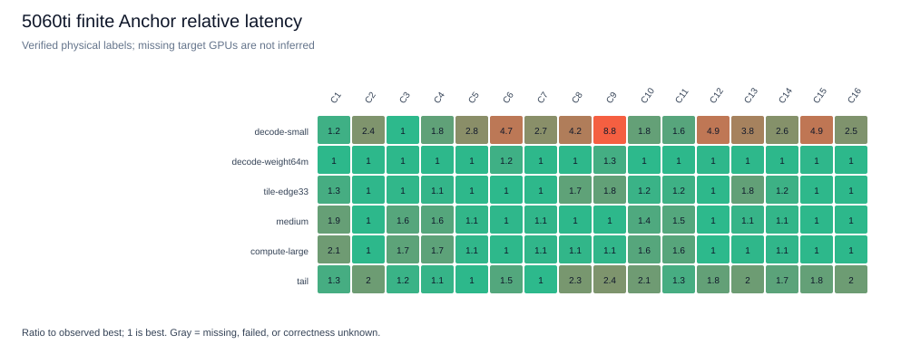
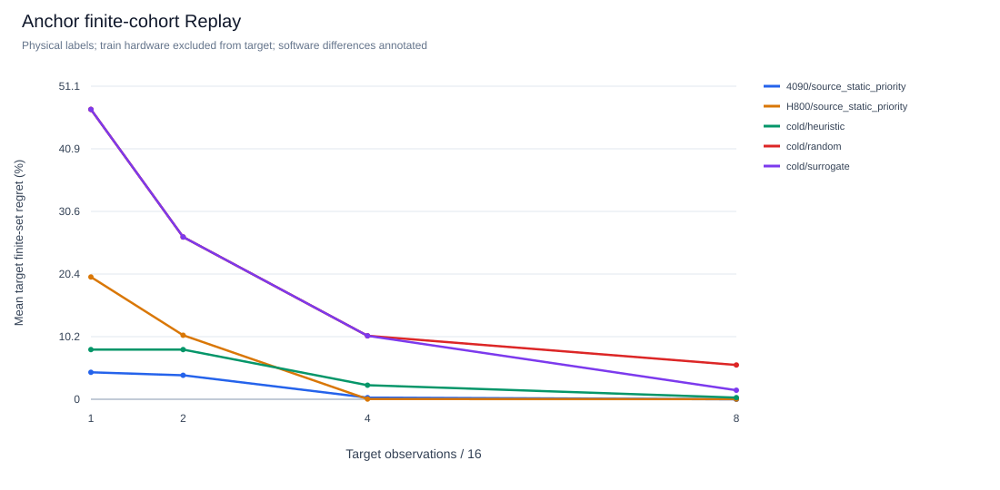

# 5060 Ti交付收尾与跨硬件Anchor

本轮已完成最终代码下新的5060 Ti Anchor：**6 Shape × 16配置 × 2输入run，192/192次新观测通过GPU数值验证**。4090和H800仅完成正常SSH及只读资源检查，尚未确认单卡分配、执行规范和workspace，未部署、安装或运行GPU负载。因此当前没有配对GPU数据，没有跨硬件迁移结论。异机备份也因没有授权目的地而受阻。

精简结果：[summary](data/crossgpu-anchor-summary.json)、[标准有限矩阵](data/crossgpu-anchor-5060ti-matrix.json)。原始样本、完整环境、源码锁、失败/attempt日志、标准SQLite/JSONL及编译产物另行本地归档，不随Git公开。

## 1. 准确版本与交付入口

起点为干净的 `research/5060ti-readiness`，commit `35ac36ed66becf19271c9ed3e97950fb67a03d87`。独立开发分支为 `research/crossgpu-anchor`，没有合并main、移动标签或覆盖旧分支。

**所有本轮GPU采集固定在 `6ecde2ed6c6778bec4c68be0c326a3320212f43c`。** T1、参考、Runner、缓存和存储与35ac的字节完全一致；该commit先提交冻结规格，再采集。后续分析代码不改变这批观测的源码版本。[runtime-sources.json](../examples/crossgpu_anchor/runtime-sources.json)锁定实现、参考、Torch上下文和计时驱动的SHA256；分析器同时核对原始assets.lock及manifest，拒绝换源码或计时口径的记录。

| 对象 | 固定标识 |
|---|---|
| main | `12cca3a724caa19427a29a0eabecf75b65740700`，不包含readiness交付 |
| readiness | `35ac36ed66becf19271c9ed3e97950fb67a03d87`，领先main 40个commit |
| Anchor cohort | `0bf1376584fecd9c4ea19b0ba5027209c7a905ec875790f6b4f4e9dc380a1f16` |
| 正式spec SHA256 | `39713e46e9af6513e6ed34f5cf1ab6c4d11a798cfdb43a0a99a0493b33ad28b2` |
| 5060 Ti数据集ID | `f3417be6a57d4a24ae8e468a0eb5b628d3c4a3008cb1878c0571f0c6e481cdea` |

README/Quickstart现在给出验证分支及准确35ac checkout，避免普通clone得到旧main。建议分两次审查：

1. PR1 `research/5060ti-readiness` → main，建议标题“Validated CUDA research workflow, T1 datasets and readiness acceptance”。范围是Graph/正确性/预算/缓存加固、SDK研究入口、T1与L2/L3、CPU/wheel/plugin验收和精简证据；readiness验证为355 CPU通过、11 opt-in跳过，另11实际GPU案例及80严格Smoke。保留有限覆盖和Config Budget区别等限制。
2. PR2为本跨GPU分支的增量：冻结Anchor、精确版本入口、离线分析/审计、备份选择修正及去敏化结果。PR1合并后可再评审此增量；这里仅准备建议，不创建或合并PR。

## 2. 旧数据保护与备份

四个正式归档重新校验SHA256通过，清单可找到SQLite、JSONL、日志、配置和源码证据；Phase1/2另有PTX/CUBIN及源码bundle。**Phase2选最终v2**，未把被替代的初次封存作为输入，也未修改旧封存目录。

另外以只读流式方式逐项核对四份封存inventory，共21,115个文件的大小与SHA全部一致，分别2,439 / 3,444 / 6,618 / 8,614项。核对的是归档内原字节，不用可变工作目录代替证据。

| 正式归档 | 字节 | SHA256 |
|---|---:|---|
| `5060ti-evidence-20261025.tar.gz` | 6,399,985 | `2bd56c0c31d47790d73c737e2f6b8676c6d86f91f8cb2979e4713452a0683774` |
| `research-workflow-evidence-20261025.tar.gz` | 3,113,563 | `431538aaca28714710dfd8c2dd8d4f8629ffaf5a5c90803476f3a39074b56987` |
| `research-phase1-evidence-20261025.tar.gz` | 30,080,535 | `1fbc2625417723030545c1ff5855558376bda671a3a713a86a0bdbce2420b12f` |
| `research-phase2-evidence-20261026-v2.tar.gz` | 59,911,403 | `84c057ff1a592e06df4d9a65f8898893025e7ed343d90d27ec91b3ac6f4c4ed4` |

异机备份是明确的交付阻塞项，没有用共享GPU服务器当备份。拿到授权的挂载目录后可运行：

```bash
KT_BACKUP_DIR=/authorized/mounted/backup bash scripts/backup_research_artifacts.sh
# 接收端在该目录逐一执行：sha256sum -c <archive>.tar.gz.sha256
```

脚本现在优先选择Phase2 v2，仍保留旧源文件；已有错误目的文件会报校验失败，不覆盖。两个使用小型合成文件的回归测试验证这两点，不冒充真实异机备份。

本轮本地Anchor另封存为 `cross-gpu-phase1-evidence-20261026.tar.gz`，4,555,208 bytes，SHA256 **`13482d4c9634123cb65258278972b7e1aba7eabffca4ac2215e386b0f3a2ff09`**。738项inventory逐一校验；10个SQLite执行quick_check、WAL checkpoint并显式关闭后再封存。归档含采集commit6ec、分析commit `3ed0d898ff5aa78872a48b35a82b631925befa75` 的完整源码bundle、Pilot/正式日志、全部原记录和匹配编译产物，另含私有只读资源日志，权限0600，未上传GitHub或共享服务器。

已从该归档恢复到临时私有目录，重跑192条原记录、5400次Replay揭示和源码bundle验证通过，再删除测试临时目录；归档本身未改动。[公开封存证明](data/crossgpu-anchor-archive.json)记录SHA、准确commit及恢复校验。此过程验证可恢复性，仍不等于异机备份完成。后续目标GPU产生新数据应另做带版本的封存，不覆盖此快照。

## 3. 两台远端的只读验收

使用现有SSH别名和正常主机密钥验证，以普通账户检查；未用sudo、agent forwarding、信任绕过、系统修改、其他用户文件或GPU负载。内部主机/账户、UUID、路径、资源说明及原始资源日志仅存本地private记录，不进入公开结果。

| 目标 | 非敏感只读事实 | 当前门禁与实际执行 |
|---|---|---|
| RTX4090服务器 | 可见8张4090，每卡驱动可见23,028 MiB，驱动550.54.15；系统Python3.6.8 | SSH passed；部分卡显存已占用；GPU索引、分配/调度、用户配额及workspace未确认；部署/安装/GPU负载均0 |
| H800服务器 | 可见8张H800，每卡81,559 MiB，驱动535.216.03；系统Python3.9.9，默认环境无Torch/Triton | SSH passed；只读瞬间空闲不代表已分配；允许的容器/环境、单卡和workspace未确认；部署/安装/GPU负载均0 |

初始PATH未发现Slurm/PBS命令、没有分配环境变量，不能据此断言不存在调度规范。可见CPU/RAM/磁盘总量也不等于用户配额。一次无界文件系统查询超时后，改用有12秒期限的本地文件系统只读检查；未据此判断GPU故障。没有遍历他人目录。

补查当前用户可见的账户初始化入口，只发现目录和会话隔离逻辑，没有查得具体GPU分配或时长/资源额度。仅只读源码，未修改或另外运行这些管理脚本；仍不能据此放行GPU实验。该补查原始记录另存本地private目录。

**继续远端执行前需要每台的获准单卡索引/UUID、允许的直接交互/调度/容器方式、最长任务时长和CPU/RAM额度、项目/环境/结果workspace。** GPU空闲及SSH可用都不足以替代这些信息。此门禁来自本轮任务的服务器使用要求。H20本轮未连接。

535/550驱动不能直接套用5060 Ti的cu132锁文件。先沿用获准容器/模块或只读复用已批准环境，再选独立兼容环境；不升级全局驱动、CUDA或系统Python。系统nvcc、驱动版本和Torch CUDA Runtime分别记录。CUDA minor compatibility也有PTX/新特性限制，参见[NVIDIA兼容性说明](https://docs.nvidia.com/deploy/cuda-compatibility/610/minor-version-compatibility.html)与[PyTorch官方安装版本](https://pytorch.org/get-started/previous-versions/)。本轮尚未选择或验证远端依赖版本。

## 4. 冻结设计、预算与实际资源

[设计规格](../examples/crossgpu_anchor/frozen-design.json)、[SDK配置与命令](../examples/crossgpu_anchor/README.md)使用原v2 Runner和cohort插件，不增加Runner或数据库。以下Shape均有5060 Ti历史探索证据，不能包装为该卡盲测；候选在获得4090/H800延迟前冻结。

| Shape M/N/K | 预先关注的问题 |
|---|---|
| 1/2048/2048 | 单token、低M并行度，BM16/warp差异 |
| 4/8192/4096 | 64 MiB权重，超过实测5060 Ti的32 MiB L2；是否访存受限仍需计数器验证 |
| 33/2048/2048 | BM32/64边界及尾块 |
| 512/1024/1024 | 中等M、分块与资源平衡 |
| 1024/2048/2048 | 较大计算量及调度对照 |
| 63/1031/1025 | 三轴尾块与tile边界 |

16配置包括旧通用BM32/BN128/BK32/w4/stage3/G1、BM16/32/64、BN32/64/128、BK32/64、warps4/8和配对stage2、GROUP8控制，精确顺序C1…C16见冻结JSON。不是底层192点Cartesian域的穷举；独立验收可能另取域内配置，其记录不进入主矩阵。

cohort插件按 `input_seed + int(shape.id[:8],16)` 对冻结候选做可复现shuffle，再按已观测history去重；输入run改变测试顺序。它不读性能表，也没有内置autotuner。

主协议为FP16，连续row-major A[M,K]/B[K,N]/C[M,N]，输入seed7/19两次物理run，warmup10，31个原始样本，Graph512 **完整GPU计划的Event摊销时间**。build、输入/参考、setup、allocation和capture不在latency内；initialize及全部有序GPU步骤在内，当前T1为一步。严格参考、输入完整性、输出poison和最终计时输出检查均保留，trust_claims=false。Graph重复使用相同缓冲，是热态协议，不代表冷缓存或端到端主机调用。

| 每张获准GPU的阶段 | 最大搜索观测 | 独立验收 | 外层硬墙钟 |
|---|---:|---:|---:|
| 最小T1 FP16/BF16/tail检查 | 16 | 最多16 | 建议600秒 |
| 原四类十dtype严格gate | 80 | 脚本内严格检查 | 建议1200秒 |
| Anchor Pilot：3 Shape×4配置×2run | 24 | 24 | 600秒 |
| 正式：6 Shape×16配置×2run | 192 | 48 | 1200秒 |

以上是分阶段停止上限，并非已获得远端60分钟GPU配额；按服务器实际额度裁剪或另行确认。环境安装耗时/磁盘另计。正式192条record内部有 **3,047,424次计时计划调用**，单编译/测量worker、无多卡、无并发性能任务。单次workspace上限256 MiB；主机/GPU各2 GiB是本地准入估计，不是已在远端施加的OS内存硬限制。远端编译器可能不同，应先Pilot复核。

5060 Ti实际：Pilot 6/6 job、24新观测、24独立验收，131.915秒；最大单条source墙钟6.743秒，重复CV中位数0.044%、最大0.672%，据此放行原冻结矩阵。正式12/12 job、192新观测、0缓存、48独立验收，job墙钟396.122秒，外层实测396.56秒，均未触及1200秒。

正式最大进程RSS为1,360,632 KiB（约1.30 GiB，非进程组聚合峰值），全设备遥测最大显存1499 MiB，含桌面。温度35–64℃、SM频率382–2737 MHz包括编译/空闲，不能归因到某个配置。所有GPU性能测量串行执行，CPU测试在采集结束后进行。

## 5. 新5060 Ti结果与质量边界

实际环境为RTX5060 Ti / sm_120 / 36 SM / probe可见显存17,074,421,760 bytes / L2 33,554,432 bytes；驱动616.92、Python3.12.13、Torch2.13.0+cu132、CUDA Runtime13.2、Triton3.7.1。数学精度/autocast/BLAS选择及编译覆盖设置进入原记录，公开摘要去掉机器路径和设备UUID。

| Shape M/N/K | 有限16配置内最好 | 延迟µs | 旧通用C2的相对损失 |
|---|---|---:|---:|
| 1/2048/2048 | C3：BM16/BN64/BK64/w8/s3/G1 | 6.720 | 144.41% |
| 4/8192/4096 | C10：BM16/BN128/BK32/w4/s3/G1 | 160.643 | 0.61% |
| 33/2048/2048 | C6：BM64/BN64/BK64/w4/s3/G1 | 15.712 | 2.45% |
| 512/1024/1024 | C12：BM64/BN64/BK32/w4/s3/G1 | 27.305 | 1.09% |
| 1024/2048/2048 | C12 | 191.529 | 0.13% |
| 63/1031/1025 | C7：BM32/BN64/BK64/w8/s3/G1 | 11.612 | 101.21% |

这里采用同cell两run的全部样本中位数；搜索Replay分别使用各输入run的标签，不把62个内部样本当62次独立实验。96个cell的两run延迟中位数CV：中位0.056%、P90 0.553%、最大1.189%。大Shape前两名差约0.08–0.15%，不能据点估计断言显著优越。低M和tail差距较大，但没有计数器证据时不把带宽/占用率解释写成因果事实。



旧通用C2在本cohort平均损失41.65%、最大144.41%；本集合内按等权平均损失事后挑出的最佳单配置为C3，平均24.77%、最大70.06%。这是本次六个历史Shape上的描述，不是新留出泛化或跨GPU稳定规律，也不覆盖更大的Phase2 C48空间。未重写旧矩阵/旧分析范围。

正式source测量墙钟合计320.493秒；准备15.717秒、初始正确性24.437秒、warmup0.282秒、measurement阶段264.330秒、最终检查7.948秒、preflight/cache1.037秒、compile6.735秒。compile内部包含build3.847秒、setup0.001秒、Graph capture2.880秒，**子项不能再相加到compile之外**。既有Triton缓存未清空，此成本不代表独立冷启动编译。job墙钟另含独立验收、预检与调度，不用source时长冒充完整调优成本。

按record中的原始SHA归档到95个不同CUBIN，共3,158,792容器bytes、565,248个ELF .text bytes，均验证匹配。去重二进制数量不等于编译key数，也不是部署/driver驻留体积；这里没有声称解决物理变体预算优化。

## 6. Reveal-only Replay与待执行迁移

本轮已运行1440条 **5060 Ti冷启动离线Replay**：Random、Heuristic、Surrogate，B=1/2/4/8，6 Shape×2物理input-run×10算法RNG。每个B/算法120条，其中确定性Heuristic的RNG重复不构成独立证据；真正物理重复每cell只有2次。没有新增GPU测量，没有使用目标oracle标签生成候选。

| B / 16候选比例 | Random平均regret | Heuristic | Surrogate |
|---|---:|---:|---:|
| 1 / 6.25% | 47.30% | 8.11% | 47.30% |
| 2 / 12.5% | 26.48% | 8.11% | 26.48% |
| 4 / 25% | 10.35% | 2.29% | 10.35% |
| 8 / 50% | 5.59% | 0.27% | 1.47% |

B8时5%以内比例分别83.33%/100%/93.33%，没有失败或缺失观测。Surrogate先进行随机初始化，因此小B与Random相同；这不是学习方法普遍有效/无效的结论。曲线统计仅适用于这个共同的有限候选集合与历史Shape。B8占一半，不能证明1%穷举成本目标。



公开分析器预备的跨硬件协议：

- 每GPU/软件上下文单独构造标准PerformanceMatrix；共同候选只取各卡所有选定Shape/input-run都编译和数值通过的交集。未执行卡不会由静态Profile推断通过。当前 `common_config_count=null`、配对方向0。
- 对同Shape计算各GPU独立绝对延迟/排名、Spearman、Top5/10/20%交集（16候选向上取整为1/2/4）。source Top1迁移损失以**target同集合的已测最好**为分母；source Top-K中target最小值只标作事后oracle覆盖，不冒充B0选择器。
- 派生硬件留出fold保留原record ID及原split，原物理记录不重写。B0仅用source Top1；B1/2/4/8比较Random、Heuristic、source固定优先序、兼容的Transfer及Surrogate。优先序只用source标签，后续history仅含已揭示观测。
- Transfer要求完整资产/实现指纹兼容；Python/依赖导致指纹不同则记录not_applicable，不强改身份绕过。源历史获取成本和目标已知source成本分开，不由共享数据推断冷启动墙钟优势。
- pairing核对冻结commit、源码字节和正确性/计时协议；软件环境各自保存并标注混杂。跨软件相同seed可能生成不同实际输入，另比较原始输入hash，不能声称已实现纯架构因果隔离。

**零目标测量迁移、跨GPU排名/Top重叠、小预算硬件迁移Replay及在线复核目前全部not_executed。** 仅本地数据不足以回答哪种规律能跨GPU迁移、哪些参数在Ada/Hopper失效或少量反馈能否恢复性能。

## 7. 复现、恢复与条件部署

在已经获得GPU使用许可和兼容独立环境后，采集使用准确commit；不要把浮动分支HEAD当实验源码：

```bash
git clone --branch research/crossgpu-anchor https://github.com/MingASA/KernelTuningLab.git
cd KernelTuningLab
git checkout --detach 6ecde2ed6c6778bec4c68be0c326a3320212f43c
# 环境安装/probe → 最小T1/tail → 原四类严格Smoke → Pilot → 正式Anchor
timeout --signal=INT --kill-after=30s 600s .venv/bin/python scripts/collect_phase1.py \
  --spec examples/crossgpu_anchor/pilot.json --output artifacts/crossgpu-local/pilot
timeout --signal=INT --kill-after=30s 1200s .venv/bin/python scripts/collect_phase1.py \
  --spec examples/crossgpu_anchor/anchor.json --output artifacts/crossgpu-local/anchor
```

必须使用分配给当前用户的执行方式和单GPU；已有调度器分配不能另改可见设备绕过。每卡单独输出，不上传本地venv、5060 Ti的缓存/PTX/CUBIN或旧大型归档。GitHub不可达时已准备并verify一个887,517-byte的纯Git源码bundle，SHA在summary中；**尚未传输**，也不包含环境/认证/原始数据。部署前仍须确认新工作目录，不能覆盖既有仓库。

原命令和output用于恢复；相同spec/源码/环境时复用兼容缓存，不将命中计作新测量，attempt和失败保留。改变关键软件版本后新建输出，不能混入旧矩阵。不使用未经允许的tmux/nohup或常驻服务。

以下离线步骤在本研究分支的分析代码运行，不需要Torch或GPU。将获准回传的数据分别放到对应label根目录；缺失目录会明确保留not_executed：

```bash
python scripts/analyze_cross_gpu.py \
  --dataset 5060ti=artifacts/cross-gpu-phase1/5060ti/anchor \
  --dataset 4090=artifacts/cross-gpu-phase1/4090/anchor \
  --dataset H800=artifacts/cross-gpu-phase1/H800/anchor \
  --output artifacts/cross-gpu-phase1/analysis
python scripts/audit_cross_gpu.py --root artifacts/cross-gpu-phase1
python scripts/summarize_cross_gpu.py --root artifacts/cross-gpu-phase1
```

标准Store导出在 `analysis/datasets/<dataset-id>/measurements.sqlite` 和 `measurements.jsonl`，完整record逐字段导入回读一致；公开矩阵可由原L3接口读取。精简JSON不替代Replay的完整物理标签。审计核对192原record、5400次Replay揭示的真实ID/预算/已观测best/成本，以及95个原始CUBIN SHA。发布器只消费本次分析声明且哈希匹配的矩阵，不因旧文件残留把未执行GPU发布成实测。

使用 `python -S` 关闭site-packages也实际通过同一完整数据审计，确认没有导入Torch/Triton。分析依赖标准库和现有CPU包，不需要远程GPU或另建数据库。

## 8. 验收表与下一步研究

| 项目 | 状态 | 证据/限制 |
|---|---|---|
| 本地基线、四正式旧归档SHA和清单 | passed | summary.prior_archive_checks；最终Phase2 v2，旧数据未覆盖 |
| 本轮证据封存与恢复 | passed | 738文件/10 SQLite；临时恢复后原记录与Replay审计通过；只在本地 |
| 异机备份 | blocked | 没有授权目的地，本地归档不等于备份完成 |
| 新Anchor本地GPU | passed | Pilot24+正式192；主矩阵96/96 cell、2/2输入run，正式0失败/0缓存 |
| CPU与新增回归 | passed | 366 passed / 11 opt-in skipped；11项本轮定向回归通过；GPU采集后执行 |
| 数据导出/Replay/编译SHA审计 | passed | 标准Store全记录roundtrip、1440 Replay / 5400揭示、95 CUBIN校验 |
| 4090/H800只读SSH | passed | 仅环境/资源观察，公开摘要去敏化 |
| 4090/H800迁移脚本 | partial | 本地write-only已生成；目标GPU执行、安装与Smoke未执行 |
| 4090/H800部署、GPU Smoke、Anchor | blocked | 资源分配、规范、配额、workspace未确认 |
| 配对GPU共同合法范围、迁移/在线对照 | not_executed | 不能把5060 Ti 16点成功推成三卡共同范围 |
| H20/H200 | not_executed | H20本轮未连接；H200未部署，无伪造Profile或性能 |

分析提交3ed0d89的[GitHub CPU CI](https://github.com/MingASA/KernelTuningLab/actions/runs/40307016749)已在Python3.10/3.12均成功。封存证明是后续纯文档提交，不改变采集或分析源码身份。

下一步最值得检验的硬件感知问题是：低M的BM/warp先验是否能跨SM数量和L2变化保持；源卡固定Top配置在哪些Shape失效且B1/2/4反馈能修复多少；同源码在不同软件栈下的lowering/资源变化有多少会混入“硬件迁移”效果。目前这些都是待检验问题，只有本地Anchor及可执行协议，没有多GPU实验支持。

先完成4090再H800的获准最小验收和此Anchor，依据重复性、共同覆盖与效应量决定是否扩大。扩大前另报Shape/config/seed数、GPU墙钟、CPU/RAM/存储和恢复方案，并取得超过现有额度所需的授权。H20以后用真实probe建立可信Profile；H200同样重新确认单卡权限、驱动环境、T1共同cohort和独立编译，不能传输5060 Ti二进制当迁移成功。
