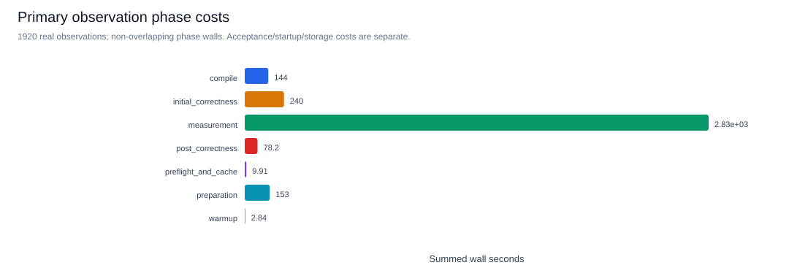
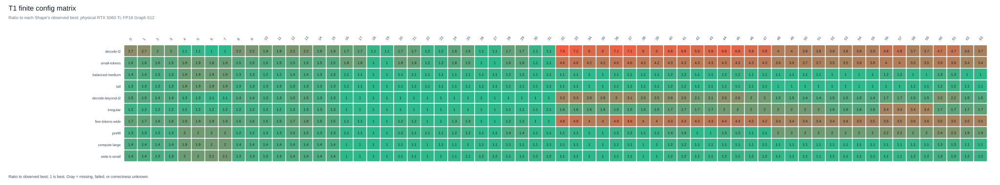
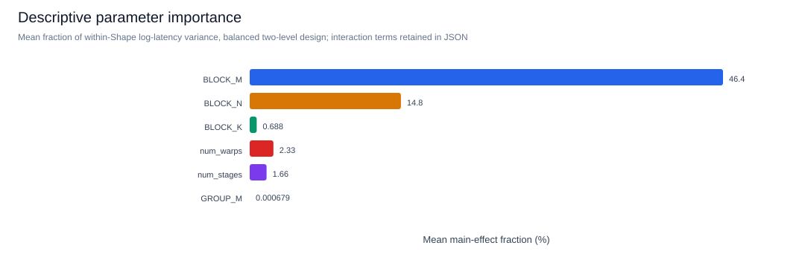
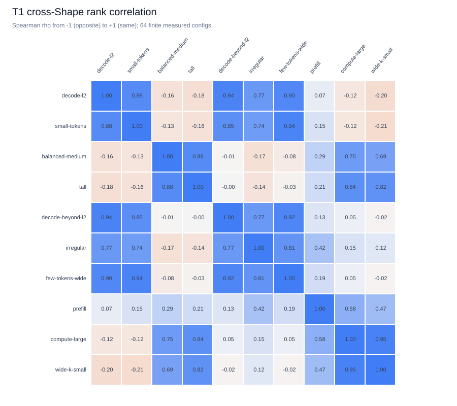
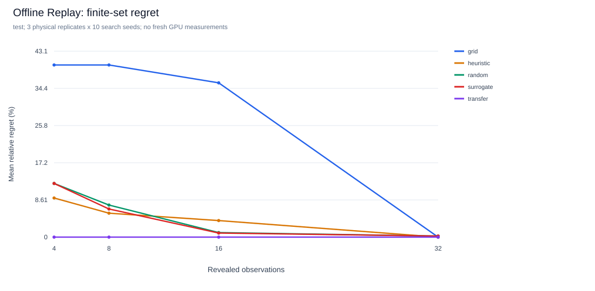
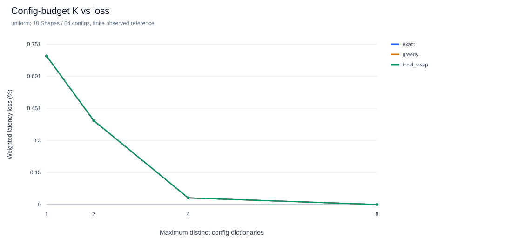
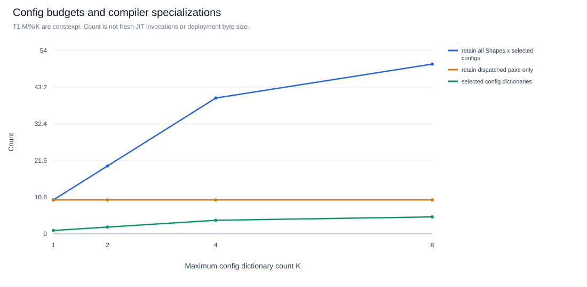
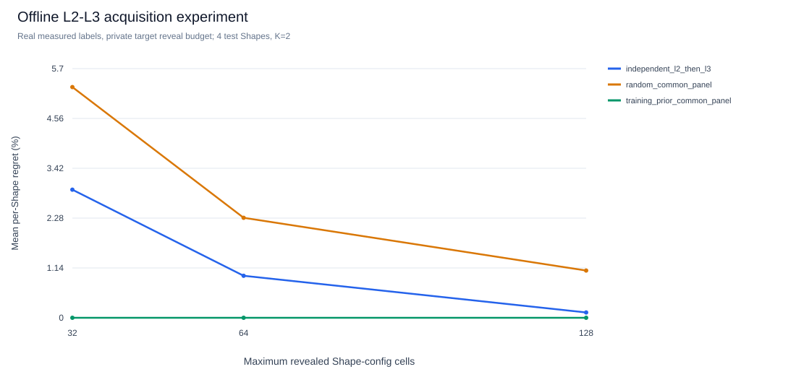
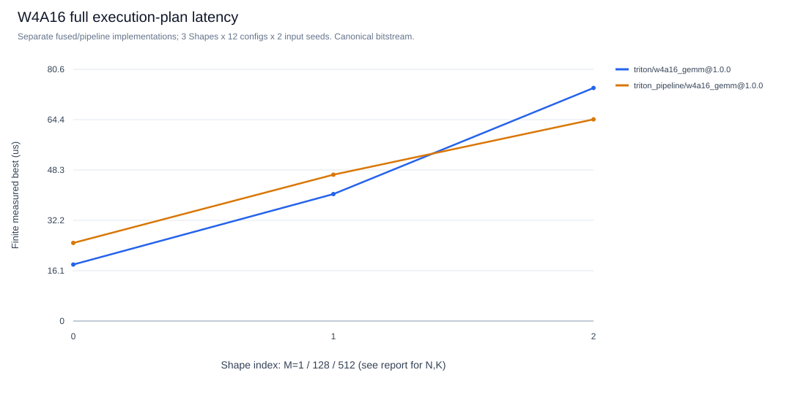

# 第一阶段配置空间研究：T1 / RTX 5060 Ti

本研究从已验证的 `9393d17` 创建独立分支 `research/shape-config-matrix`。原验证分支和 `main` 保持不动。研究问题是配置偏好如何随 Shape 改变、有限观测预算能否利用这些规律，以及少量配置覆盖多个 Shape 时到底限制了什么。

## 已冻结的设计与协议

T1 是 `triton/t1_gemm@1.0.0`，通过现有 SDK 自动接入，复用原 GEMM 的输入与独立 FP32 参考。保留 `triton/gemm@1.0.0` 受控基线，增加固定的 `torch/mm@1.0.0` 库基线。T1 使用 Tensor Core 分块、递增指针、软件流水线和 grouped program ordering，所有搜索均由平台显式执行，没有内置 autotuner、融合激活或数学语义变化。

实现参考 [Triton 官方教程 03](https://triton-lang.org/main/getting-started/tutorials/03-matrix-multiplication.html)，保留 [MIT 许可](../third_party/triton-tutorial-LICENSE)。实际代码和依赖文件指纹由资产系统绑定，每条记录保留执行时的真实环境。

受控空间为六个实际参数各两个值，共 64 配置：BM=32/128、BN=32/128、BK=32/64、warps=4/8、stages=2/3、GROUP_M=1/8。原始实现的更大 SDK 空间未被宣称穷尽。GROUP_M 改变多行 tile 的执行顺序；单个 M tile 时会退化，不能将该 Shape 下两个 GROUP_M 值的微小波动解释为调度收益。大 tile/高 stage 的理论操作数暂存量可达 98,304 bytes，最终仍检查实际编译 shared memory，未仅依赖估计。

10 个 Shape 的理由、固定的整 Shape train/validation/test 划分与输入规模在 [shape-design.json](../examples/research_phase1/shape-design.json)。低 M 覆盖 B 位于 L2 内、接近 L2 和超过 32 MiB L2 的情况；其他 Shape 覆盖计算型、长宽矩阵、N/K 比例和三轴尾块。最大原始 FP16 输入/输出约 64 MiB，另计 FP32 参考、输入完整性检查、编译器内存与 Graph；Graph 复用缓冲，未分配 512 份输入输出。

主协议：物理 RTX 5060 Ti 16GB / sm_120；Torch 2.13.0+cu132、Triton 3.7.1、CUDA Runtime 13.2、驱动 616.92；Graph 每次重放 512 次完整调用、warmup=10、31 个样本。三轮独立输入 seed=7/19/31；每个 trial 内候选顺序由独立 SDK 插件可复现地打乱。原始样本、配置、dtype、stride、正确性、源码与真实 GPU 身份保留在既有 v2 journal。不同 seed 是不同输入；另有同 seed 的前后锚点检查时间漂移。

正式采集还加入 Runner 源码 SHA256 绑定以及 `phase_wall_time_ms`：准备（含参考）、编译、初始校验、warmup、整个测量回调、最终校验分别计时，异常结束的已知阶段也保留。编译仍含 build/setup/Graph capture，细分在执行元数据中；不要与编译总量重复相加。Graph 样本边界未改变，测量回调墙钟还包括输出 poison、同步和主机循环，不能当作纯 GPU 延迟。旧 Pilot 的这些新字段保持未知，没有回填估算；Torch 基线和前置锚点在相同新协议下重新采集，旧轮次归档保留。源码绑定使旧协议缓存不会静默用于新协议。

Pilot 的 4 Shape × 12 配置 × 2 seed，共 96 次新测量全部通过，另有 32 次独立验收，总 job 墙钟 236.39 秒。两轮中位数相对差的 P50/P90/最大值为 0.82%/1.99%/3.85%。这些只有两轮，不能视作精确置信区间。超过 L2 的 decode 每候选平均实际成本 5.305 秒，因此正式 trial 上限由 180 调到 600 秒，保留样本质量；整轮采集仍用 90 分钟硬期限。

## 复现

沿用 [5060TI_RESULTS.md](5060TI_RESULTS.md) 的项目独立环境，不升级全局驱动或其他项目的软件栈。先检查上轮数据，再串行执行：

```bash
(cd artifacts && sha256sum -c 5060ti-evidence-20261025.tar.gz.sha256)
(cd artifacts && sha256sum -c research-workflow-evidence-20261025.tar.gz.sha256)
.venv/bin/python examples/research_phase1/design.py
.venv/bin/ktlab research --spec examples/research_phase1/matrix.json \
  --output artifacts/research-phase1/plan --write-only
.venv/bin/python scripts/collect_phase1.py --spec examples/research_phase1/correctness.json \
  --output artifacts/research-phase1/correctness
.venv/bin/python scripts/collect_phase1.py --spec examples/research_phase1/pilot.json \
  --output artifacts/research-phase1/pilot
.venv/bin/python scripts/collect_phase1.py --spec examples/research_phase1/library.json \
  --output artifacts/research-phase1/library
.venv/bin/python scripts/collect_phase1.py --spec examples/research_phase1/anchor-before.json \
  --output artifacts/research-phase1/anchor-before
timeout --signal=INT --kill-after=30s 5400s .venv/bin/python scripts/collect_phase1.py \
  --spec examples/research_phase1/matrix.json --output artifacts/research-phase1/matrix
.venv/bin/python scripts/collect_phase1.py --spec examples/research_phase1/anchor-after.json \
  --output artifacts/research-phase1/anchor-after
.venv/bin/python scripts/analyze_phase1.py --matrix artifacts/research-phase1/matrix \
  --library artifacts/research-phase1/library --simple artifacts/research-phase1/simple \
  --output artifacts/research-phase1/analysis
```

先运行对应的 `simple.json`、`bf16.json`、`w4.json` 才能分析这些补充实验。主矩阵是 1,920 次研究测量，独立验收最多 120 次；不是“预算64，整套只测64次”。所有 GPU 执行串行；采集脚本只为 `ktlab research` 增加每两秒的只读温度/频率/功耗/利用率采样，没有第二套 Runner 或数据库。重跑同一命令重新验收、缓存已完成候选，缓存不算新物理测量。

## 数据选择与研究纪律

分析只读取当前 suite 各 trial 明确揭示的 record ID，不扫描累计 journal 捡最好成绩。原始记录通过现有 `ExperimentStore` 导出到按记录 ID 集合 SHA256 版本化的标准 SQLite/JSONL，入口是分析目录的 `dataset-manifest.json`。可用 `ExperimentStore.import_jsonl` 导入其他实验数据库；原 record ID、计时/正确性/源码语义不变。`coverage.json` 明确列出每个 Shape/config/seed 的缺失与失败。若任何正式格子缺测，脚本保留部分矩阵并拒绝宣称完整矩阵。

矩阵按每格三轮共 93 个原始样本的中位数聚合，独立 run median 的 CV/范围另列。Replay 每次仅使用一个真实测量轮次，三轮分别重放，避免用三轮测量的总成本冒充一次观测。比较 Random、Grid、已有 Heuristic、已有 Surrogate 和 Transfer；预算4/8/16/32，搜索 seed=0..9。Transfer 只读预先划定的四个 train Shape；validation/test 从未提供训练标签。已测全表最优仅用于最终评分，不交给搜索器。其成本是原记录成本的 Replay，新增 GPU 测量为0，不等同于冷启动真实调优墙钟。

L2–L3 联合探索也是离线选择模拟：4 个 test Shape、K=2、32/64/128 个已揭示 cell 上限。独立 L2 流程为候选补测预留预算；公共面板方法每个候选在所有目标 Shape 测量。训练先验只用 train Shape，所有目标标签均通过收费 reveal。未揭示的已测全表只在最后评分。不同方法实际花费可低于上限，必须同时报告。

## L3 的三个预算

现有 Solver 限制 **Config Budget**：至多 K 个配置参数字典。新的 `config_count` / `budget_kind=config_count` 为正式字段；旧 `variant_count` 保留为兼容别名，含义仍是配置数。

**Compiled Variant Budget** 限制真实编译特化。T1 的 M/N/K、stride 和 tile 都是 constexpr；同一配置跨不同 Shape 不能假定共用二进制。实际 Triton compiler cache identity、PTX/cubin SHA256 及产物 bytes 由 `record_compiled_kernel` 保存。多步骤量化路径分别记录每个 Kernel。Torch 内部 dispatch 的身份未知，保持未知。

**Binary / Code Size Budget** 限制部署代码体积。本轮可统计去重 cubin ELF 容器大小，但这包含元数据，不等于纯指令段、驱动常驻内存或最终部署包体积。已有 Solver 未求解后二者。分析分别统计“选定配置 × 所有已知 Shape 全保留”和“仅按最终分派所需特化保留”，不能将一种部署策略的计数冒充另一种。

正式 L3 使用10 Shape，显著多于K=1/2/4/8。均匀权重与明确合成的 decode 偏斜权重分开；没有真实线上概率。精确 oracle 可先删去在所有已测 Shape 上被另一配置支配的列，这是有限表的精确简化；仍超枚举上限时明确未计算，另有预先确定的16配置子集 exact。报告同时给出加权绝对延迟目标和逐 Shape 相对损失。

## 跨硬件准备与备份

[cross-hardware](../examples/research_phase1/cross-hardware) 保留同一 T1 源码、Shape、dtype、64候选与计时协议，分别输出到独立目录。H200/H800 规格选择现有明确的 SXM Profile；4090 选择桌面版。H20 没有已验证 Profile，配置 `hardware=null`，使用实际 probe 保存真实属性，不能填一个猜测的 H20 规格。

本轮没有其他 GPU 实测。共同合法子集应由各 GPU 的真实预检/编译/正确性结果取交集；未经执行的配置保持未测试。当前 T1 不使用 Hopper 专属机制，硬件扩展候选另建有标识的 cohort，不能覆盖当前公共候选表。未来迁移统计应分别报告公共已测子集中的 Top 配置迁移损失、Spearman 相关、覆盖和失败率，并检查实现/协议身份。仅有一张 GPU 时不执行 Leave-One-GPU-Out 训练评估。

旧归档均做 SHA256、单次流式读取和本地 SQLite quick_check：最初 GPU 验证归档2,440文件/99个现存 journal，工作流归档3,445文件/19个现存 journal。未发现损坏。没有已授权的外部备份目的地，因此未自动上传。可在确认挂载目的地后执行：

```bash
KT_BACKUP_DIR=/your/authorized/mounted-backup bash scripts/backup_research_artifacts.sh
```

该脚本先验证源归档，复制后再次验证，不覆盖已有文件，不访问外部上传服务。原始产物保持在被 Git 忽略的 `artifacts/research-phase1/`；最终另做归档及校验，公开 Git 只保存配置、代码、精简证据和图表。

## 实测范围与数据版本

主采集冻结在 **`97cc869b4ddeb96a4991c56597e6d93c6efd88e1`**，run ID 为 `fe1c3f4c6eb2408eabf14540f01323f9`。离线分析、审计与汇总代码提交为 **`1852829`**，summary还保存各分析脚本SHA256。后续提交增加分析、实验规格和报告，未更改正式采集的 Kernel、Runner 或 CUDA Graph 计时实现。主数据集 ID 是原始 record ID 排序集合的 SHA256：

`c1996b97f16e2e1020b6c0326b8877d8a15eb601f12d10b7276698ccc917d3c5`

该 ID 标识**本次原始观测集合**；其他机器重新测量会产生新的 ID。协议、源码指纹及软件栈可比较性仍需另行检查。精简证据见 [summary.json](data/research-phase1-summary.json)，可直接用于现有 L3 的标准序列化矩阵见 [matrix.json](data/research-phase1-matrix.json)。原始 SQLite/JSONL 是 Replay 的输入，不能用聚合矩阵代替包含真实成本的原记录。

| 本轮当前有效 suite | 新物理研究测量 | 缓存观测 | 独立验收次数 | 覆盖范围 |
|---|---:|---:|---:|---|
| T1 尾块正确性 | 192 | 0 | 16 | 4 边界 Shape × 12 配置 × FP16/BF16 × 2 seed |
| Pilot | 96 | 0 | 32 | 4 Shape × 12 配置 × 2 seed |
| **正式 FP16 主矩阵** | **1,920** | **0** | **120** | **10 Shape × 64 配置 × 3 seed，100%** |
| BF16 补充 | 96 | 0 | 32 | 4 Shape × 12 配置 × 2 seed，有限采样 |
| Torch 库基线 | 30 | 0 | 120 | 10 Shape × 固定实现 × 3 seed |
| Torch 稳定性复测 | 9 | 0 | 36 | 3 Shape × 3 seed |
| 前/后锚点 | 18 / 18 | 0 | 36 / 36 | 同 3 Shape × 2 配置 × 3 seed |
| 原简单 GEMM | 180 | 0 | 120 | 10 Shape × 6 配置 × 3 seed |
| 中间 tile 探索 | 72 | 0 | 48 | 4 Shape × 6 额外配置 × 3 seed |
| W4A16 | 144 | 0 | 16 | 2 实现 × 3 Shape × 12 配置 × 2 seed |
| 新 GPU 搜索轨迹 | 35 | 13 | 24 | 2 test Shape × 3 算法 × B8 × seed7 |

主矩阵 30/30 jobs 通过，640/640 单元格都有 3 轮正确性通过的真实测量，共 **59,520 个 latency samples**，定时 Graph 中实际执行 **30,474,240 次完整算子调用**。总 job 墙钟 **3,722.44 秒（62.04 分钟）**，在 90 分钟外层期限内。未发生主矩阵编译、数值、运行或资源失败；不是将失败改写为成功。研究空间之外的 SDK 候选以及未覆盖的 BF16 单元格都仍为未测试。

初次尾块验收曾在通用 acceptance space 中触发研究 cohort 插件的空间假设，4 个 jobs 在预检阶段失败，**没有 GPU 观测**。保留原 attempts/logs，修正插件以使用 SDK 提供的实际有限空间；研究空间仍按显式 cohort 运行。另发现旧 Runner 缺少分阶段墙钟，已先保存复现，再增加成本记录和缓存源码绑定；旧结果未补造这些字段。相应回归在 `test_phase1_analysis.py`、T1 资产及 measurement runtime 测试中。

## 测量稳定性、成本与可比基线

每格独立 run median 的 CV：全表中位数 **0.414%**、P90 **0.939%**。前后 18 对同 Shape/config/input-seed 锚点，延迟相对变化中位数 **+1.014%**，最大绝对变化 **4.160%**。只有 3 个独立输入轮次，尚不足以给出精确置信区间。测试顺序按 trial seed 打乱，并未锁频、清空桌面负载或将输入变为冷缓存。

每两秒的遥测包含编译和空闲阶段：主轮温度 33–63°C、SM 时钟 757–2737 MHz、功耗 13.56–182.36 W、显存占用 782–1613 MiB。不能将这些整轮范围当作某个配置的稳态频率，也没有硬件计数器证据来证明具体瓶颈。

主轮原始 observation 墙钟合计 **3,462.48 秒**，余下 job 成本含验收、进程启动和存储等。新增非重叠阶段合计：准备 152.99 秒、编译回调 143.97 秒、初始校验 240.10 秒、warmup 2.84 秒、测量回调 2,834.37 秒、最终校验 78.23 秒、预检/缓存 9.91 秒。编译内部已知 build 118.79 秒、Graph setup/capture 25.09 秒，是编译回调的组成部分。定时 GPU Event 合计 2,720.92 秒也是测量回调的组成部分，不能重复相加。编译器磁盘缓存可能已热，以上不是全新 CUDA 软件栈的冷 JIT 成本。



原简单 GEMM 与 T1 的 6 个相同 tile/warp/stage、T1 GROUP_M=1 候选分开比较；完整 T1 best-of-64 的收益不全部归因于实现修改。例如 balanced-medium 的 simple/T1 同候选最优为 28.679/28.797 µs；compute-large 为 206.030/198.578 µs；small-tokens 为 18.610/24.296 µs。**T1 没有在所有 Shape 上优于简单实现**。完整空间的最优分别达到 27.604、192.408、15.491 µs，说明配置选择和实现身份都重要，旧实现继续保留。

同语义、连续 FP16、预分配输出、同 Graph512 协议的 Torch 对照中，balanced-medium 的 Torch/T1 为 27.877/27.604 µs，compute-large 为 191.975/192.408 µs；差异与本轮噪声同量级。prefill 为 26.950/27.941 µs。T1 在这些负载达到可比库性能，适合作为真实配置空间研究对象，但没有“全面超过 cuBLAS”的结论。

**decode-l2 的 Torch 参考不稳定。** 相同正式协议第一次三轮中位数为 16.047/20.414/12.732 µs，目标复测为 9.510/10.825/9.487 µs，部分 run 内 P10–P90 也很宽；中/大 M 复测则稳定。原因尚未确定，不能归因于未经证明的频率、库选择或计时缺陷。全部原始样本保留，分析用显式质量标记抑制此 Shape 的加速比：run-median CV>5% 或 run 内 P10–P90 相对宽度>10% 时 `unstable_no_speedup_ratio`。这是探索性比较门槛，未修改数值容差或测量成功状态，也不挑选复测中最有利的一轮作分母。

## A：配置偏好与有限空间的盲区

主矩阵每格以 93 个原始样本的中位数汇总。以下是**有限 C64 已测最优**，单位 µs：

| Shape | M × N × K | 最优延迟 |
|---|---|---:|
| decode-l2 | 1 × 2048 × 2048 | 14.794 |
| small-tokens | 16 × 4096 × 2048 | 15.491 |
| balanced-medium | 512 × 1024 × 1024 | 27.604 |
| tall | 2048 × 512 × 1024 | 53.342 |
| decode-beyond-l2 | 1 × 8192 × 4096 | 162.292 |
| irregular | 257 × 769 × 513 | 15.031 |
| few-tokens-wide | 8 × 8192 × 2048 | 30.413 |
| prefill | 128 × 2048 × 2048 | 27.941 |
| compute-large | 1024 × 2048 × 2048 | 192.408 |
| wide-k-small | 512 × 4096 × 512 | 50.168 |



配对比较固定其余 5 个参数；下表先对每 Shape 的 32 对配置取延迟比的几何均值，再列 10 Shape 的中位数。方差比例是平衡 2^6 表的描述性 log-latency 主效应，**不是因果检验或显著性检验**。

| 参数 high / low | 延迟比中位数 | 平均主效应方差占比 |
|---|---:|---:|
| BM 128 / 32 | 1.421 | 46.45% |
| BN 128 / 32 | 0.853 | 14.84% |
| BK 64 / 32 | 0.993 | 0.69% |
| warps 8 / 4 | 1.049 | 2.33% |
| stages 3 / 2 | 0.929 | 1.66% |
| GROUP_M 8 / 1 | 1.000 | 接近 0 |



BM 是最强变化来源，BN 次之；仍约三分之一方差来自交互或更高阶项，不能把主效应直接当作逐 Shape 的最优规则。小 M 的填充计算与中/大 M 的 tile 数、并行度是可检验的解释；本轮未用计数器确认 occupancy 或访存瓶颈。GROUP_M 在当前热态、采样范围内没有稳健平均优势，M 只有一个 tile 时该参数本来就退化；不能据此否定更大工作集或 Hopper 上的 grouped ordering。

全表排名 Spearman 范围 **−0.208 到 0.951**。decode-l2 / decode-beyond-l2 为 0.944，compute-large / wide-k-small 为 0.951；small-tokens / wide-k-small 为 −0.208。平均链接聚类先形成低 M 组和较大 M 组；irregular 的尾块偏好另有差异。**排名相关与近最优可覆盖性不是同一指标**：许多较差候选的顺序变化很大，但少量候选仍能接近多个 Shape 的最好值。



严格 Top-5%/10%/20% 分别取每行前 4/7/13 个配置，10 Shape 全交集大小为 **0/1/2**。Top 边界的微小差别容易受噪声影响，完整 Jaccard 矩阵与重复波动一起保留。配置 `BM32 BN128 BK32 warps4 stages3 GROUP1` 跨 10 Shape 的平均相对损失 **2.012%**、最大 **12.059%**，9/10 Shape 在各自有限最优的 5% 内；最敏感的是 decode-l2。

主空间特意使用两个水平以辨识作用，**不等于完整 SDK 的 192 候选空间**。正式轮后另测 4 Shape × 6 个含 BM16/64、BN64 的专家/中间 tile 候选：decode-l2 达到 **11.850 µs**（BM16 BN64 BK64 w4 s3 G1），irregular 达到 **13.500 µs**（BM64 BN64 BK32 w4 s3 G8），比 C64 有实质改善；medium 27.478、large 193.548 µs，与原 best 差异很小。这 72 次观测保持独立，未补入另外 6 个 Shape 的未知格子，也未回改训练先验。**下一轮应优先补中间 tile，减少 GROUP 的重复预算**，而不是把当前先验的成功解释为已经解决通用 GEMM 调优。

## B：有限观测预算与训练先验

每个 Replay 只用一个原始输入轮次的 64 条标签，3 个物理轮次分别重放。四个 train Shape 为 decode-l2、small-tokens、balanced-medium、tall；两个 validation Shape 和四个 test Shape 完整留出。5 算法 × 6 留出 Shape × 3 轮 × 10 搜索 seed × 4 预算，共 **3,600 个 Replay**，没有缺失请求或失败，没有新增 GPU 测量。

Transfer 每轮使用 **256 条真实兼容 train 标签**，全训练集共 768 条原始记录、已知 source observation 墙钟 **765.59 秒**（不含额外验收/启动）。训练先验在主 test jobs 开始前冻结，并在 `ca63ae3` 提交；[冻结记录](data/research-phase1-prior.json) 保留时间和 train 记录 SHA。此前库基线、资源验收与部分几何相同的 Pilot 已执行，因此“未见 test”严格指**主矩阵 test 标签没有作为训练/搜索输入**，不声称从未在任何先前实验见过这些几何。没有使用 test oracle 调参。

下表是 test 四 Shape × 3 轮 × 10 搜索 seed 的平均 regret，分母均为同一轮有限 C64 已测最优。确定性算法重复 RNG seed 不构成新的独立实验。

| 算法 | B4 | B8 | B16 | B32 | B8 达到 5% 内 |
|---|---:|---:|---:|---:|---:|
| Random | 12.43% | 7.42% | 1.05% | 0.24% | 54.2% |
| Grid（字典序） | 39.86% | 39.86% | 35.73% | 0.00% | 0% |
| 已有 Heuristic | 9.06% | 5.54% | 3.83% | 0.00% | 25.0% |
| 已有 Surrogate | 12.43% | 6.51% | 0.94% | 0.25% | 66.7% |
| 已有 Transfer | 0.00% | 0.00% | 0.00% | 0.00% | 100% |



Random 在 B8 的 pooled P10–P90 regret 为 1.32%–16.11%，Surrogate 为 0%–20.06%；该范围同时含 Shape、物理输入轮次和搜索 RNG 差异，不能称为单个 Shape 的置信区间。详细 seed 轨迹、5%/10% hitting time、P10/P90 与 source 成本在 summary / 原 replay.json。Grid 的前 32 个恰好覆盖全部 BM32，低预算表现高度依赖枚举顺序，其 B32 结果不构成学习能力。Surrogate 的 B4 是随机冷启动，当前候选集未显示其在高预算明显优于 Random。

只预测一个配置、不开目标搜索的 train-only constant，在 4 test Shape × 3 轮上平均 regret **0.327%**，全部在 5% 内。Transfer 首个提案平均 **0.471%**；原 Heuristic 首个提案平均 **10.855%**。这些都是**有历史训练成本条件下**的 held-out 评分，不等于免费冷启动优势。一个常数已足够强，当前数据不足以证明复杂学习模型的必要性。

另在 few-tokens-wide、compute-large 上实际运行 Random/Heuristic/Surrogate、B8、seed7，共 **48 个观测，其中35次新物理测量、13次缓存命中**，另有24次验收。Random/Heuristic 的4条配置序列全部与 Replay 相同；Surrogate 两条前4步均相同，其中一条后续候选顺序受新测噪声影响。最终最好延迟与对应 Replay 差异最大约 **1.73%**。这是有限规模实机复核，不是把全部3,600次离线实验说成新GPU搜索。

## C：Config Budget 的覆盖、分派和编译成本

10 Shape / C64，K=1/2/4/8；Greedy、Greedy+LocalSwap、Exact 在本表达到相同目标。全表有8个非支配候选，精确删去被逐行支配的候选后可完成 Exact；该删减只用于离线 oracle，不泄漏给 L2。另有预先每四取一的16配置子集 Exact，结果单独标明范围。

| K 上限 | 实际配置数 | 均匀权重加权延迟损失 | 合成 decode 偏斜损失 | 全保留编译身份 | 仅分派所需身份 |
|---:|---:|---:|---:|---:|---:|
| 1 | 1 | 0.6954% | 1.3185% | 10 | 10 |
| 2 | 2 | 0.3928% | 0.5677% | 20 | 10 |
| 4 | 4 | 0.0311% | 0.0187% | 40 | 10 |
| 8 | 5 | 0.0000% | 0.0000% | 50 | 10 |

损失为 `sum(w*selected_latency)/sum(w*row_best)-1`，不是逐行相对损失的均值。K1 的逐 Shape 相对损失均值为2.012%，最大12.059%；大绝对延迟的行会主导加权延迟目标，必须同时看这两个指标。偏斜权重是人工设置的 `[.25,.15,.05,.03,.20,.02,.15,.07,.05,.03]`，不是生产流量。



K1 选中前述公共配置；K2 加入 decode-l2 专用 BN32/w8/G8；K4 再加入 small-tokens 的 BK64/w4 和 decode-beyond-l2 / irregular 的 BK32/w8 配置，其余六个 Shape 共用公共配置。K8 只需5个不同配置即可匹配有限表逐行最优；新增 GROUP8 配置改善 tall/few-tokens/large 中若干极小差距。K4 最大逐行损失只有0.0882%，**K4→8 的边际收益低于本轮噪声，不应宣称有稳健部署收益**。

实际主矩阵 **640 个 compiler cache identities、608 个不同 cubin、去重 cubin 容器23,572,688 bytes、ELF `.text` 段4,290,432 bytes**。608份匹配PTX都记录目标`sm_120a`及`mma.sync.aligned.m16n8k16.row.col.f32.f16.f16.f32`，确认本轮实际生成Tensor Core指令。同一配置跨Shape存在10个特化；部分编译键最终产生相同 cubin。Graph512节点不增加512倍编译身份。这些是观测到的特化身份，不是本轮发生的新JIT次数。



“全保留”存储选定配置对全部已知Shape的矩形；“仅分派”只存储最终分派到的10个Shape/config对。后者 K1/2/4/8 的 cubin 容器总量约311,112 / 305,584 / 303,760 / 304,184 bytes，不随配置数单调增加。实际缓存产物通过记录的SHA逐个匹配并归档，还解析ELF `.text` 段字节数，见summary。**配置数、编译特化数、去重二进制数和代码体积是四个不同统计量；本轮仍未求解物理编译变体或代码体积约束优化。** 未知的 Torch 内部身份没有以配置数替代。

## L2–L3 联合选择：有先验条件下的探索

4 个 test Shape、K2、目标 cell 预算32/64/128，3物理轮次×20随机seed×3预算×3策略，共 **540次离线选择模拟**。每次 reveal 收费一条真实31样本record；独立L2预留补齐候选跨Shape测量的预算，再将余量用于公共候选；面板策略完整测量每个被选候选对全部4Shape的性能。评分器只在最终计算 regret 时看隐藏全表，单元测试扰动未揭示标签不会改变选择。

| 策略 | T32 平均逐Shape regret | T64 | T128 |
|---|---:|---:|---:|
| 独立随机 L2 + 补齐 + 余量探索 | 2.930% | 0.961% | 0.121% |
| 随机公共面板 | 5.277% | 2.287% | 1.080% |
| train-only 先验公共面板 | 约0% | 约0% | 约0% |

独立方法平均实际揭示31.62/63.85/128个cell，面板为32/64/128。先验方法另有历史train采集成本，不算在目标预算内。**公共面板并未无条件优于独立搜索**，本表强先验使第三种方法很容易成功；这不是新联合算法获胜的证据。后续应研究带不确定性、预计覆盖增益和物理编译/校验成本的自适应cell选择，并在更难的候选/Shape分布上评价。



## W4A16：规律不能直接照搬

canonical bitstream、FP16、K2048，Shape依次为 `(1,2048,2048)`、`(128,2048,2048)`、`(512,1024,2048)`。fused和pipeline分别建矩阵，各12配置×3Shape×2seed全部通过；BM32/128、GROUP1/8、SPLIT_K1/2/4，其余参数固定。Graph计时包括计划内反量化、初始化、GEMM和reduction，分配/编译/one-time setup除外。

| 实现的有限已测最优（µs） | M1 | M128 | M512 |
|---|---:|---:|---:|
| fused | 18.082 | 40.633 | 74.589 |
| pipeline（物化权重） | 24.996 | 46.834 | 64.537 |



fused 的 BM128/BM32 配对延迟比随三Shape为 **1.488/0.624/0.605**，中/大M偏好较大tile，与T1主表不同；SPLIT_K4/1为 **0.351/0.506/0.683**，收益已包含reduction。pipeline 的SPLIT_K4/1为 **0.592/0.902/1.107**，到M512反而变慢。GROUP效应仍小。物化反量化成本被更多M计算摊薄是可检验假设，但尚未用逐步骤计时确认原因，完整调用仍是排序口径。

每实现另有Random/Heuristic/Surrogate、B4/8、10搜索seed的Replay，共720次，详细regret与覆盖在summary。不将GEMM训练标签送入不兼容的量化Transfer。fused有42个、pipeline有44个实际compiled identities（两者都不等于12配置）；pipeline包含多个物理Kernel。这里没有GPTQ/AWQ布局、生产推理或端到端模型加速比的声称。

B8下 fused 的 Random/Heuristic/Surrogate 平均regret为 **2.741% / 21.971% / 0.019%**，pipeline为 **0.602% / 2.711% / 0.565%**。这只是每实现3Shape、2物理轮次、10搜索seed的有限空间结果；已有通用Heuristic在fused上明显失配，Surrogate在这里比在T1上更值得进一步检查。下一轮特征应包含实现身份、反量化/物化步骤、Split-K工作区和Shape，而不能只迁移普通GEMM的最佳BM。

## 可独立重跑的完整分析与归档

需要训练先验时，可先执行与主实验同名的 `train-only.json`，冻结完整train标签，再用完整 `matrix.json` 继续同一输出目录：

```bash
.venv/bin/python scripts/collect_phase1.py --spec examples/research_phase1/train-only.json \
  --output artifacts/research-phase1/matrix
.venv/bin/python scripts/analyze_phase1.py --matrix artifacts/research-phase1/matrix \
  --output artifacts/research-phase1/pretest --freeze-training-prior
timeout --signal=INT --kill-after=30s 5400s .venv/bin/python scripts/collect_phase1.py \
  --spec examples/research_phase1/matrix.json --output artifacts/research-phase1/matrix
```

此分批复现方式把768次train测量计入前缀阶段，完整suite会报告它们为缓存观测；跨两阶段实际新测量总数仍为1920。原始本轮是在完整串行suite进入test前冻结train，没有将缓存算作新测量。已经启动test的manifest会拒绝再声称“pre-test freeze”。

补充实验对应 `simple.json`、`bf16.json`、`expert-probe.json`、`w4.json`、`online.json`、`library-repeat.json`，均使用 `collect_phase1.py --spec ... --output artifacts/research-phase1/<同名目录>` **串行**运行。离线分析可在完全没有Torch/Triton的CPU环境执行：

```bash
python scripts/analyze_phase1.py --matrix artifacts/research-phase1/matrix \
  --library artifacts/research-phase1/library --simple artifacts/research-phase1/simple \
  --output artifacts/research-phase1/analysis
python scripts/analyze_phase1_followups.py --root artifacts/research-phase1 \
  --output artifacts/research-phase1/analysis
python scripts/archive_compiled_phase1.py --root artifacts/research-phase1 \
  --output artifacts/research-phase1/compiled-artifacts
python scripts/audit_phase1.py --root artifacts/research-phase1
python scripts/summarize_phase1.py --root artifacts/research-phase1
```

只有归档编译产物那一步需要测量机仍保有原Triton缓存；已归档数据离线分析时直接使用原 `compiled-artifacts/`。它按实际SHA读取缓存，不会重新编译或编造缺失产物。审计检查1920个原标签与原样本、SQLite→JSONL→SQLite所有record payload一致、重复导入幂等、3600条搜索轨迹只取已揭示best、540次cell预算和补齐成本、L3配置/编译身份语义、编译产物SHA以及SVG格式。

新原始归档为 `artifacts/research-phase1-evidence-20261025.tar.gz`，旁边的 `.sha256` 与 `.audit.json` 保存归档校验和及逐文件流式审核结果。归档内含原SQLite/JSONL/logs、每次实验冻结配置、遥测、旧失败attempts、标准数据集导出、编译CUBIN/PTX、文件清单、源码bundle/patch及最终状态。旧两份归档保持原SHA，不会被新归档覆盖。公开Git只保存精简JSON/矩阵和SVG，未提交大型二进制或原始数据库。

封存产物为 **30,080,535 bytes、6,619个文件逐一校验通过**；公开[归档校验清单](data/research-phase1-archive.json)记录SHA256、dataset ID和代码快照`c653bf7`。清单在封存后单独提交，避免让归档包含自己的校验和；后续清单文档提交不改变实验源码或数据。没有已授权的外部原始数据备份目的地，当前原始归档仍仅在本机，需使用上面的备份脚本迁移到授权目的地。

```bash
(cd artifacts && sha256sum -c research-phase1-evidence-20261025.tar.gz.sha256)
tar -tzf artifacts/research-phase1-evidence-20261025.tar.gz
# 在空的恢复目录解包后，按 FILE_INVENTORY.json 核对逐文件SHA。
# 标准数据集入口为 research-phase1/analysis/dataset-manifest.json。
```

CPU-only全套回归 **336 passed, 9 skipped**；GPU CUDA Graph回归 **9 passed**。本轮没有放宽既有FP16/BF16容差，没有关闭输入完整性、初始多次调用或最终实际输出校验。

## 尚未验证的边界与下一轮三个问题

已真实验证的是5060Ti上的T1受控FP16完整矩阵、有限BF16/边界覆盖、同协议库/简单基线、有限在线搜索与W4补充。64配置之外只有4Shape的补测；其他Shape的16/64 tile仍未知。冷缓存、生产并发、端到端模型、完整量化生产布局及其他GPU都未测。当前热态重复缓冲的结论不能直接代替真实请求流性能。

跨硬件规格准备保留同一实现/协议/Shape；静态检查现有H200/H800/4090 Profile下C64满足初步约束，**不等于编译/数值/性能验证**。H20继续无猜测Profile，先真实probe再扩展；T1不依赖TMA/WGMMA，Hopper专属实现另建cohort。各GPU按成功实测单元格取共同集合，报告目标GPU上的Top迁移损失、Spearman、Top重叠及失测/失败率。至少多张真实GPU数据到齐后再做Leave-One-GPU-Out，当前没有跨硬件训练结论。

最值得推进的三个科学问题：

1. **近最优配置为什么能跨Shape覆盖，而全排名又差异很大？** 主表rank相关可为负，但一个train-only常数已覆盖所有test到5%内；补测16/64 tile又显示空间盲区。下一轮固定有限价值的GROUP，增加中间tile、M边界和不同工作集，先检验该覆盖规律是否稳健，再研究Shape/工作集/并行tile数等简单可解释特征。
2. **在哪些条件下学习型搜索真正值得其数据和调优成本？** Surrogate当前不稳定胜过Random，强训练先验几乎解掉测试集，复杂模型没有充分舞台。路线A先评价零观测配置预测的校准与失效Shape；路线B再评价有预算、失败和编译成本的下一步选择。需要更难的同协议数据、整Shape/整GPU留出和独立冷启动成本，而不是把AI包装成随机搜索。
3. **测什么cell才能找到高覆盖且部署成本可控的配置集？** 当前随机公共面板输给独立搜索，但编译身份数与Config Budget明显不同。下一步将实测不确定性、覆盖增益、Shape概率和真实特化/代码成本纳入受控采样；保留Random、独立L2补齐和固定先验面板基线，不能预设联合方法一定更好。

本轮硬件特征只有一个取值，无法从这些数据估计SM数量、L2容量或架构对迁移的预测贡献。Shape层面可先检验M与tile的比例、N/K长宽比、权重工作集/L2容量比、CTA数量及尾块比例；这些是由本轮对照提出的特征假设，尚不是已验证的因果模型。后续AI生成规则或搜索插件仍走现有SDK的只读历史与预算接口，独立评分器保留未揭示标签。

这批数据支持描述性规律和下一轮可证伪假设；尚不支持通用最优算法、跨GPU迁移收益或生产推理加速的结论。
