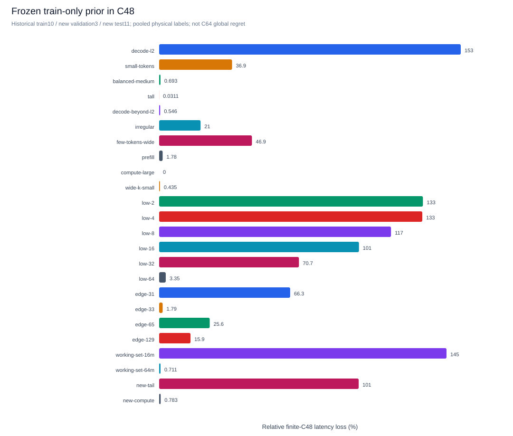
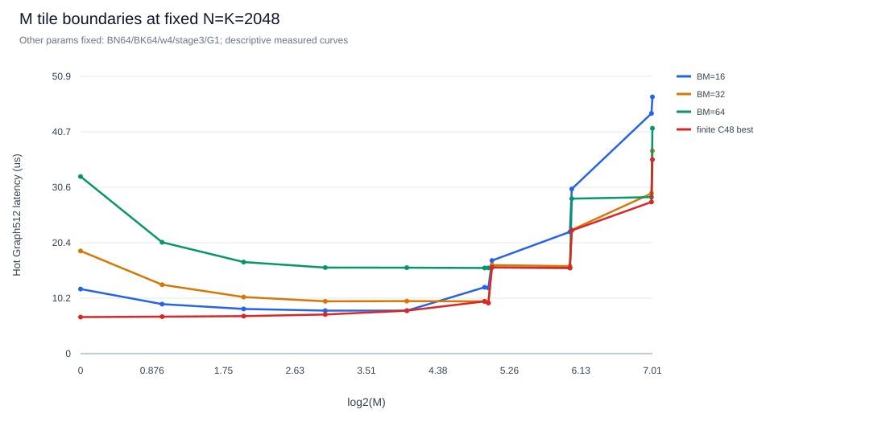
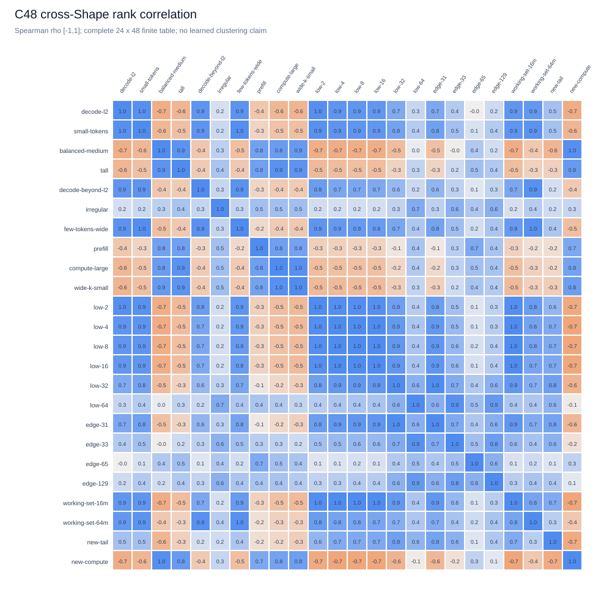
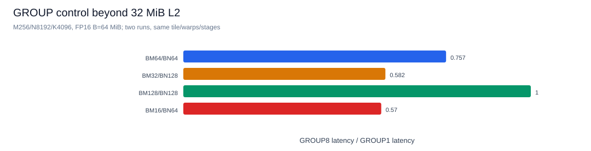
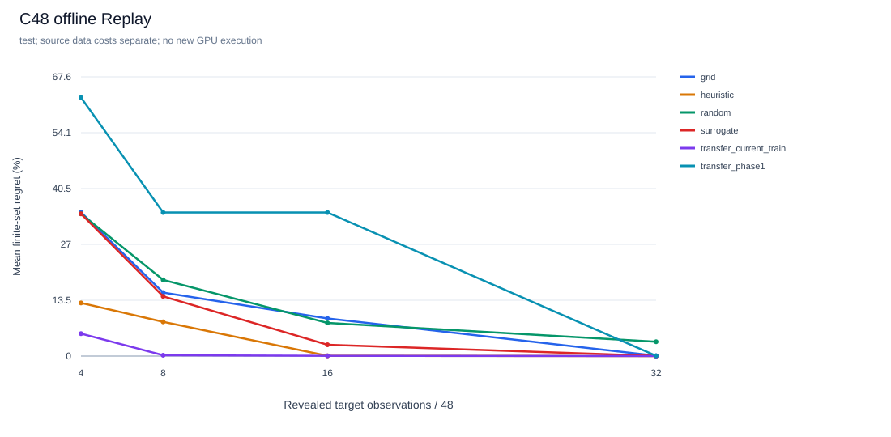
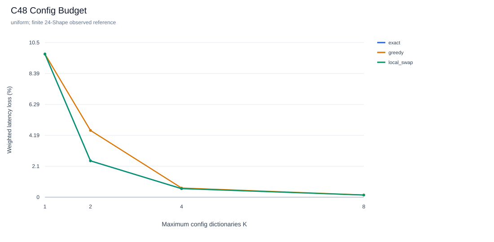
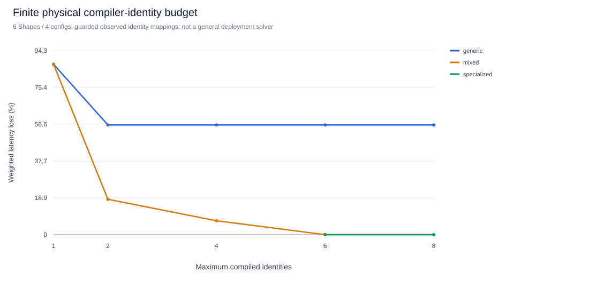

# 5060 Ti readiness：扩展配置空间、物理变体与交付验收

本轮从 `522e66fa02b4bcf416085fa404801b1c8584b3dd` 创建 `research/5060ti-readiness`。旧研究分支和 main 保持原 HEAD，没有合并。主要采集日期为 **2026-10-26 UTC，宿舍本地 2026-10-25**。所有 GPU 数字来自同一张物理 RTX 5060 Ti 16GB；其他 GPU 和 FlashInfer/xLLM 端到端性能本轮未测。

机器仍为 WSL2、4 个可用逻辑 CPU、约 7.8 GiB RAM / 4 GiB swap，36 SM、32 MiB L2、101,376 B opt-in shared memory/block。Python 3.12.13、Torch 2.13.0+cu132、Triton 3.7.1、CUDA Runtime 13.2、驱动 616.92；未修改驱动、全局 CUDA 或其他项目环境。[固定依赖](data/5060ti-requirements.txt)保持原栈。

机器可读证据：[精简矩阵](data/research-phase2-matrix.json)、[统计/成本/编译身份](data/research-phase2-summary.json)、[交付验证](data/research-phase2-validation.json)、[归档清单与 SHA256](data/research-phase2-archive.json)。完整记录、原始 samples、失败、SQLite/JSONL 和编译产物在 `artifacts/research-phase2/`，不提交大型原始二进制到 Git。

## 1. 冻结与审计

三个旧归档逐一校验，并检查归档内容和第一阶段逐文件清单；本轮结束时再次核对三个 tar 的 SHA256，全部不变。第一阶段完整 1,920 条记录和旧 C64 矩阵保留。没有外部备份目的地，归档仍在本机；异机备份需执行者指定授权目录。

| 问题/检查 | 发现、修复与证据 |
|---|---|
| 训练数据身份 | 相同 Transfer 插件/options/数据库路径，原地增加历史标签曾得到相同 trial ID。`9aab099` 将实际训练 record IDs、内容 hash、来源成本绑定 trial 和报告系列；`test_training_provenance.py` 保留最小复现和回归 |
| SDK 数据 Replay | Python SDK FP32/tile_size 被错误套用 v1 CUDA 约束，24 次 Replay 没有可评分结果。`3d7e9e5` 按匹配资产恢复空间，资产内容不可用时明确限制为 observed-config cohort；修复后 24/24 可评分 |
| L3 混合日志 | CLI 按 source context 分别求解不同协议，维持 Runner/Matrix 的隔离；固定实现支持 `{}`，不伪造可调参数。`test_cli_asset_datasets.py` 4 项回归 |
| 参考计算状态 | 实机 `medium → reference → get_precision` 报新旧 Torch API 混用；外层 BF16 autocast 使 FP16 参考偏差达 0.09375。`676a804` 使用局部 IEEE/禁用 autocast，恢复完整精度状态，容差不变 |
| 可变执行状态与缓存 | 改变 FP16 reduced-precision-reduction 后，原环境身份不变且实际命中同一 record。修复后环境/缓存身份改变，产生两个独立、正确性通过的 record。加入已知 Torch/BLAS/SDPA/autocast/编译控制及 helper 源码指纹，probe 保存可用 device UUID |
| wheel 与扩展 | wheel 曾缺第三方教程许可证，已修复并检查 ZIP。最终源码、wheel、文件插件、安装包 entry point 均从源码目录外执行成功 |
| 输入、计时和恢复 | 继续保留输入完整性、初始/最终实际输出检查、完整 initialize/steps、Graph scope 隔离、失败预算和 attempts。CPU 全量及真实 GPU 回归通过 |

精度/缓存首败和修复后实际 CUDA 复现位于 `baseline/torch-state-before-first.log`、`torch-state-before.json`、`torch-state-committed.json` 及对应标准 SQLite。修复后 `medium` 原样恢复、参考误差为 0、改变 reduction 设置不再复用缓存。API 处理依据 [Torch CUDA 精度说明](https://docs.pytorch.org/docs/main/notes/cuda.html#tensorfloat-32-tf32-on-ampere-and-later-devices)。

**协议边界**：主矩阵和科研补测均在精度修复前的默认隔离 worker 中采集，无外层 autocast；未追填旧环境字段。修复后 GPU gate、计时校验、新用户流程另存 `regression/`、`onboarding/` 和迁移 smoke，源码/环境身份不同，未混入旧矩阵排名。自定义插件的任意传递依赖和外部后端状态仍须用 metadata/source_files 明确声明。

## 2. 预先冻结的 C48 与实际成本

设计在 `2f842c9` 冻结：[配置/Shape/划分](../examples/research_phase2/frozen-design.json)。C48 是 C64 的**非嵌套后继 cohort**，不是全 192 配置 SDK 空间的穷举：

`BM={16,32,64,128} × BN={32,64,128} × BK={32,64} × warps={4,8}`，固定 stage=3、GROUP=1。另设 stage/GROUP 控制组，未根据测试结果扩充主矩阵。

10 个历史几何全部划为 train；新增 3 validation / 11 test，旧 test 不再冒称盲测。新几何覆盖固定 N=K=2048 的 M=2/4/8/16/32/64、31/33/65/129 边界、M4 的 16/64 MiB 权重工作集、63×1031×1025 尾块及 768×1536×3072 计算场景。历史训练还包含 32 MiB 工作集。逐 Shape 假设、字节估算和角色见冻结文件。

先运行历史 4 Shape × 8 配置 × 2 seed Pilot：64 次新观测、32 次验收，164.1 秒，无编译/数值失败。最大流水化 tile 估计 98,304 B，实际编译资源检查继续启用；大工作集只使用单 worker。Pilot 有部分 CPU 回归重叠，因此主采集期间停止 CPU 测试、Replay、安装和其他 GPU 性能任务。

主数据：**24 Shape × 48 Config × 2 input seed（7/19）=2,304 次新 GPU 测量，1,152 个格子，100% 成功覆盖，零缓存命中**。每条 FP16、warmup=10、31 个原始 Event samples、Graph batch=512，包含完整 GPU 计划。每个 sample 是 512 次热缓冲调用的摊销值，不是服务延迟。配置遍历按 seed 打乱。

| 研究采集 | 新物理观测 | 额外说明 |
|---|---:|---|
| 主 train / validation / test | 960 / 288 / 1,056 | 各自 80 / 24 / 88 次独立验收；job 墙钟合计 59.40 分钟 |
| Pilot | 64 | 仅历史 Shape，不参与主 oracle |
| 第三次重复 | 288 | 预选 6 Shape × 48 配置，input seed=31 |
| stage/GROUP 控制 | 144 | 6 Shape × 12 配置 × 2 seed |
| BF16 主实现抽查 | 64 | 4 Shape × 8 配置 × 2 seed，独立于 FP16 排名 |
| generic 正确性 / 对照 | 32 / 96 | FP16/BF16 尾块；6 Shape × 4 配置 × 2 实现 × 2 seed |
| 在线搜索 | 50 | 72 次目标观测：50 新测 / 22 缓存，另 36 次验收 |
| W4 fused/pipeline | 144 | 两实现分别 3 Shape × 12 配置 × 2 seed |
| 多 tile、超 L2 GROUP / Torch | 16 / 12 | 独立探索性控制，不进入主矩阵 |

上述研究采集合计 **3,214 次新物理观测、528 次独立验收、约 91.57 分钟 job 墙钟**，包含首次 partial/失败尝试和恢复；不含后续软件回归及安装检查。主观测非重叠 Runner phase 总墙钟包括 preparation 162.9s、compile 200.0s、initial correctness 255.4s、measurement 2476.4s、post correctness 82.9s 等；Graph setup 32.1s 是嵌套成本，不能再加一次。每候选/每 job 原始成本均保留。

保留两处实验配置错误及修正：generic 的独立验收额度4不足以覆盖6个 context，首次96条搜索测量虽正确，总状态为partial；[增加额度后恢复](../examples/research_phase2/acceptance-amendment.json)，96条观测均缓存复用。W4 pipeline 的参数名误写 `DEQUANT_BLOCK`，预检在执行前拒绝；[改为 SDK 声明的 DEQUANT_BLOCK_SIZE=512](../examples/research_phase2/w4-amendment.json) 后新增72次pipeline观测，融合72条缓存复用。原日志、spec和attempts保留；增加静态 SDK 参数契约回归。

## 3. 扩展空间改变了什么

训练结束、任何新 validation/test 采集开始前，在 `088daa2` 提交了[固定先验](data/research-phase2-prior.json)。按 train-Shape 平均相对损失选中的仍是旧常量 `BM32/BN128/BK32/w4/stage3/G1`。

| 范围 | 该常量的平均相对损失 | 5% 内覆盖 |
|---|---:|---:|
| 历史10 Shape，重新实测 C48 pooled samples | 26.08% | 6/10 |
| 新14 Shape（validation+test），pooled samples | 65.44% | 4/14 |
| 严格 test11，逐 input run 评分后平均 | 70.81% | 27.27% 的 run/Shape |

原 C64 的 9/10 结论只适用于 C64。新表中事后最佳单常量 `BM32/BN64/BK64/w4/stage3/G1` 在全部24 Shape 平均损失25.82%、最大180.83%；它使用了全部标签，仅是诊断，**不是新的盲测预测器**。平均损失较低也不保证最大损失较低。



固定 N=K=2048 时，M=1/2/4/8 倾向 BM16/BN64/BK64（这里实测最好为w8）；M31/32转向BM32，M33/64附近BM64有价值。64 MiB 权重的低M场景则偏好BN128。tile边界、CTA数量与工作集提供可检验解释，尚无硬件计数器证明具体瓶颈。



跨 Shape Spearman 最低约 **−0.733**；24 Shape 的 Top5%/10%/20%（3/5/10个配置）全局交集均为空。没有一个对全部场景稳定近最优的配置。完整排名、匹配参数敏感性、Top Jaccard 和相对延迟在精简数据及原分析中。



GROUP 在原控制组多接近无影响，但新增 M256/N8192/K4096、B=64 MiB 多tile控制中，G8/G1延迟比为 BM16/BN64 **0.570**、BM32/BN128 **0.582**、BM64/BN64 **0.757**、BM128/BN128 **1.001**。这直接反驳把“平均弱效应”外推成可永久删参；结果与调度/复用交互假设一致，因果归因待 profiler。



两次物理 run 的格子中位 CV=0.160%、P90=0.738%；288 个三次重复格子的中位 CV=0.387%、P90=1.005%。旧/新320对相同 Shape/config/input-seed 的每Shape中位延迟比为0.991–1.019。温度/频率/负载逐2秒保留，但未锁频。输入seed、顺序和时间共同变化，不能当作纯时漂或严格置信区间；百分之零点几的Top差异不作稳健胜负结论。

## 4. L2：已有数据何时帮助、何时妨碍

3,360次 Offline Replay：新14 Shape × 2物理输入run × 6方法 × 5搜索RNG × B=4/8/16/32。每次只揭示请求的观测；完整 C48 仅供 evaluator 评分。B占空间8.3%/16.7%/33.3%/66.7%。另报告 B=0 固定先验。算法RNG重复不是新GPU实验，均衡汇总也不把deterministic Grid的重复当独立物理样本。

test11 平均有限-C48 regret：

| 方法 | B4 | B8 | B16 | B32 |
|---|---:|---:|---:|---:|
| Random | 34.44% | 18.44% | 8.02% | 3.48% |
| Grid | 34.80% | 15.36% | 9.11% | 0.075% |
| Heuristic | 12.86% | 8.28% | 0.061% | 0.000% |
| Surrogate | 34.44% | 14.45% | 2.74% | 0.034% |
| Transfer：当前C48 train | 5.43% | 0.202% | 0.063% | 0.003% |
| Transfer：历史C64 train | 62.57% | 34.76% | 34.76% | 0.061% |



当前 Transfer 在B8全部test run进入5%内，但每个输入run使用480条历史标签，两run历史测量墙钟合计 **1,631.03s**，另有验收/启动成本。历史C64方法用4个原train Shape、每run256条标签，共524.26s来源测量墙钟。两者训练覆盖/候选域不同，不是纯算法或纯数据规模因果对照。

Transfer实现按历史config ID优先排序，未知ID排在已知之后；C64与C48只有16个共同配置，旧Transfer的B8→B16停滞与该代码机制相符。当前Transfer也不依据目标延迟更新后续优先序，只排除已尝试项；不能称为已验证的自适应学习策略。对本有限表，**有覆盖的候选优先序+少量验证** 已很有效，复杂AI尚无必要性证明。

低M边界处固定先验明显失效；Heuristic到B16已足够好，Surrogate在B16明显优于Random，但仍不总优于Heuristic。达到5%/10%的条件观测数、成功率、每Shape及物理run/RNG分解、来源成本和CPU回放成本保留在 `analysis/replay.json`；主完整表没有失败/缺失标签，不能从零失败率推出开放空间零失败。

另外在low4、edge33、new-compute运行Random/Heuristic/Surrogate的B8真实搜索，共9条轨迹。补做同seed=7的Replay后，**9/9候选序列一致**；独立延迟按实际采样保留，不把波动修正为oracle值。72目标观测中50新测、22缓存，job墙钟122.73s、验收36次；这是共享缓存及热编译条件下的真实成本，不是独立冷启动算法速度排名。

## 5. L3：配置预算与物理编译预算

原Solver继续优化Config Budget，目标为加权绝对延迟之和相对逐Shape已测最优之和；它不同于上面的平均逐Shape regret。

| K | 均匀权重 Greedy | 均匀 Local Swap | 均匀 Exact | Local Swap最大Shape损失 |
|---|---:|---:|---:|---:|
| 1 | 9.708% | 9.708% | 9.708% | 178.02% |
| 2 | 4.528% | 2.464% | 2.464% | 31.15% |
| 4 | 0.622% | 0.578% | 0.578% | 4.52% |
| 8 | 0.150% | 0.144% | 未计算 | 2.10% |

24个Shape显著多于K。Exact在33个Pareto候选上求K1/2/4；K8超组合上限，如实未计算。预先每三配置取一的16候选Exact另有独立参考，未冒充C48 oracle。合成低M权重（M≤16权重4，其余1）的Local Swap损失为12.036%/1.707%/0.427%/0.086%，不是线上流量。



Config K=1/2/4/8若保留全部Shape×所选配置，实际compiler identities为24/48/96/192；只保留分派到的pair则通常为24。配置共享没有自动消除constexpr Shape特化。逐Shape分派、选中参数、最敏感Shape和每种保留策略的实际CUBIN统计在数据中。K8在有限表的点估计已覆盖全部Shape到5%以内，微小收益需结合噪声，不称为全空间或部署最优。

### Shape-generic 概念验证

新增独立资产 `triton/t1_gemm_generic@1.0.0`，原T1保留。M/N/K与6个stride作为运行期参数，明确禁用value和alignment特化；依据 [Triton JIT接口](https://triton-lang.org/main/python-api/generated/triton.jit.html)。FP16/BF16四种尾块各4配置均通过。

在6个代表Shape、4配置、2输入run的匹配对照中，记录实际compiler signature/constants、进程内对象、每次launch hash和PTX/CUBIN SHA。9个scalar均为i32；同一进程内同config跨6 Shape复用同一编译对象，实际launch与warmup hash相同。

| 保留全部6 Shape×4配置 | 特化T1 | Generic T1 |
|---|---:|---:|
| compiler identities | 24 | 4 |
| 去重CUBIN | 24 | 4 |
| CUBIN ELF容器字节 | 774,168 | 215,424 |

使用全新私有Triton cache，保留初次编译、验收预热、后续进程磁盘复用和build lookup成本；没有清全局cache。部分首次研究候选已被验收编译，不能把每条compile_time称为冷编译。Generic/特化延迟比中位 **1.707**、范围0.949–3.028，复用有真实性能代价。

进一步在实际身份映射通过后，对这6 Shape/4配置精确枚举通用binary子集及逐Shape特化升级：均匀权重下，K1/2/4的mixed损失87.29%/18.12%/7.13%；generic-only K2/K4均为56.21%。K4 mixed保留4个compiler identities、134,016容器字节、26,624指令段字节。全Shape特化至少需6个身份；K6可零损失，这在6 Shape概念验证中并不意外。



这是有限、已验证身份映射下的**compiled-identity预算POC**；原通用Solver仍是Config Budget。CUBIN容器、ELF `.text`、部署常驻/打包体积分别解释；未求解一般Code Size Budget。warmup编译handle尚未初始化的register数量保留unknown，未据此推算occupancy。dtype、pointer alignment、tile、编译选项和target仍可特化，CUDA Graph仍按Shape/缓冲单独捕获；未声称任意Shape/布局只产生一个二进制。

## 6. W4A16、库对照与计时校验

W4 canonical bitstream、group_size=32；fused/pipeline分别分析，完整GPU计划包括反量化/可选workspace与reduction。

| Shape | fused已测最好 µs | pipeline已测最好 µs |
|---|---:|---:|
| 4×2048×2048 | 18.19 | 24.95 |
| 64×2048×2048 | 36.96 | 34.05 |
| 257×1031×1025 | 110.44 | 43.99 |

小M fused最好为BM32/Split4；M64 fused转向BM128/Split4，pipeline为BM32/Split2；尾块pipeline为BM32/Split4。分解、workspace和编译kernel数量随实现/Split变化，不能只取GEMM子步骤计时。480次实现隔离的冷启动Offline Replay中，fused B8 Heuristic平均损失5.36%，Surrogate 0.050%；pipeline B8 Grid/Heuristic在有限12配置表都达到已测最优。支持“融合实现需要不同先验”的有限新Shape证据，尚不构成广泛泛化结论或GPTQ/AWQ生产加速比。

六个Shape还独立测了预分配Torch mm。1024×2048×2048场景，POC四配置中最佳特化T1为192.76µs、Torch为192.88µs，至少没有故意把计算基线做成极慢玩具。库内部实际dispatch未知；Torch-only record未记录不使用的Triton字段，严格跨实现比较guard因此抑制自动加速比，且3/6库点有波动警告。保留并列点值及原因，不填版本或输出生产级胜出结论。

精度修复后，`scripts/check_gpu_timing.py`再测同实现、输入和配置，Graph512/3轮。平台Graph与独立Triton Graph中位分别为1.302/1.301µs、9.128/9.099µs、55.114/55.248µs；各差约0.32%以内。单launch Event及同步完整调用显著受host空隙影响，继续分别保存，未混入Graph矩阵。

## 7. 新用户与验收表

入口已整理为[Quickstart](QUICKSTART.md)、[贡献指南](CONTRIBUTING.md)、[科研协议入口](RESEARCH_PROTOCOL.md)、[排错](TROUBLESHOOTING.md)和[GPU迁移清单](GPU_MIGRATION.md)。GitHub Actions增加无GPU的Python3.10/3.12测试；远端CI结果以实际Actions为准。

| 验收项 | 状态 | 证据/限制 |
|---|---|---|
| 旧数据安全 | 已通过，本机归档 | 三旧tar SHA不变；新归档逐文件清单和校验另存；未进行异机备份 |
| CPU-only完整回归 | 已通过 | 最新全量355 passed / 11 GPU opt-in skipped；干净克隆安装时354 passed（随后新增1个历史兼容性回归），均在无Torch/Triton/Matplotlib的Python3.10中执行 |
| 源码/wheel/SDK新用户 | 已通过 | 新临时克隆、新venv，28步：安装、scaffold/check/run、entry-point包、research/resume/report、export/import/Replay/L3 |
| wheel真实GPU扩展 | 已通过 | 独立固定依赖环境、源码目录外；probe/GEMM/L2/缓存恢复，并安装独立搜索插件wheel与Random/Heuristic一起完成GPU research |
| 原四类严格Smoke | 已通过 | 新源码80条真实GPU记录，10/10阶段，全成功、无缓存 |
| 状态/Graph回归 | 已通过 | 18项测试中11个实际GPU案例、7个CPU状态单测；含causal Attention、W4/W3/W2、MoE persistent/Split-K及外层autocast |
| C48及L2/L3 | 已通过有限空间 | 完整1,152格子、3,360 Replay、9条在线轨迹；不称全空间最优 |
| Generic物理复用 | 部分通过 | 6 Shape/4配置FP16身份对照，另有BF16/尾块数值；任意stride/alignment/规模未穷举 |
| W4、BF16、stage/GROUP | 有限采样通过 | 具体cohort及首败/修正如上；不是完整量化配置空间 |
| 安装后默认Torch baseline自动加速比 | 已知限制 | 未使用Triton的库记录缺该版本字段，比较guard保守抑制；部分库测量波动 |
| H20/H200/H800/4090 | 未执行 | 仅准备规格/流程；迁移脚本静态检查，执行分支在5060Ti验证；H20无猜测Profile |
| 通用部署二进制/byte budget、Nsight因果解释 | 未解决/未执行 | 仅有限身份POC与ELF统计，无驱动常驻大小和硬件计数器结论 |

## 8. 复现、归档与下一步

主数据集ID：`bca2bf28d62bfa1ea19e7d8c0fb97e8c98f883fca2c583556d69b5236202d6ea`。train采集commit `88bff02`，validation/test为`088daa2`；设计`2f842c9`，generic验收修正`0ebd835`，W4规格修正`2fb1791`，精度/缓存修复`676a804`。每个job另有实际commit、spec、资产源码指纹和原环境。Pilot旧commit对象与重署作者后的相同tree对应关系保留在baseline及source bundle；不重写原测量身份。

```bash
# 同一固定环境、空输出；单卡串行。主研究约60分钟，全部科研采集约92分钟。
.venv/bin/python scripts/collect_phase1.py --spec examples/research_phase2/pilot.json --output artifacts/my-phase2/pilot
.venv/bin/python scripts/collect_phase1.py --spec examples/research_phase2/train.json --output artifacts/my-phase2/train
.venv/bin/python scripts/analyze_phase2.py --root artifacts/my-phase2 --freeze-prior
.venv/bin/python scripts/collect_phase1.py --spec examples/research_phase2/validation.json --output artifacts/my-phase2/validation
.venv/bin/python scripts/collect_phase1.py --spec examples/research_phase2/test.json --output artifacts/my-phase2/test
.venv/bin/python scripts/analyze_phase2.py --root artifacts/my-phase2
```

精确复现旧矩阵软件身份须检出采集commit；新代码重跑使用新身份与新输出，不混表。恢复重复原命令；Replay不需要GPU但必须先有真实完整标签。补测使用同目录的 `repeat/controls/generic-correctness/bf16/online/w4/group-beyond-l2/torch.json`。generic正式复现使用 `generic-acceptance.json` 和新建的私有 `TRITON_CACHE_DIR`，不要清全局cache。`archive_compiled_phase1.py --studies ... --cache-dirs ...`复用原编译归档器；随后运行 `analyze_phase2_supplements.py`、`audit_phase2.py`、`summarize_phase2.py`。完整命令与原始日志在归档中。历史库不在Git内，可用 `--history-root` 指定原research目录；缺失或参考内容不兼容时，历史Transfer明确记为不适用，不伪装成冷启动Heuristic。完整原Replay对应 `d4d5d97` 的脚本SHA，保留在 `analysis/replay-source-version.json`，可用它核对原始轨迹。

```bash
# 只复制到执行者明确授权的本地/挂载备份目录；脚本复核源和目标SHA，不上传公网。
KT_BACKUP_DIR=/authorized/mounted/backup bash scripts/backup_research_artifacts.sh
```

当前平台已足以让具备Python/CUDA基础的外部研究者完成受控、单卡、有限空间实验；不能据此承诺开放空间无错、任意后端可自动公平比较或生产部署已完成。最值得继续的三个科学问题是：

1. **空间变化下怎样利用历史而不盲信历史？** C64 Transfer在B8/16停滞而当前C48先验在B8有效。下一轮先比较coverage-aware探索、Shape/tile/SM/工作集特征规则，再用严格train-only数据训练配置预测器；同时记录历史采集成本。
2. **何时反馈比固定候选列表有价值？** 零测量单常量在test平均损失70.81%，但已有Heuristic到B16已很好。AI下一步建议应在更广、跨实现的未见Shape中，证明超越同样训练数据的静态top-list，而非包装Random；区分Shape、物理run和RNG。
3. **有限测量应寻找逐Shape最优，还是识别高覆盖配置/物理变体？** C48 K4只有0.578%加权损失，同时generic可复用却常变慢。以这张真实完整表设计隐藏未揭示格子的联合测量选择基线，分别约束config、真实编译身份和bytes；本轮没有新增联合方法胜出声明。

跨GPU改变SM数量、L2/带宽、资源合法性和编译lowering，当前解释的可迁移性必须由H20/H200/H800/4090的真实probe、相同实现/共同合法cohort及独立软件账本回答。先执行迁移清单与小Pilot，再讨论Leave-One-GPU-Out；本轮只有一张GPU的数据。
