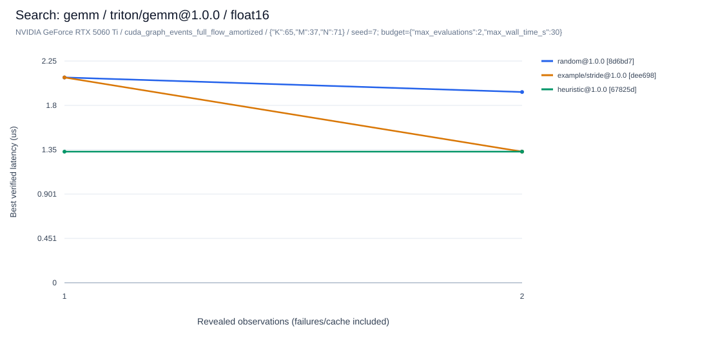
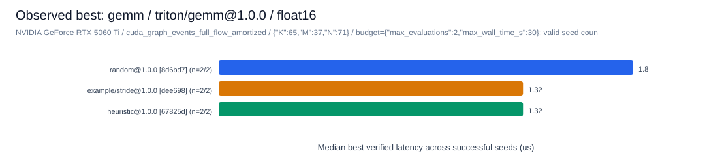

# 搜索算法研究：一个插件、一份配置、一条命令

研究者提交普通 SDK 搜索插件，在 JSON 中选择算子、实现、Shape、dtype、seed、预算与基线，然后运行：

```bash
.venv/bin/ktlab research --spec examples/research/cuda.json --output artifacts/my-study
```

这条命令串行执行真实 CUDA 搜索与独立正确性检查，自动生成汇总、逐观测 CSV、搜索/墙钟曲线、性能图、成本和失败分析。新增算法不需要修改核心注册表、Runner 或报告代码。运行的算子实现必须已经通过 SDK 注册；插件也可用文件、模块或既有 entry points 注册。

无 CUDA 的机器先运行可直接执行的 CPU 示例：

```bash
python3 -m venv .venv
.venv/bin/python -m pip install -e '.[dev]'
.venv/bin/ktlab research --spec examples/research/cpu.json --output artifacts/cpu-study
```

CPU 示例只生成真实 CPU 数据。GPU 示例需要另外安装与实际 GPU 兼容的 Torch/Triton；5060 Ti 已验证环境见 [5060TI_RESULTS.md](5060TI_RESULTS.md)。SVG 报告使用现有标准库绘图组件，不要求 Matplotlib、网络服务或 GPU。

## 独立算法插件

[stride_search.py](../examples/research/stride_search.py) 是一个仅依赖公开 SDK 的完整示例：

```python
from kernel_tuning_lab.sdk import SearchAlgorithmDefinition, SearchCapabilities

class MySearch:
    def __init__(self, seed=0):
        self.seed = seed

    def suggest(self, hardware, operator, shape, space, history, budget, batch_size=1):
        # 只用硬件、输入、空间和已经揭示的观测；不读未知配置性能。
        if budget.exhausted(0, 0):
            return []
        # 实际算法应有界采样/探测、检查合法性并排除 history 中的已尝试项。
        ...

def create(seed=0):
    return MySearch(seed)

ASSETS = (SearchAlgorithmDefinition("my/search", "1.0.0", create, SearchCapabilities()),)
```

用配置的 `plugins` 加载文件，用 `algorithms` 引用资产及已有基线。算法选项使用 `{"asset":"my/search@1.0.0","options":{"probe_limit":512}}`。版本、工厂内容和选项进入验收/试验记录；建议显式写版本。有限域、只读空间、条件参数、有界候选及观测历史契约仍由 v2 验收和运行时保护，详情见 [EXTENDING.md](EXTENDING.md)。插件是可信 Python 代码，子进程期限不是安全沙箱。

同一算法可以以不同 `options` 重复选择，各自成为独立任务及报告系列；完全相同的规范化选择会拒绝。无需复制插件或另起资产名来做参数对照。

## 研究配置

研究入口使用 `schema_version=1, kind=research`，将矩阵展开为原生 schema v2 `AssetExperiment`。不改变已有 `ktlab run/check` 的 schema。

```json
{
  "schema_version": 1,
  "kind": "research",
  "name": "my-study",
  "plugins": ["my_search.py"],
  "algorithms": ["my/search@1.0.0", "random@1.0.0", "heuristic@1.0.0"],
  "dtypes": ["float16", "bfloat16"],
  "seeds": [7, 19],
  "budgets": [
    {"max_evaluations": 4, "max_wall_time_s": 30},
    {"max_evaluations": 8, "max_wall_time_s": 30}
  ],
  "defaults": {
    "timing_mode": "cuda_graph",
    "cuda_graph_batch_size": 512,
    "warmup": 3,
    "repetitions": 9,
    "validation": {
      "max_configs": 4,
      "max_cases": 0,
      "max_wall_time_s": 30,
      "trust_claims": false
    }
  },
  "cases": [{
    "name": "gemm",
    "operator": "gemm@1.0.0",
    "kernels": [{
      "asset": "triton/gemm@1.0.0",
      "space": {"BLOCK_M": [16, 32], "BLOCK_N": [32, 64], "BLOCK_K": [32],
                "num_warps": [4], "num_stages": [2]}
    }],
    "shapes": [{"M": 37, "N": 71, "K": 65}]
  }]
}
```

插件文件相对配置所在目录解析，CLI 全局 `--plugin` 相对调用目录解析。生成的 v2 配置使用解析后的插件路径；原配置、实际资产指纹和有效空间分别保留。案例可以覆盖 `dtypes`、`parameters`、`hardware`、warmup/repetitions、计时模式、Graph 批次、工作区、preflight 和 validation；validation 字段与默认值合并。不同算子拥有自己的 Shape/参数/Kernel 空间。

默认不信任正确性声明，搜索中的每个新候选仍通过独立参考及计时后检查。若显式设置 `trust_claims=true`，声明性能仍保留声明身份，报告只用 reference-verified 记录做性能排名，不将声明提升为 GPU 验证。

每项预算必须显式给出观测数量及有限墙钟上限。重复 JSON 键、未知字段、重复 seed/预算、非有限值、bool seed 和无界预算都会拒绝。`max_jobs` 默认 1024，超过时须先检查展开维度后显式调整。

## 先展开，再执行

```bash
.venv/bin/ktlab research --spec examples/research/cuda.json \
  --output artifacts/study-plan --write-only
```

这个步骤不导入插件，也不探测或执行 CUDA。输出明确列出 job、trial、最大观测数、独立验收次数上限和串行墙钟许可总和。附带 GPU 示例包含：

- GEMM、W4A16 两个算子，普通 GEMM/量化融合/量化 pipeline 三个实现。
- 每个实现两个 Shape、FP16/BF16、两个 seed、两个预算、三个算法。
- 72 个 v2 job、144 个研究 trial、最多 432 个观测；另有最多 144 次验收。

`max_evaluations=4` 不等于整个矩阵只有四次测量。验收预算对每个展开的 v2 job 生效，研究预算对每个请求 Shape 生效。编译、参考、正确性、warmup、Graph setup 等都计入实际调优墙钟；延迟样本边界保持 v2 原协议。

## 算法隔离、缓存与恢复

每个算子案例/实现/dtype 使用一个既有 v2 测量 journal，各算法、seed、预算作为独立受监督 job 串行运行。一个算法的合约失败或能力不匹配不会阻止同一输入的其他算法；一个实现失败不会阻止其他实现。没有新增实验数据库类型或并行 GPU worker。

同一案例的算法共享兼容测量缓存，seed、硬件、Shape、配置、源码、正确性、空间和计时协议仍由原 cache key 约束。**缓存命中和已测失败都消耗研究观测预算**，新物理尝试、缓存命中、合约失败分别计数。非法建议在验收/合约层拒绝时没有伪造测量，消耗的预检/建议时间和失败原因仍记录。

断点恢复就是再次运行原命令：

```bash
.venv/bin/ktlab research --spec examples/research/cuda.json --output artifacts/my-study
```

它会重新检查当前源码/硬件/环境，再从空的已揭示历史重放算法，逐个复用已完成兼容记录；不会因旧完成标志就跳过验证。先前被父进程终止的候选保留诊断，但不作为已完成缓存，恢复时重试。验收会重跑并另计成本。增加算法或 Shape 不会因新建另一套存储而丢掉原 journal；真正能否复用仍由原 cache key 判断。

每轮套件报告保留在根 `attempts/`，每个 v2 job 的旧配置、验收、trial/trace 和日志仍由原 `runs/<group>/attempts/<run_id>/` 机制保留。根 manifest 使用 v2 run ID 定位历史，不把累计数据库中的旧成绩当成本轮搜索结果。整套研究目录有互斥锁；POSIX（包括 WSL/Linux）上传递锁描述符给 v2 worker，主进程被强制终止时，未退出的 worker 仍持锁，避免恢复时并发争用同组输出/GPU。

## 报告与成本解释

| 文件 | 内容 |
| --- | --- |
| `experiment.json` / `source_experiment.json` | 冻结的解析配置及原配置 |
| `research_manifest.json` / `specs/` | 展开维度、预算、job 状态、v2 run ID、原生实验配置 |
| `summary.json` / `report.md` | 当前轮结构化汇总与可读报告 |
| `trials.csv` / `observations.csv` | 每个 trial 和每个已揭示候选的配置、验证、延迟分位数、预算及成本 |
| `failures.jsonl` | 验收、候选测量、算法、超时、中断及不适用项的分类诊断 |
| `figures/` | 每个可比较上下文的观测/墙钟搜索曲线、性能图，及成本/失败图 |
| `runs/<group>/measurements.sqlite` / `.jsonl` | 原 v2 journal，包含历史和完整测量语义 |
| `runs/<group>/trials/*/observations.jsonl` | 逐观测追加检查点，最终 trial manifest 同时引用准确 record IDs |

纯报告重建不需要原插件、CUDA 或 Matplotlib：

```bash
.venv/bin/ktlab research --report-only --output artifacts/my-study
```

图表依据实际记录的硬件、算子/实现、Shape、dtype、正确性协议、计时模式/Graph 批次及软件/源码上下文分别生成，不跨口径计算总平均加速比。算法版本内容/选项也分开。性能汇总列出成功 seed 数及未完成项，缺失值保持缺失，不填 0。没有把所有稀疏观测的最好值说成全局最优，也没有引入离线 oracle 结果充当在线曲线。

`--report-only` 读取并核对已存执行证据；保留原 run ID、源码提交和 GPU 标识，不表示报告重建时重新运行了 GPU。

逐观测 trace 区分：

- `source_compile_time_ms` / `source_measurement_wall_time_s`：原记录实际发生过的成本。
- `physical_compile_time_ms` / `physical_measurement_wall_time_s`：这次研究新增的测量成本；缓存命中为 0。
- `elapsed_wall_time_s`：当前 trial 的建议、查缓存、测量等实际耗时，缓存复用仍有开销。
- job 墙钟与验收成本：包含每个受监督进程的启动、预检及额外验收，不能与纯 kernel latency 混淆。

编译成本沿用 v2 compile 回调范围，包含 build、one-time setup 和 Graph capture；纯构建/初始化细分仍保留在测量执行元数据中。它是测量墙钟的子集，成本图不得相加。共享 Triton/测量缓存会让后运行的算法受益；该结果不能直接解释为独立冷启动调优成本排名。中断时已完成 trace 保留，未完成物理尝试及其已知墙钟另列，未知总编译成本为 null，已知部分另列，不估成零。

## 状态和退出码

`passed` 表示所有请求 job 完成且无实际失败；`not_applicable` 只用于明确的 dtype/architecture/算法能力声明不匹配；缺设备为 `deferred`。预检/输入错误、编译、数值、运行、算法合约和 timeout 保持失败身份。后续未启动的 trial 明确为 `not_run`。失败项不会从图表分母或清单中消失。

CLI 退出码：0 完成或只生成配置；2 至少一个失败或报告数据损坏；3 有不适用/待设备/覆盖不足；130/143 为中断。各 job 保留原 v2 exit code，包括硬超时 124。研究矩阵中的一个失败不会阻止其余 job 归档，SIGINT/SIGTERM 则结束当前串行矩阵。

图表只用于已观测、正确性通过的数据；GPU 完成标识还要求本轮每项的实际 GPU 证据。CPU-only 测试和生成配置都不会成为 GPU 验收。

## 2026-10-25 真实 GPU 验收

本轮从 `72619d3` 接续，在 `gpu/5060ti-validation` 分支实现；没有合并主分支。通用入口的实现提交为 `47f2f7b`，原始 case identity/历史链接修复为 `aa05678`，覆盖分母、未知成本与算法选项对照修复为 `5d9270c`。每份实际 manifest 和每条测量仍保留其执行时提交、插件/Kernel/算子指纹及环境。后续报告修复没有重新命名先前执行提交。

设备为物理 RTX 5060 Ti 16GB / sm_120，WSL2；Python 3.12.13、Torch 2.13.0+cu132、Triton 3.7.1、CUDA Runtime 13.2、驱动 616.92。继续使用独立 `.venv`，没有改动全局驱动或其他开发环境。完整依赖基线及 CUDA 安装说明仍见 [5060TI_RESULTS.md](5060TI_RESULTS.md)。

主验收直接执行文首命令，将输出改为 `artifacts/research-workflow/gpu`，不需要运行专用驱动或汇总脚本。对照算法为独立 SDK `example/stride@1.0.0`、Random、Heuristic；FP16/BF16，seed 7/19，预算 2/4 个观测、每 trial 最多 30 秒。空间均限制为 4 个配置；Graph 每次重放 512 个完整计划，warmup 3、repetitions 9，独立验收每 job 最多 2 次。详细 Shape 与参数在 [cuda.json](../examples/research/cuda.json)。

| 实验 | job 状态 | 研究 trial | 观测 / 新测量 / 缓存 | 独立验收次数 |
| --- | --- | --- | --- | --- |
| 主矩阵恢复后 | 72 passed | 144 / 144 执行 | 432 / 68 / 364 | 144 |
| 缓存恢复探针 | 3 passed | 6 / 6 执行 | 24 / 0 / 24 | 6 |
| 故障及口径对照 | 4 passed、2 failed、3 not_applicable | 6 / 12 执行 | 12 / 9 / 3 | 8 |
| 算法选项对照补验 | 6 passed | 6 / 6 执行 | 18 / 4 / 14 | 12 |

主矩阵覆盖 GEMM、W4A16 融合及 W4A16 pipeline 三个实现。生成 12 个可比较上下文、122 份 SVG，所有 432 个已揭示观测均有真实 GPU 正确性证据。48 组相同上下文/seed/预算的算法对照均出现了不同候选轨迹，插件确实参与选点。跨 seed 共 96 个唯一研究记录；本轮目标是工作流验收，不据此声称某算法更优。

首次执行在报告回归中暴露 AssetCase ID 与 MeasurementRecord case ID 不同，修复时主动中断并保留首次失败日志、112 个已揭示观测、28 次新测量及未完成的验收诊断；当时为 19 passed、1 interrupted、52 not_run。相同命令随后完成全部任务，复用先前 28 条兼容研究记录并新增 68 条，既未删除失败证据，也未把未完成验收当作有效缓存。根 `attempts/215f13f9be134fb6818c13316fae820a/` 保存首次部分结果，其 `cost_trace_complete=false`，旧报告成本字段只能视作已知部分；当前版本对未知总编译成本明确输出 null。

缓存探针通过 SQLite 标准备份恢复同一 group 的 journal 后执行较小子集；24 个 record ID 与主矩阵对应 trial 完全相同，新增研究编译/测量成本为 0，源成本仍保留，独立验收实际重跑。该项验证可迁移的完整 journal 备份；原目录断点恢复由上面的主实验及 CPU 超时测试另行验证。

故障对照加入只提交非法配置的插件，以及该实现未声明支持的 float32。非法算法的两个 job 失败、另外三项明确不适用，套件保持失败退出码 2，其他算法继续执行。报告保留非法算法的 `n=0 / requested=1`，没有从分母删除。额外的同步完整调用计时与 Graph 计时生成独立上下文，未混入同一性能矩阵。

最后在 `5d9270c` 上实际执行 `gpu-options.json`：同一个 Stride 插件以 `probe_limit=128/256` 与 Random 对照，单个 GEMM/FP16/seed 7、预算 2/4。6 个 job 全部通过，新增 4 次真实测量、14 次缓存命中、12 次独立验收；报告保留三条独立算法系列。这验证了新增算法及选项都只需修改插件/配置，不需修改平台核心。

主矩阵当前轮总 job 墙钟 320.17 秒，其中独立验收 145.61 秒；新增研究测量墙钟 8.69 秒，编译回调范围 5.99 秒包含在其中。进程启动、重复验收及缓存检索是实际成本，不能把 8.69 秒当作整个研究用时，也不能由缓存共享顺序推导独立冷启动算法成本。此次每 job 分开监督的取舍是故障隔离清晰、启动/验收成本较高；尚未做免重验的快捷路径。

紧凑机器可读证据见 [research-workflow-validation.json](data/research-workflow-validation.json)。原始规格、完整 journal、trace、首败日志及所有图表保存在忽略 Git 的 `artifacts/research-workflow/`，单独归档说明也在该证据中。报告可以在独立、无 Torch/Triton 的 CPU-only 环境重建；这一步已实际执行，未重测 GPU。

独立 Python 3.10.12 CPU-only 虚拟环境没有 Torch、Triton 或 Matplotlib，完整测试为 **322 passed、9 skipped**。其中 17 项通用工作流回归覆盖多案例命令、缓存成本、严格配置、选项/预算隔离、算法失败、不适用 dtype、缺 CUDA、中断重试、报告数据损坏及 POSIX 孤儿 worker 锁。修复前的失败日志仍保留；最终测试和补充只读审计检查了 SQLite 完整性、精确缓存 ID、单调 best-so-far、口径隔离以及当前/归档报告链接。





图中延迟仅适用于标注的实现、Shape、dtype、热态 Graph 协议和有限空间。实验没有覆盖所有算子、生产规模空间或 Hopper；其他已注册 SDK 算子可以在配置中选择，仍须在目标设备独立验收。不同输出目录之间没有全局 GPU 调度锁，执行者应避免另起争用同一 GPU 的性能实验。
