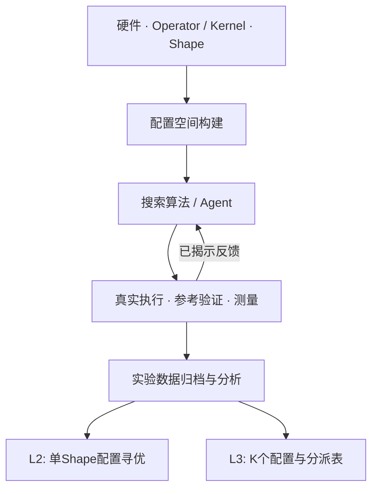

# KernelTuningLab 使用文档

定位：面向真实硬件的 GPU Kernel 配置寻优研究平台。

当前稳定入口：`main`，Web v2 / 1.1.0；历史 v1.0.1 标签与开发分支保留。历史实验固定自己的源码 commit，后续科研在独立分支进行。

快速阅读：浏览器操作先看7.3节；CLI立即运行看第3章；GPU调参看第4–5章；加算法看第6章；结果和L3看第7章；AI看第8章；新服务器与E盘恢复看第10章。最后的[个人练习](PERSONAL_HANDOFF.md)供第一次独立操作。

动机是让实验者只需要写算子、搜索算法、配置空间和预算等关键内容，由平台完成编译、正确性、测量、对比、作图与保存；多人合作时共用实验契约和数据格式。

## 1. 平台概览



### 1.1 回顾研究背景

以Triton GEMM为例，数学语义为 `C = A × B`。相同Kernel可以使用不同的 `BLOCK_M/N/K`、`num_warps`、`num_stages`、`GROUP_M`，计算同一个结果，性能可能不同。

| 层次 | 要回答的问题 | 平台对应能力 |
|---|---|---|
| L1：Kernel实现 | 怎样实现正确、高效的计算？ | Operator参考、生产实现与研究插件 |
| L2：单点配置寻优 | 给定GPU与Shape，在有限预算下选什么配置？ | 真实配置空间、Searcher、Runner |
| L3：有限变体选择 | 多个Shape只能保留K个配置，选哪K个？ | 性能矩阵、Exact/Greedy/Local Swap、K–Loss |
| L4：运行时分派 | 请求使用哪个已保留配置？ | ShapeDispatcher、冻结表与身份检查 |

### 1.2 输入输出

| 输入 | 例子 | 含义 |
|---|---|---|
| Hardware | RTX5060Ti / 4090 / H800 | 执行设备与实测属性 |
| Operator | `gemm@1.0.0` | 数学语义、输入生成、正确性参考 |
| Kernel | `triton/gemm@1.0.0` | 被调优的具体实现 |
| Shape / dtype | M=37,N=71,K=65，FP16 | 具体工作负载 |
| ConfigSpace | BLOCK_M∈{16,32}等 | 原生可调参数、条件域与约束 |
| Searcher | Random、SMAC、自己的Agent | 谁提出下一个候选 |
| Budget / Protocol | B=8、warmup、Graph批次 | 最多揭示多少候选、怎样计时 |
| 输出 | SQLite/JSONL、trials、report、SVG | 配置、正确性、样本、失败、成本与身份 |

Operator是“算什么”，Kernel是“怎么实现”，Config是“同一实现使用哪些运行/编译参数”。同一Operator可以有多个Kernel。位宽、group、mask等任务语义不能为了更快而改变。

## 2. 当前平台能力

### 2.1 已有算子和真实配置空间

研究算子覆盖GEMM/BMM、Softmax、LayerNorm、W2/W3/W4反量化与A16 GEMM、Attention和Grouped GEMM。生产算子使用固定上游源码或原始组件，保留各自参数域：

| 生产路径 | 已有定向实机覆盖 | 空间与边界 |
|---|---|---|
| GemLite A16 W4/W2 | 4090，FP16/BF16，默认/显式GEMM与Split-K | 算法家族、tile、warps、stage、Split-K；uniform group-scale；尾部元数据问题已修复 |
| FLUTE W3 High | H800 FP16/BF16；4090部分模板/FP16默认 | P32的24个结构模板；独立原FP32归约；精确共享内存检查 |
| FlexAttention | H800 Torch2.6，TRITON forward，dense/causal，FP16/BF16 | 原生默认及显式参数；与FLASH/backward和其他Torch版本分开 |
| SGLang paged decode | H800，默认/显式、等长/不等长分页，FP16/BF16 | Split-KV和merge；关闭PDL的兼容profile |
| vLLM MoE0.8.5 | H800完整专家调用，FP16/BF16 | 对齐、两次GEMM、SiLU、加权归约；官方组件与Torch2.6/CUDA12/ABI0绑定 |

MoE示例的完整静态可行空间约3200点，构建由47.926秒降至0.501秒且集合一致。静态可行并不表示3200点全部编译或数值通过。FLUTE原Mixed的精度失败保留；新生产High为独立身份，不通过放宽阈值掩盖失败。

`ktlab assets list`查看资产；完整支持/未验证范围见[生产支持说明](PRODUCTION_STABILITY.md)。GemLite GEMV/RevSplit-K、新架构、未覆盖dtype与执行路径不能由个别成功推成已支持。

### 2.2 搜索算法

| 方法 | 基本思想 | 适用和注意事项 |
|---|---|---|
| random / grid | 随机 / 遍历 | 基线；遍历顺序本身也影响预算内结果 |
| heuristic / local | 规则 / 当前优解附近 | 低成本，依赖任务与初始位置 |
| surrogate / transfer | 已测数据建模 / 历史迁移 | 需要计入训练数据成本和分布边界 |
| smac_rf | 随机森林引导搜索 | 原生SMAC2.4.1，含条件空间、预算、失败与恢复适配 |
| kernel_tuner_de | 差分进化 | 原生Kernel Tuner1.5.0及持久callback |
| 自定义 / AI | SDK Searcher或模型 | 遵守统一正确性、预算与反馈接口 |

原生优化器需要独立依赖。缺依赖时明确报错，不静默换成Random。大空间支持partial、region、有界补全和候选访问；一个随机池或截断前缀不代表整个空间。

### 2.3 硬件支持情况

| 设备 | 当前证据 |
|---|---|
| CPU | 无GPU核心安装、真实CPU实验、SDK、数据库、Replay、L3、报告、Web |
| RTX5060Ti | 核心GPU Runner及研究算子；历史L2/L3与冻结192点Anchor |
| RTX4090 | 定向生产/量化路径、原Marlin与有限分派；不等于全部后端全配置 |
| H800 | 五类生产路径定向覆盖、原本地LLM阶段与有限L3真实分派 |
| H200 / H20 / 其他GPU | 新设备验收待做；硬件描述与源码可表达不等于实机通过 |

已验证与未验证以具体GPU、环境、dtype、输入及执行路径区分。环境恢复按安装、CPU、目标GPU数值与人工上手分层记录，以交付清单和各次receipt为准。旧有效GPU证据只读复用，不因迁移自动重跑。

## 3. 安装与第一次CPU实验

平台核心是 CLI / SDK 加实验 Runner。当前默认在服务器部署 Web API 与独立 Worker，本机浏览器通过 SSH 隧道创建、监控和分析实验；源码、插件与完整测量数据在远端。CLI / SDK 仍可独立安装、开发和运行。

### 3.1 环境与版本

核心Python≥3.10，无第三方运行依赖。本页 Web v2 使用稳定 main，CLI 与只读查看器保留兼容。复现实验固定具体 commit。

```bash
git clone --branch main https://github.com/MingASA/KernelTuningLab.git
cd KernelTuningLab
python3 scripts/bootstrap.py --profile core --env .venv
source .venv/activate-ktlab.sh
ktlab doctor
ktlab assets list
```

Windows推荐WSL2。Windows原生CPU的可执行文件位于`.venv\Scripts\`；GPU使用Linux/WSL。修改平台或策略时另建研究分支。

### 3.2 预览预算与真正运行

先运行最短的真实CPU GEMM：

```bash
ktlab run --spec examples/quickstart/cpu.json --output artifacts/first-run
```

预期`status=passed`，Random/Grid各两次候选揭示；独立验收另计。CPU运行用于学习流程，不是GPU性能证据。

多算子/dtype/算法/预算矩阵使用research：

```bash
# 只展开计划与总预算
ktlab research --spec examples/research/cpu.json --output artifacts/cpu-study --write-only
# 正式执行该CPU研究规格
ktlab research --spec examples/research/cpu.json --output artifacts/cpu-study
```

`--spec`决定测什么与预算；`--output`是固定结果目录；`--write-only`不测量，也不能证明GPU可运行。

### 3.3 查看实验结果

先看`report.md`与summary，再深入原始数据。run和research的输出层级不同：

| 文件 | 内容与用途 |
|---|---|
| `report.md` | 可读总结与结果入口 |
| `run_summary.json` / research的`summary.json` | 完成状态、验收、观测、真实执行、缓存 |
| `trials.json` / `trials.csv` | 每条搜索试验的算法、预算、最优配置和成本 |
| `observation_trace` / `observations.csv` | 每步揭示、来源记录、缓存、失败、墙钟 |
| `measurements.sqlite / measurements.jsonl` | 原始样本、正确性、失败、环境与生效身份 |
| `validation_report.json / acceptance.json` | 独立验收与覆盖 |
| `experiment.json / assets.lock.json` | 规格和实际资产内容身份 |

research的数据库位于`runs/<group>/`。重新生成报告不重新测量：

```bash
ktlab research --report-only --output artifacts/cpu-study
```

## 4. 真实GPU实验

### 4.1 第一步：环境和设备检查

本地开发与远端执行通过SSH连接。Git/Bundle同步源码，rsync/scp同步结果；SSH端口转发用于查看远端Web。具体地址、账户和UUID留在私有操作页。

```bash
ssh ktl-gpu
cd "$KTL_SOURCE"
source "$KTL_ENV/activate-ktlab.sh"
ktlab doctor --devices
ktlab probe --gpu
ktlab assets list --kind kernel
```

不同后端允许独立环境。H800/4090兼容栈与5060Ti栈分开；bootstrap不复制旧venv，也不自动执行GPU实验。安装与原生组件来源见[DEPLOYMENT](DEPLOYMENT.md)。

### 4.2 第二步：GPU实际测试

推荐使用短生产示例：

```bash
python scripts/with_idle_gpu.py --gpu auto --expected-model H800 \
  --receipt artifacts/moe-resource-01.json --timeout 360 -- \
  python -m kernel_tuning_lab run \
  --spec examples/quickstart/moe-h800.json --output artifacts/moe-first
```

它需要moe-cu124+optimizers及官方0.8.5组件，包含Random/SMAC，每方法最多四次揭示。包装器检查显存、利用率和compute/graphics进程。门禁拒绝时保留receipt；不能因为同UID就停止未知任务，也不能用空闲截图作为持续无干扰证明。

本机5060Ti用`python scripts/prepare_target_gpu.py --target 5060ti --output artifacts/5060-ready`生成适用规格；执行前核设备和授权。旧有效192点Anchor不自动重跑。

### 4.3 性能测量

- Kernel延迟：当前完整调用范围内的单次时间。
- 搜索墙钟：提议、检查、编译、测量和反馈等真实消耗。
- 模型成本：加载、推理、搬移、API等按原记录分开。

CUDA Graph通过重复执行摊销短Kernel的CPU启动开销。一次10μs的调用可能需要数秒才能编译并验算；两个数字回答不同问题。packing输入准备与可变workspace分开，必要初始化、归约及输出稳定化仍按协议计时。

## 5. 自定义一次配置搜索实验

### 5.1 实验JSON的主要参数

| 参数 | 作用 |
|---|---|
| operator / parameters / dtype | 语义、位宽/group等任务参数 |
| kernels / space | 实现和原声明空间的约束；不能添加不存在的旋钮 |
| algorithms | 搜索器引用及options |
| shapes / seeds | 任务规模与随机输入 |
| budget / budgets | 每条搜索的揭示次数和墙钟 |
| warmup / repetitions / timing_mode | 计时和采样协议 |
| validation | 独立正确性预算，不与搜索预算混淆 |

单任务v2例子见`examples/quickstart/cpu.json`与`moe-h800.json`。多任务research例子保持下面的结构：

```json
{
  "schema_version": 1,
  "kind": "research",
  "name": "gemm-study",
  "algorithms": ["random@1.0.0", "heuristic@1.0.0"],
  "dtypes": ["float16"], "seeds": [7],
  "budgets": [
    {"max_evaluations": 8, "max_wall_time_s": 60},
    {"max_evaluations": 16, "max_wall_time_s": 60}
  ],
  "defaults": {
    "hardware": null, "timing_mode": "cuda_graph",
    "cuda_graph_batch_size": 128, "warmup": 3, "repetitions": 9,
    "validation": {"max_configs": 2, "max_cases": 0,
                   "max_wall_time_s": 30, "trust_claims": false}
  },
  "cases": [{
    "name": "gemm", "operator": "gemm@1.0.0",
    "kernels": [{"asset": "triton/gemm@1.0.0", "space": {
      "BLOCK_M": [16,32,64], "BLOCK_N": [32,64], "BLOCK_K": [32],
      "num_warps": [4], "num_stages": [2]
    }}],
    "shapes": [{"M":128,"N":256,"K":128}, {"M":256,"N":512,"K":256}]
  }]
}
```

`max_evaluations=8`为每条搜索的揭示预算。本例2 Shape×2算法×2预算共8条搜索，最多请求96次候选揭示，不含独立验收；缓存和已测失败也消耗揭示预算。

### 5.2 运行、解释和恢复

```bash
ktlab research --spec gemm-study.json --output artifacts/gemm --write-only
# 仅在正确GPU环境和获准资源下运行
ktlab research --spec gemm-study.json --output artifacts/gemm
# 中断后使用完全相同的规格、命令和输出目录
ktlab research --spec gemm-study.json --output artifacts/gemm
```

恢复会重查源码、空间、协议和环境；拒绝不兼容身份。新任务用新目录，保留原失败。

### 5.3 三种实验命令的区别

| 命令 | 功能 | JSON |
|---|---|---|
| check | 独立验收与配置检查；可能真实运行Kernel | schema_version=2 |
| run | 一个实验的配置搜索与测量 | schema_version=2 |
| research | 多算子/Shape/算法/预算研究矩阵与报告 | schema_version=1, kind=research |

新Kernel先check，再短run，正式研究用research。write-only只展开计划，不能代替check。

## 6. 接入自己的Kernel和搜索算法

### 6.1 添加新的Kernel

```bash
ktlab scaffold kernel --operator gemm@1.0.0 --runtime python --output my_kernel
ktlab check --spec my_kernel/experiment.json --output artifacts/my-kernel-check
ktlab run --spec my_kernel/experiment.json --output artifacts/my-kernel
```

主要修改`assets.py`的实现与参数域，`experiment.json`配置Shape、算法和预算。使用已有Operator时可复用输入生成、参考结果和验证逻辑。已有Triton Kernel通过SDK注册KernelDefinition；完整CPU例子在`examples/extensions/cpu_kernels.py`。

### 6.2 添加自己的搜索算法

只需实现suggest，返回本次建议配置：

```python
class MySearch:
    def suggest(self, hardware, operator, shape, space, history,
                budget, batch_size=1):
        # 根据任务、合法空间、已揭示反馈与剩余预算选择配置
        return configs
```

| 参数 | 含义 |
|---|---|
| hardware / operator / shape | 当前设备、语义和尺寸 |
| space | 当前权威配置空间，包括条件域与约束 |
| history | 已揭示的配置、失败、正确性与性能 |
| budget | 剩余揭示和墙钟 |
| batch_size | 本次最多返回几个候选 |

```bash
ktlab scaffold algorithm --output my_search
ktlab run --spec my_search/experiment.json --output artifacts/my-search
```

模板先用真实CPU跑通，再修改策略。模板的候选窗口是教学策略，不限制平台全部空间接口。SDK用法见[EXTENDING](EXTENDING.md)与`examples/extensions/search_algorithm.py`。

### 6.3 比较自己的算法和已有算法

在research JSON声明自己的插件、引用和基线，例如`my/search@1.0.0`、`random@1.0.0`与原生SMAC。固定相同任务、输入、协议、揭示预算与计费范围。平台记录失败和重复建议，不能借恢复或缓存重置预算。

## 7. 其他实验工具与部分实验结果

### 7.1 Regret指标定义

Best Latency越低越好；有限已测集合上的 `Regret = 搜索所得已验证延迟 / 参照最优延迟 - 1`。例如参照10μs、找到11μs，Regret为10%。参照可能仅覆盖48个已测配置，不能称所有可能实现的全局最优。

原文的5060Ti研究结果继续保留在[阶段二报告](RESEARCH_PHASE2.md)：Transfer可利用训练历史，但历史数据有成本，结果依赖工作负载。v1发布没有重跑这些实验，也没有加入模型规模比较或算法排名。

### 7.2 Replay的使用

利用已保存的真实性能数据模拟候选揭示，不重新运行GPU：

```bash
ktlab replay --database measurements.sqlite --split test \
  --budgets 4 8 16 --seeds 0 1 2 --output artifacts/replay
```

数据库必须包含对应split和候选。未测配置没有真实延迟；Replay、Mock、真实CPU和真实GPU为不同证据层级。

### 7.3 远端 Web 实验工作台

在专用服务环境安装 `.[web]`，GPU 环境独立登记：

```bash
# 服务器
ktlab serve --workspace "$HOME/ktlab-workbench" --port 8765
# 本机另一个终端
ssh -N -o ExitOnForwardFailure=yes -L 127.0.0.1:8765:127.0.0.1:8765 ktl-gpu
```

浏览器打开 localhost:8765，用已设置的工作区密码登录；重启和归档恢复不会自动更改密码。导航包括实验工作区、新建实验、任务队列、算子与算法、结果分析、设备与环境。

第一次使用选择 CPU 模板，核对 Shape、算法和预算，预检后提交。上传自定义算子或 Searcher 时，先查看静态清单、SHA、注册资产和依赖，再确认代码来源与精确版本可信；Worker 才会导入。平台不自动安装上传的 requirements，不提供任意 Shell。

GPU 任务选择服务器已登记的解释器和获准物理 GPU。提交前展开原生 schema 的任务数、算法揭示和独立验收预算。一个工作区串行执行一张卡；资源忙保留排队状态，人工重试，不抢占其它用户。预检与编译成功不能代替数值通过。

详情以实时 Best-so-far 曲线和阶段为先，可切换观测次数/实际墙钟、图例、缩放和筛选。配置表展开请求参数、实际模板/launch、正确性、样本与来源身份；成本沿用原字段，未记录项保持缺失。不同硬件、Shape、dtype、seed、空间与协议分组比较。

API 重启或浏览器断线不停止独立 Worker。SSE 通过持久序号重放事件；取消仅停止本任务有身份的进程树。恢复使用原 Runner 缓存，缓存再揭示与新物理测量分别显示。旧数据缺轨迹时按已有最终记录展示。

**文件与下载** 按选择打包报告、配置、SQLite、轨迹或编译产物，并附 SHA 清单；SQLite 使用一致备份。完整记录默认留在远端，E 盘只按需归档。`control.sqlite` 是控制索引，测量仍在原 Runner 库。

保留 `ktlab web --root artifacts/first-run` 只读兼容，用于无需 Web extra 的历史分析。工作区迁移、隔离范围和异常排查见 [WEB](WEB.md)。

### 7.4 L3相关支持

L2为单Shape搜索配置；L3在不超过K个配置的约束下覆盖多个Shape：

```bash
ktlab l3 --database measurements.sqlite --output artifacts/l3
ktlab web --root artifacts/l3
```

原文的24 Shape/48配置研究中，均匀权重下K=4的损失约0.578%，限于该有限实测集合，不是推理系统端到端收益。当前还提供冻结dispatcher与定向真实分派证据，详见[L3](L3.md)及[生产支持](PRODUCTION_STABILITY.md)。

| 概念 | 含义 |
|---|---|
| 配置数K | 保留几组tile/warp等参数 |
| 编译特化数量 | 实际生成多少二进制/Graph特化 |
| 代码体积 | 实际编译产物字节数 |

后两项缺测时保持未知。缺测矩阵不填成成功；部署要绑定设备、Operator、Kernel、packing和实际生效配置。

## 8. 如何使用AI / Agent进行寻优

### 8.1 三种路线

| 路线 | 做什么 | 平台入口 |
|---|---|---|
| A：已有预测模型 | 由已有模型预测配置或分数 | 预测器接口、模型身份与成本 |
| B：逐步决策 | 模型读任务和历史，提出配置，再接收真实反馈 | 完整配置、partial、region、空间查询 |
| C：生成程序 | 模型生成可复用规则或SDK Searcher | 审查、契约检查、开发、冻结、测试 |

A不要求平台本轮训练专门模型；B每步决策可能有推理成本；C的生成成本和后续规则执行成本分开。API、本地CPU进程、本地GPU推理是部署方式，不是新的研究路线。

### 8.2 真实调用与工程接口

原文中的0.8B/1.7B/4B逐步决策、Qwen3.8-27B规则生成属于已有冻结H800研究阶段。本轮不重启旧队列，不由fixture声称真实模型证据，也没有建立AI优于SMAC/DE的结论。模型原始输出、规范化、人工修正、父版本、提示和源码SHA都保留。

常驻GPU模型在测量前通过实际推理生产者的合作门禁证明静默，并记录资源上下文。一次利用率、empty_cache或任意伪造receipt不能代替门禁。

### 8.3 接入入口与运行方法

- 从`ktlab scaffold algorithm`学习SDK Searcher；参考[接口文档](INTERFACES.md)和[生产AI接口](PRODUCTION_SUITE.md)。
- 本地模型例子在`examples/h800_llm_study/`；先恢复checkpoint名称、revision、文件SHA和依赖，再按该目录资源协议执行。
- 生成程序使用`ktlab ai-program --help`中的审查、检查、开发与冻结入口；程序是可信代码，不提供沙箱安全承诺。
- 外部API由使用者正常配置自己的凭据和额度。日志中的模型/API成本、失败与预算保留；v1交付没有使用任何key发真实付费调用。

模型身份可以在已有文件上生成，不自动下载/训练：

```bash
python -m kernel_tuning_lab.local_llm manifest \
  --model ./existing-checkpoint --model-id Qwen/Qwen3-1.7B \
  --hash-weights --output model.json
```

留出测试策略冻结后，不能据目标测试性能修改提示或规则再称盲测。

## 9. 当前局限与后续研究

### 9.1 当前已经完成什么

v1基础设施包含核心安装、生产空间、原生搜索器、三种AI接口、预算化Runner、正确性、成本、失败、SQLite/JSONL、报告、Web及恢复工具。main作为稳定入口，研究继续在独立分支。

### 9.2 当前有哪些主要限制

生产实现的空间与packing/模板/架构强耦合，不能人为统一为几个无效旋钮。High与Mixed、vLLM0.8.5与0.30、Torch2.6与其他版本属于不同profile。新服务器仍要按Python、Torch、CUDA ABI和GPU架构选择或重建组件；现有机器的新目录恢复不是跨架构通过。

原始私有数据已迁至E盘并逐成员/SQLite恢复检查；共享权重按身份恢复，部分通用安装缓存单列metadata-only。每次GPU执行都需获准空卡。人工练习由使用者执行，自动验收不能代替用户验收。

### 9.3 后续研究方向

主要转向使用平台研究硬件感知的低预算AI寻优，再将L2数据用于真实分布的L3有限变体选择。固定任务、拆分开发/验证/测试、记录训练与推理成本，不从少数任务给出总体算法排名。本轮基础设施交付不继续扩展研究矩阵。

## 10. 新服务器迁移与E盘数据恢复

最短流程：初始化源码 → doctor → 选择兼容profile → 安装/构建 → 恢复数据 → 最小验收 → 使用。

```bash
python3 scripts/bootstrap.py --profile core --env .venv
source .venv/activate-ktlab.sh
ktlab doctor
export KTL_VAULT=/mnt/e/GPT/KernelTuningLab
ktlab archive verify --vault "$KTL_VAULT"
ktlab archive restore --vault "$KTL_VAULT" --source H800 \
  --prefix "$EXPERIMENT_PREFIX" --output restored-data
```

E盘保存源码bundle、内容去重归档、原始实验、失败与验收、模型调用、冻结产物、原生资产、环境锁和恢复证明。每个源catalog记录原路径和对象SHA。恢复不会启动旧研究或覆盖不同内容。

源文件可移植；扩展、CUBIN/PTX与Python/Torch ABI和架构绑定，必要时重编译并做新设备最小验收。可信wheel/source缓存复用，旧venv不直接搬家。完整操作与离线安装见[部署与恢复](DEPLOYMENT.md)。

新结果从本机拉回E盘：

```bash
mkdir -p /mnt/e/GPT/KernelTuningLab/records/user/my-run
rsync -a --partial --checksum "ktl-gpu:$KTL_REMOTE_RESULTS/" \
  /mnt/e/GPT/KernelTuningLab/records/user/my-run/
ktlab web --root /mnt/e/GPT/KernelTuningLab/records/user/my-run
```

服务器原始数据不删除；原始私有数据、机器信息、凭据和大模型权重不上传GitHub。

## 11. 个人上手与团队使用

按[个人练习](PERSONAL_HANDOFF.md)依次完成：服务器安装 → SSH 隧道 → 浏览器 CPU → 正确环境下的一次生产短预算 Random/SMAC → 查配置与成本 → 选择性下载/归档 E 盘 → scaffold Searcher。

自动模拟与用户亲自验收分开登记。使用者执行后记录main提交、环境/资源receipt、结果目录和问题，再确认人工验收完成。

## 附录A：常用命令速查

| 想做什么 | 命令 |
|---|---|
| 环境/设备 | `ktlab doctor` / `ktlab doctor --devices` / `ktlab probe --gpu` |
| 资产 | `ktlab assets list` |
| 模板 | `ktlab scaffold kernel` / `ktlab scaffold algorithm` |
| 检查/运行 | `ktlab check --spec ...` / `ktlab run --spec ...` |
| 多任务研究/预览 | `ktlab research --spec ...` / 加`--write-only` |
| 恢复 | 原命令与原输出目录；身份重新检查 |
| 报告 | `ktlab research --report-only --output ...` |
| Replay/L3 | `ktlab replay --database ...` / `ktlab l3 --database ...` |
| Web 工作台 / 只读兼容 | `ktlab serve --workspace ...` / `ktlab web --root ...` |
| 迁移恢复 | `ktlab archive verify` / `ktlab archive restore` |

## 附录B：仓库开发文档

| 内容 | 文档 |
|---|---|
| 安装与第一次实验 | [QUICKSTART](QUICKSTART.md) |
| 新机器与数据恢复 | [DEPLOYMENT](DEPLOYMENT.md) |
| 团队个人练习 | [PERSONAL_HANDOFF](PERSONAL_HANDOFF.md) |
| Research JSON | [RESEARCH_WORKFLOW](RESEARCH_WORKFLOW.md) |
| SDK / 架构 | [EXTENDING](EXTENDING.md) · [ARCHITECTURE](../ARCHITECTURE.md) |
| 真实生产支持/空间 | [PRODUCTION_STABILITY](PRODUCTION_STABILITY.md) · [SPACE_PRODUCTION](SPACE_PRODUCTION.md) |
| Web / L3 | [WEB](WEB.md) · [L3](L3.md) |
| 历史结果 | [RESEARCH_PHASE2](RESEARCH_PHASE2.md) · [CROSS_GPU_PHASE1](CROSS_GPU_PHASE1.md) |
| 原H800模型阶段 | [H800_LLM_REVIEW](H800_LLM_REVIEW.md) |
