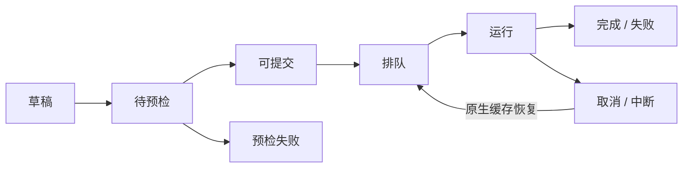

# 远端 GPU 实验工作台

Web v2（包版本 1.1.0）将创建、预检、提交、监控和选择性下载放到浏览器中。源码、插件、队列和完整测量记录默认在远端。浏览器通过 SSH 隧道连接远端 loopback 服务；本机不需要挂载远端文件系统或 E 盘。


[上传与创建页面](assets/web-v2-create.png) · [窄屏页面](assets/web-v2-mobile.png)。截图来自实际 CPU 验收，完整步骤和证据范围见 [Web v2 交付记录](WEB_V2_DELIVERY.md)。

CLI / SDK 仍可独立使用。`ktlab web --root …` 保留为零额外依赖的只读查看器；新工作台入口为 `ktlab serve`。Web v2 的交付分支是 `feature/web-v2-workbench`，既有稳定标签 v1.0.1 保留。

## 1. 启动和连接

在 Linux 服务器（或 WSL2）的私有环境安装 Web extra，不需要 GPU、Node 或 CDN：

```bash
python3 -m venv "$HOME/.venvs/ktlab-web"
"$HOME/.venvs/ktlab-web/bin/python" -m pip install '.[web]'
"$HOME/.venvs/ktlab-web/bin/ktlab" serve \
  --workspace "$HOME/ktlab-workbench" --port 8765
```

从仓库根目录执行安装；离线安装使用核验过的 wheel 与匹配 Python 的依赖缓存。首次在服务器终端启动会提示设置工作区密码；后续启动直接沿用，重启和归档恢复不会自动更改。浏览器输入密码登录，不需要读取 token 文件。

无人值守的首次配置可用 `ktlab serve --workspace "$KTL_WORKSPACE" --password-file "$KTL_PASSWORD_FILE"`，文件应私有保存。它只初始化密码；已有密码时必须一致，绝不静默覆盖。密码以加盐哈希保存在控制库中，不写入明文到源码或日志。

在本机另开终端：

```bash
ssh -N -o ExitOnForwardFailure=yes \
  -L 127.0.0.1:8765:127.0.0.1:8765 ktl-gpu
```

打开 <http://127.0.0.1:8765>。`ktl-gpu` 是用户自己的 SSH 别名。若本机端口占用，改转发左端为 `8877`，浏览器也用 `8877`；远端仍可用 `8765`。

服务只绑定 `127.0.0.1`。固定密码、HttpOnly / SameSite 会话、Host / Origin 检查和写请求 CSRF 共同保护提交接口；不能据此部署公网或多用户服务。

## 2. 创建第一个实验

1. 点击 **新建实验**，选择 CPU 模板或服务器环境中已注册的 Kernel / Operator。
2. 选择环境与设备，填写 Shape、dtype、参数、搜索器、seed、观测预算、墙钟预算与计时协议。
3. 表单适合单个实验；高级 JSON 使用原生 `AssetExperiment` schema。`research` JSON 可展开多任务矩阵。
4. 点击 **预检并继续**。页面显示展开的试验数、最大算法观测、独立验收额度、物理执行上限和串行墙钟额度。
5. 预检成功后点击 **提交实验**。HTTP 请求立即返回，独立 Worker 执行原有 `run / check / research`。

算法揭示次数包含失败和缓存命中；物理测量另计，独立验收另计。静态空间和 CPU 预检通过后，GPU 执行仍需资源准入、原生准备和数值验证。

预算是一次原生执行尝试的上限。显式取消后恢复可能再做一轮独立验收；累计记录与成本保留在各次尝试中。

草稿可以保存，历史配置可以复制后重新预检。重复提交相同计划使用幂等键，不产生第二次执行。修改源码、项目、环境或规格后必须建立新计划身份。

## 3. 上传项目与可信代码

支持单个 `.py`、实验 `.json`、多个文件或 ZIP。上传阶段只做文件检查、AST 和 JSON 解析，展示文件清单、SHA、发现的资产与依赖声明，**不会 import 插件或安装 requirements**。

项目中的插件路径相对于上传项目，例如：

```json
{
  "plugins": ["assets.py"],
  "operator": "gemm@1.0.0",
  "kernels": [{"asset": "python/gemm@1.0.0"}],
  "algorithms": ["local/search@0.1.0"],
  "shapes": [{"M": 3, "N": 5, "K": 7}],
  "dtype": "float32",
  "budget": {"max_evaluations": 3, "max_wall_time_s": 15},
  "validation": {"max_configs": 1, "trust_claims": false}
}
```

`ktlab scaffold algorithm --output my_search` 生成可上传的 SDK 起点。依赖缺失时，由服务器管理员在独立环境安装并登记；网页不执行任意 Shell，也不修改平台源码或共享环境。

含 Python 的项目必须填写代码来源并确认**这一文件版本**可信，之后才允许受限 Worker 预检和执行。ZIP 拒绝绝对路径、`..`、Windows 驱动器路径、符号链接、特殊文件、重复目标和超出大小/数量/压缩比上限的内容。项目按内容版本保存，不覆盖旧版本。

Worker 使用私有 HOME、临时目录和缓存，清理继承的 API keys / SSH 凭据并限制资源。Linux 上优先使用经过实际 canary 的 Bubblewrap 命名空间与只读挂载；可用时采用 Landlock 文件边界。上传代码没有文件隔离能力时拒绝执行。Bubblewrap 默认隔离网络；Landlock 回退主要提供文件边界，不能视为相同的网络/PID 隔离。管理员登记的 `read_paths` 和 `env` 属于执行信任边界。

这些措施用于单用户可信插件的受限执行，不构成对恶意 Python 的完整安全沙箱。不要对不可信用户开放上传/执行入口。独立多用户隔离不在本版本范围内。

## 4. 环境与 GPU 准入

默认 `core` 环境可运行 CPU。生产后端登记在工作区 `server.json`；示例见 [server.example.json](../examples/web/server.example.json)。服务环境与执行环境可以使用不同 Python minor 和 Torch：

- `python`：真实解释器绝对路径；`profile`：已有部署 profile。
- `plugins`：此环境允许导入的生产后端和搜索器。
- `env` / `read_paths`：固定原生组件、overlay、manifest 的显式路径。
- `gpu_lock`：与同机其它合作任务共用的锁，不能每项任务新建一个锁冒充互斥。
- `gpu_uuids`：允许执行的物理 UUID；`hardware_profile` 用于 CPU 域预检，运行身份由实际设备绑定。

修改配置后，在 **设备与环境** 中刷新环境目录，再重新预检受影响的草稿。当前已冻结计划不会悄悄采用新环境。

每个工作区只有一个串行 Worker。GPU 使用固定 UUID，沿用原有多样本显存/利用率/compute 与 graphics 进程检查和合作锁。其它用户的进程不归本任务所有。资源忙时任务保留为 **排队 / 资源忙**，需要明确点击重试，不无限轮询或抢占。

服务继承了 `CUDA_VISIBLE_DEVICES` 或作业调度器分配时，当前空卡准入器拒绝覆盖这一分配。应在符合管理员规则的专用登录/作业上下文部署；不能通过网页改写分配来绕过调度器。

## 5. 状态、恢复与实时事件



API 与 Worker 是不同进程。浏览器关闭或 API 重启不停止实验。Worker 元数据绑定 PID、start ticks、host 和冻结计划；Worker 重启可接续自己仍在运行的 launcher。取消只终止有身份记录的本任务进程树，保留尝试、日志与测量数据库。

恢复调用原 CLI / Runner 的缓存和恢复逻辑。已完成观测不会再做物理测量，但原生恢复可能重新向算法揭示缓存记录；页面保留缓存标签和各次尝试，不能把缓存当成新测量。

观测与墙钟曲线使用当前原生尝试的真实时钟；不拼接不同尝试来伪造一条连续轨迹。以前尝试的轨迹、阶段和成本可在文件中查看或下载。

事件通过 SSE 推送，持久单调序号支持 `Last-Event-ID` 和缺失事件补读。页面显示阶段、已揭示观测、真实/缓存/失败、最佳已验证延迟、日志和最近错误。搜索曲线使用真实 JSONL 轨迹；旧数据没有逐步墙钟时不补造时间。

曲线按硬件、实现、Shape、dtype、seed、空间和协议分组。可以缩放、切换图例、悬停、切换观测/墙钟轴并下载 SVG。配置表支持筛选、分页和展开详情；成本保留原生阶段字段，缺失字段不填零。L3 使用已保存配置集合、分派与 K–Loss。

## 6. 文件与选择性下载

工作区结构：

```text
workbench/
  server.json            # 私有环境登记
  control.sqlite         # 任务、状态、事件索引
  projects/<id>/<sha>/    # 上传项目及版本
  jobs/<id>/plans/        # 冻结平台、插件、原生规格
  jobs/<id>/attempts/     # 各次 launcher、准入与执行记录
  jobs/<id>/output/       # 原 Runner SQLite / JSONL / 报告
  exports/               # 用户明确选择的导出包
  worker/                # Worker 身份、租约、环境探测
```

`control.sqlite` 不是第二套测量库；原始测量仍在 Runner 的 `measurements.sqlite`。

在 **文件与下载** 勾选报告、配置、数据库、轨迹或编译产物；ZIP 附文件清单和每项 SHA。SQLite 使用一致备份后校验，运行中不直接下载正在变化的数据库。终态普通文件可单独下载，配置表另有 JSON / CSV 下载。完整原始记录默认留在远端。

历史目录由管理员通过 `history_roots` 登记，只读加载。E 盘继续作为离线资产库，按需下载或通过现有 SSH / rsync 归档，不是在线默认输出位置。

## 7. 迁移和停止

API 的 `Ctrl+C` 只停止 API；需要完整停机或归档时先等待任务结束，再停止 API 和该工作区 Worker：

```bash
ktlab worker --workspace "$KTL_WORKSPACE" --stop
ktlab workspace archive --workspace "$KTL_WORKSPACE" --output "$KTL_NEW_VAULT"
ktlab archive verify --vault "$KTL_NEW_VAULT"
ktlab archive restore --vault "$KTL_NEW_VAULT" --source workspace \
  --output "$KTL_RESTORED_WORKSPACE"
ktlab serve --workspace "$KTL_RESTORED_WORKSPACE"
```

`worker --stop` 等到租约释放才返回 `stopped`；25 秒仍未释放时返回非零 `stop_pending`，保留工作区并检查该任务。

归档要求无活动任务、API 与 Worker 租约均已释放。恢复沿用现有对象 SHA / SQLite 校验，工作区为仅属主权限；移动后只轮换会话签名，登录密码保持不变。旧结果可查看，旧绝对路径计划不能直接恢复执行；重新登记环境、复制规格并预检。venv 和编译缓存不能当作跨架构安装包。

需要登录后长期运行时，可使用 [API](../deploy/ktlab-api.service.example) 与 [Worker](../deploy/ktlab-worker.service.example) 的 `systemd --user` 模板；两者使用同一工作区，API 加 `--no-worker`，不需要 sudo。已有部署 bootstrap 和资产恢复入口见 [DEPLOYMENT](DEPLOYMENT.md)。

## 8. 排错

| 现象 | 查看位置 / 操作 |
|---|---|
| 无法连接 | 远端服务日志、SSH 隧道与两端端口 |
| 登录失败或过期 | 使用已设置的工作区密码重新登录；重启不会重置密码 |
| 项目没有资产 | 文件预览的解析结果；核对 SDK 注册入口和相对插件路径 |
| 预检失败 | 任务错误、预检日志、依赖与实际环境路径 |
| 排队且资源忙 | 设备进程与准入 receipt；资源获准空闲后手动重试 |
| Worker 退出 | Worker 日志、进程身份、attempt 的 result 与 launcher 日志 |
| 没有实时曲线 | 原生 observations.jsonl 是否产生；连接状态和事件序号 |
| 恢复后不能提交 | 新服务器重新登记环境，复制旧规格并预检 |
| 只有最终结果 | 使用静态记录视图；不生成虚假实时轨迹 |
