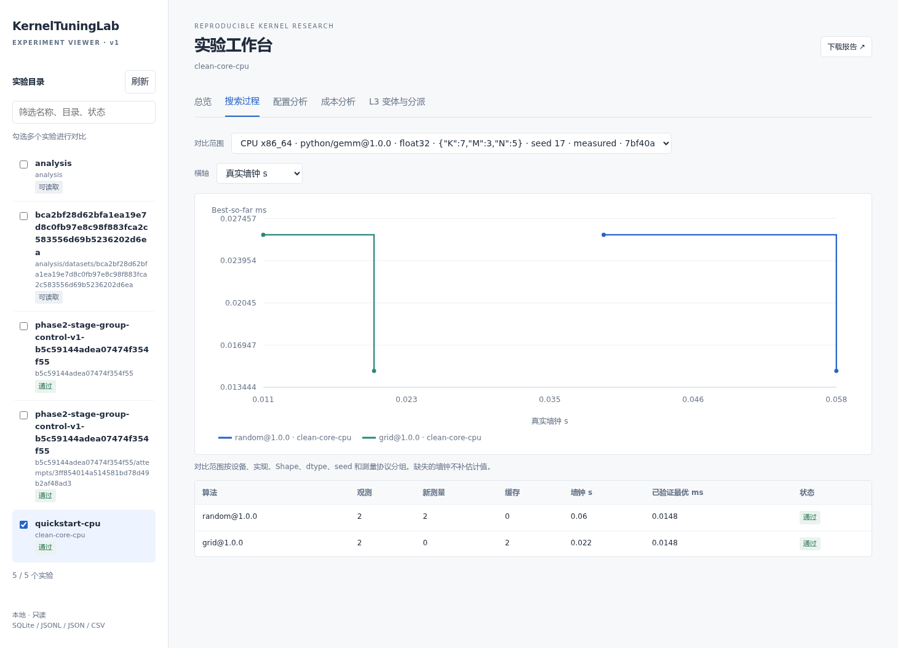

# 本地实验查看器

安装核心包后，一条命令启动，不需要前端构建或额外数据库：

```bash
ktlab web --root artifacts/first-run --port 8765
```

打开 <http://127.0.0.1:8765>。用 `Ctrl+C` 退出。多个 `--root` 可以选择不同实验目录，也可以指定包含实验的父目录。查看器识别现有 SQLite、JSONL、trials JSON/CSV、run summary、L3 与资源准入记录；忽略 venv、Git、缓存和归档对象目录。



## 五个视图

| 视图 | 用途 |
|---|---|
| 总览 | 设备、算子实现、Shape、dtype、预算、状态、已验证配置和验收 |
| 搜索过程 | Best-so-far，按候选观测次数或保存的真实墙钟绘图；比较同一范围的算法 |
| 配置分析 | 按参数、配置ID、设备、状态、来源与失败原因筛选；点击ID查看完整原始记录 |
| 成本分析 | 空间构造、提议、实际编译/测量、搜索墙钟、缓存及原有算法/模型/API诊断 |
| L3 | 已保存的K–Loss、配置集合、Shape分派、dispatcher与来源身份 |

左侧勾选多个实验对比；顶部可切换视图。搜索范围按设备身份、实现、Shape、dtype、seed、来源与计时协议区分，避免把不同条件接成同一条曲线。独立验收记录不参与搜索best-so-far。

`success`表示记录成功，正确性另有已验证/未知标签；数值错误、编译错误、非法配置分别保留。缓存命中在轨迹里标注，来源样本仍是原记录。记录详情中的 `metadata.correctness.execution.annotations`、环境与protocol用于查看实际launch/模板和绑定身份；没有保存的生效信息保持未知。

旧实验可能只有汇总CSV或SQLite，没有逐步墙钟或轨迹。对应图表显示缺数据，不从样本延迟累加估算。没有模型/API成本时显示缺失；空间构造可能包含在提议耗时里，不能把重叠阶段相加当作总成本。

L3输出目录可以单独打开：

```bash
ktlab l3 --database artifacts/first-run/measurements.sqlite --output artifacts/first-l3
ktlab web --root artifacts/first-run --root artifacts/first-l3
```

K为配置数，二进制数、字节数和实际部署证据使用原保存字段；没有证据时不由配置数推导。

## 本地、E盘与SSH

从服务器同步结果后，在本机直接打开：

```bash
ktlab web --root /mnt/e/GPT/KernelTuningLab/records/user
```

或在远端启动查看器，再在本地建立端口转发：

```bash
# 远端，在正确核心环境中
ktlab web --root "$KTL_RESULTS" --port 8765
# 本地另一个终端；ktl-gpu为自行配置的SSH别名
ssh -N -L 8765:127.0.0.1:8765 ktl-gpu
```

浏览器仍打开本地8765端口。若端口占用，远端`--port`与转发两端使用同一个新端口。

查看器绑定127.0.0.1，只读启动时选定目录，拒绝外部Origin、写请求和越界文件；不执行Python、Shell、模型调用或GPU任务。未提供公网监听选项。报告以Markdown附件下载。

## 验证与排错

- 浏览器交互已使用真实CPU实验、历史5060Ti记录和已有L3数据验证，包括筛选、空数据、原始记录、墙钟轴、多来源分组和手机宽度。
- 数据完整性与HTTP访问边界有回归。GPU历史数据仅只读加载，没有重新测量。
- 看不到实验：检查目录是否包含`measurements.sqlite`、`trials.json`、`trials.csv`、`l3.json`或`run_summary.json`，然后刷新。
- 只有数据没有曲线：查看是否存在`observation_trace`及实际墙钟；旧结果不自动补轨迹。
- 从归档恢复：先用`ktlab archive restore`生成普通目录。查看器不直接解压巨型归档。
